# DoodleNook Quick Start

DoodleNook is a cosy program for drawing, painting, pixel art and animation. This page gets you going in a few minutes.
Everything here is also in the menus, and holding the pointer over a button shows what it does and its shortcut.

## 1. Draw right away

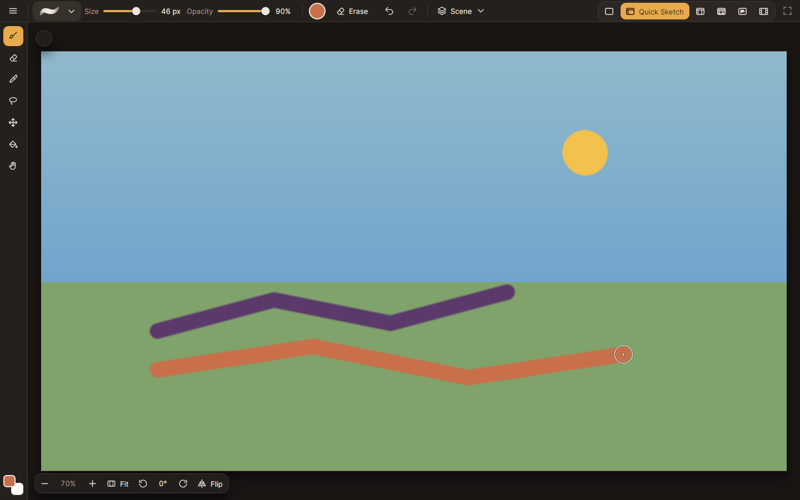

DoodleNook opens ready to draw.

- `B` is the brush and `E` the eraser. `[` and `]` make it smaller or larger.
- **Right-click** (or your pen's button) opens the quick palette at the pen, with colours, brushes and size.
- `Ctrl+Z` undoes and `Ctrl+Shift+Z` redoes.
- `Ctrl+S` saves a `.dnk` file with every layer and frame. **File › Export as PNG…** saves a flat picture, and
  **File › Export animation…** a GIF, a sprite sheet or numbered PNGs. `F1` lists every shortcut.

## 2. Choose a workspace

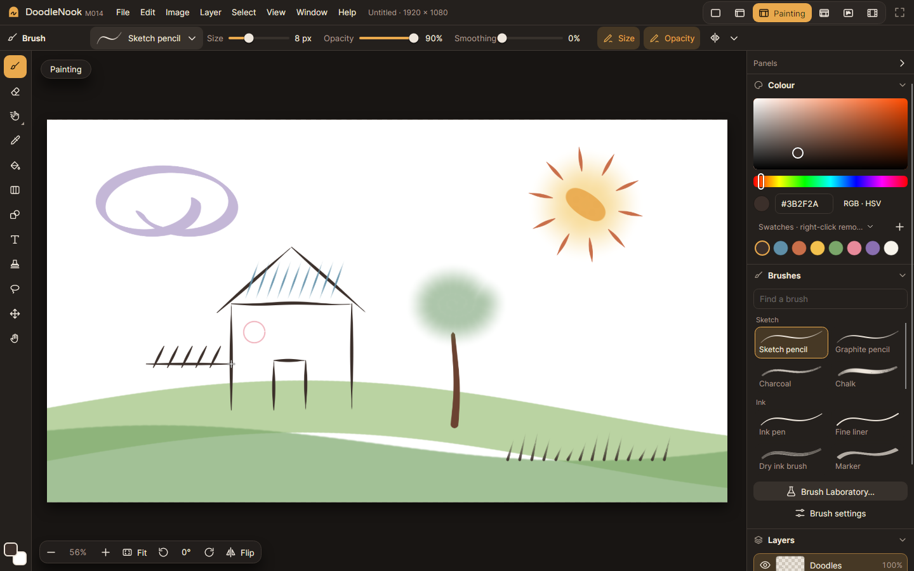

Each workspace shows only what that kind of work needs:

- `Alt+1` Pure Sketch
- `Alt+2` Quick Sketch
- `Alt+3` Painting
- `Alt+4` Editing
- `Alt+5` Pixel Art
- `Alt+6` Animation Studio

Your picture comes with you when you switch. **Window › Customize workspace…** chooses which extra tools and panels
stay visible.

## 3. Colours and palettes

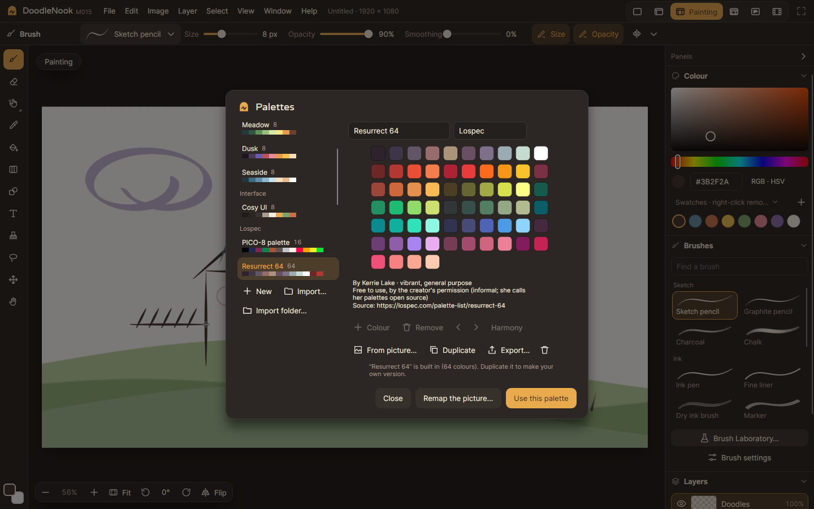

Click a swatch to paint with it. **Window › Palettes…** holds DoodleNook's own palettes plus ten classic palettes by
pixel artists, in the *Lospec* collection. Each shows its creator, terms and source. **Import…** reads one palette file;
**Import folder…** brings in a whole folder of them at once (`.gpl`, `.hex`, `.pal`, `.txt`, `.ase`, `.png`). Palettes you
already have are skipped, and the imported ones are your own copies: the folder can go afterwards.

## 4. Pixel art

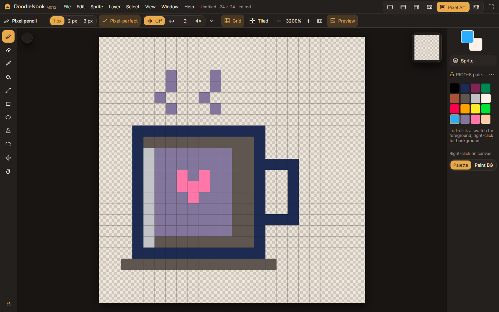

`Alt+5` gives you the pixel pencil, whole-number zoom and exact pixels. `Ctrl+'` shows the pixel grid.
To keep a picture to one palette, choose the palette in the palette panel, then pick **Lock the picture to …** in that
panel's menu. Whatever colour you choose, only that palette's colours are painted. **Sprite › Remap to palette…**
converts a finished picture.

## 5. Animate

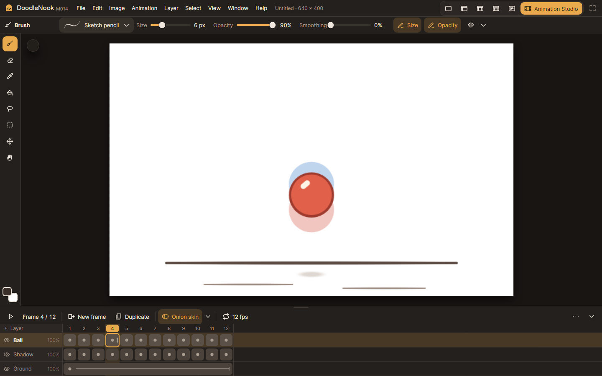

`Alt+6` opens Animation Studio.

- `N` adds a new frame and `O` turns onion skin on or off.
- `Enter` plays and pauses.
- Click a layer's percentage in the timeline to change its opacity on every frame.
- **View › Animation preview** keeps the whole animation looping in the corner while you draw on any frame. Its ⤢
  button opens it in its own window (a second screen works too); its background button chooses what shows behind
  transparent areas. That background is only for looking: it is never exported.

## 6. Draw over an animation or a sprite sheet

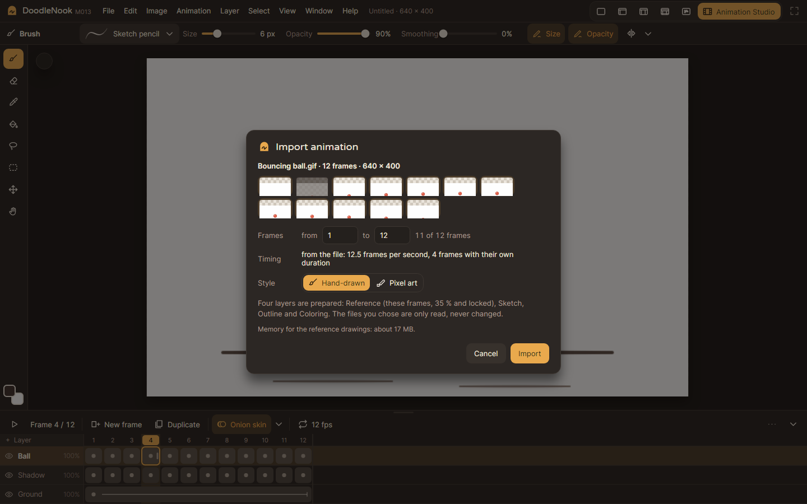

**File › Import animation…** reads a GIF, an animated PNG, or numbered PNG pictures (choose one and the rest of the
sequence comes along). Click a frame to leave it out, then press Import. You get four layers:

- **Reference:** the imported frames, at 35 % and locked.
- **Sketch**, **Outline** and **Coloring:** empty, ready to draw on.

The file's timing is kept.

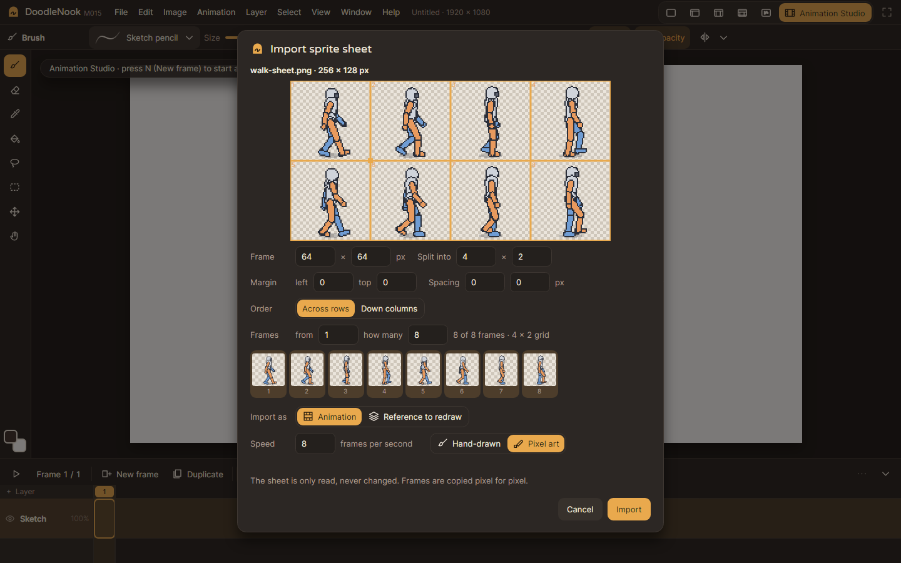

**File › Import sprite sheet…** shows the sheet with the grid it will cut: drag the grid, drag the first frame's corner,
or type the frame size. Import it as a plain animation, or as the four layers above. **File › Export animation…** turns an
animation into a sheet, and **File › Sprite sheet from pictures…** lays numbered pictures out on one.

## 7. Reference cycles

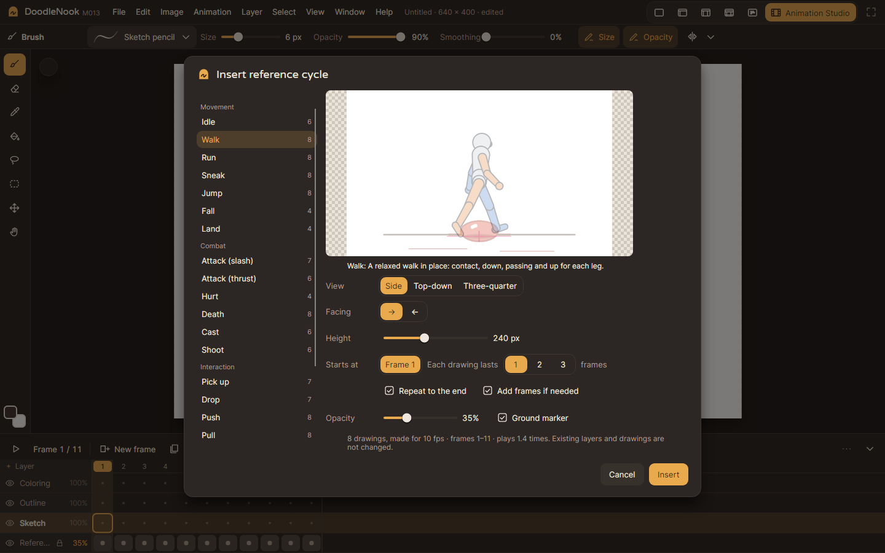

**Animation › Insert reference cycle…** adds a ready-made motion guide in side, top-down or three-quarter view:
idle, walk, run, jump, attacks, hurt, pick up and more. Drag in the preview to place its feet, then choose its height
and facing and press Insert. It lands faint and locked under the layer you draw on, and nothing already in the
animation changes. **Animation › Adjust reference cycle…** moves or changes it later.

## 8. Paste pictures and references

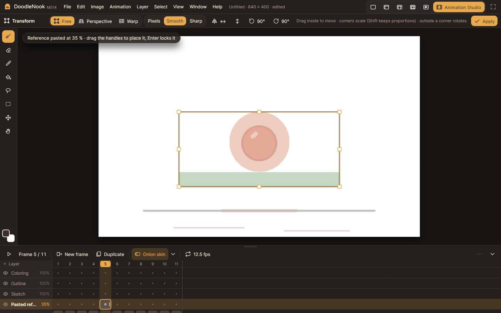

`Ctrl+V` pastes a picture copied in another program (a browser, Paint, a screenshot) onto a new layer, ready to
move: drag the handles, then press `Enter`. The other way works too: `Ctrl+C` copies the selection (or the layer) so you
can paste it into other programs, with its transparency where they support it. **Edit › Paste as reference** puts it at 35 % under the layer you draw on and
locks it once it is in place.

## 9. Storybook

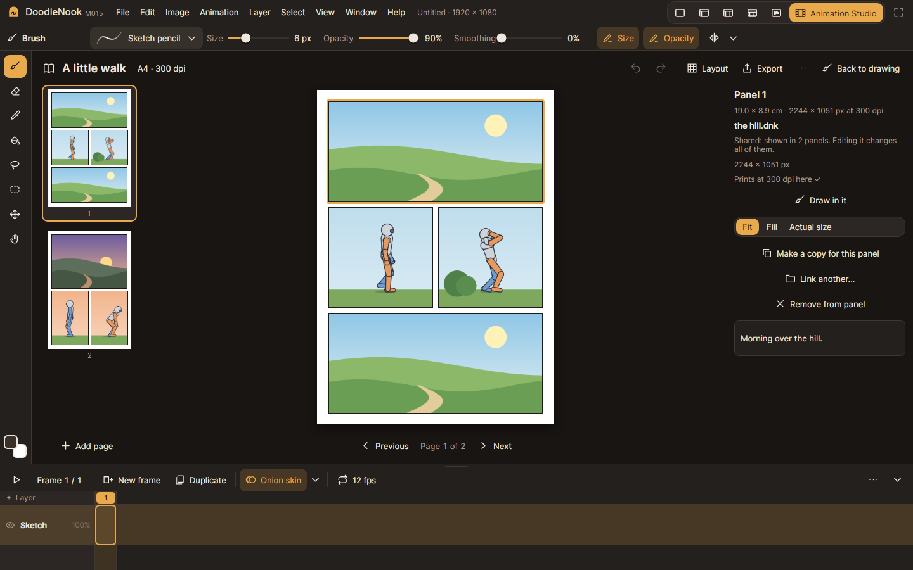

**File › New storybook…** makes comic or storyboard pages from your drawings. Choose a layout for each page, then
double-click a panel to draw in it: it opens in the normal editor at exactly the right size, and **Back to the
storybook** shows it on the page. Every panel has the same pixels per centimetre, whatever its size. **Export** saves
pages as PNG or one PDF. While a storybook is shown it has the window to itself; `Esc` (or **Back to drawing**) brings
the drawing and its tools back. **Help › A little walk (storybook)** opens a sample.

## 10. Learn by doing

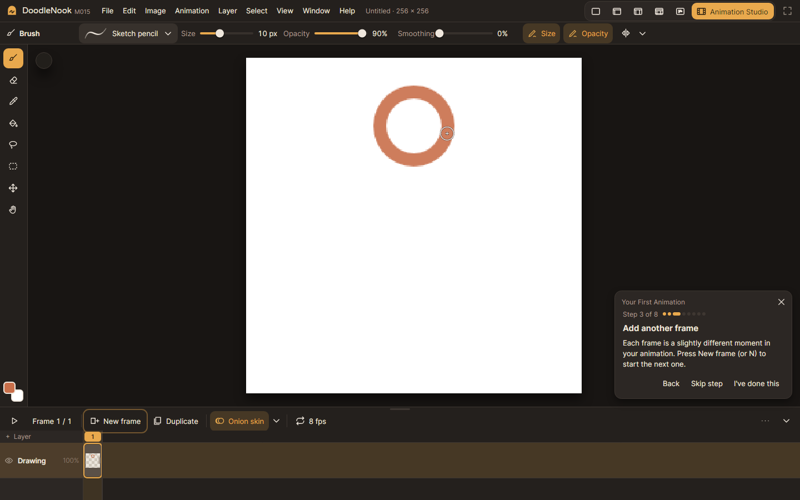

Open **Help › Guided Tutorials…** to follow interactive lessons inside DoodleNook. In **Your First Animation** a small
guide points at the real controls while you draw a bouncing ball, frame by frame. You do the drawing; stop whenever you
like, and your animation stays open.
