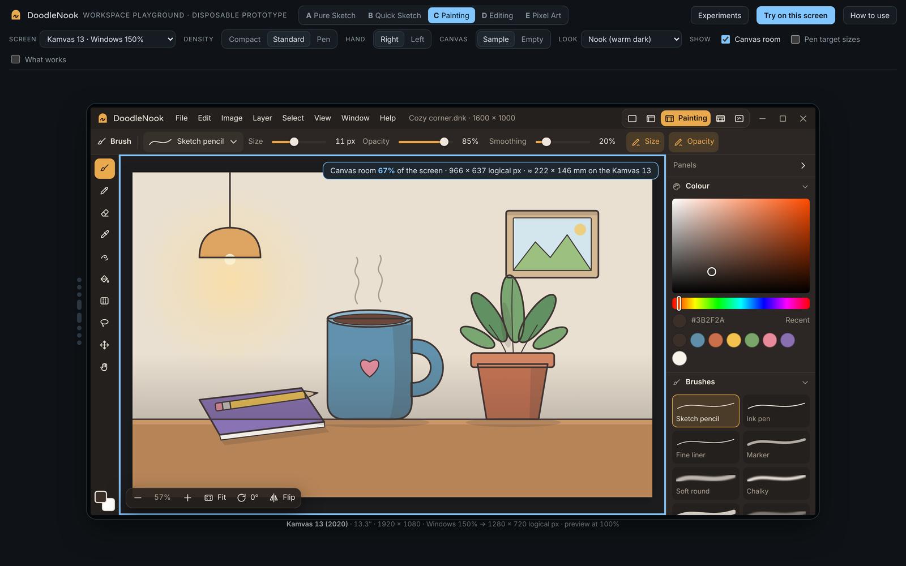

# Mission 003: Workspace playground

A **disposable, interactive design prototype** for exploring how DoodleNook could look and feel.
It is not the application: there is no painting engine, no real layers and no file handling.
Nothing here is a final design decision. The user decides after trying it.

## How to open it

- **Published version (private link):** https://claude.ai/artifact/UxJFPr7nPZ7es8xQVkcJEh. Share it from the page's Share menu if others need it.
- **Offline:** open [`index.html`](index.html) in Edge or Chrome. It is a single self-contained file. Without internet it falls back from the web fonts to Segoe UI.
- **On the Kamvas 13 itself:**
  1. Open the page in a browser on the Kamvas.
  2. Press **Try on this screen**. This hides the playground bar and lays DoodleNook out in that window at real size.
  3. Press F11 for full screen.

  Pen pressure works where the browser receives Windows Ink pressure.

`source/playground.html` is the published page. `source/build.py` wraps it into the standalone `index.html`.

## What the playground lets you do

- **Switch workspaces:** A Pure Sketch, B Quick Sketch, C Painting, D Editing, E Pixel Art. Use the playground bar, the in-app switcher, or Alt+1–5.
- **Pick the screen:**
  - Kamvas 13 at Windows 100/125/150%;
  - a 27″ 2560×1440 monitor;
  - **Kamvas + 27″ together**, with panels on the monitor and the canvas on the Kamvas, drawn at true relative physical size;
  - **this window at real size**.
- **Pick density, hand and look:**
  - Density: Compact, Standard, Pen.
  - Hand: right or left; left-handed mirrors the docks, palette and status.
  - Look: Nook (warm dark), Paper (warm light), Graphite (neutral dark).
- **Turn on overlays:**
  - **Canvas room:** the drawing area in logical pixels and millimetres.
  - **Pen target sizes:** every control coloured by its size in millimetres on that screen. Green is 7 mm or more, amber 5–7 mm, red under 5 mm.
  - **What works:** outlines the controls that respond.
- **Hide and reveal the interface** with Tab. In Pure Sketch, Tab returns to the previous workspace.
- **Open the quick palette (radial)** at the pen with right-click, the pen's side button, or Q.
  - Tap an item, or press and flick toward it.
  - Drag its centre to change brush size.
- **Draw** with a deliberately tiny demo ink (pressure, size, opacity, smoothing, eraser, undo/redo). It is there only so cursors and controls have something to act on.
- **Pixel Art:**
  - a working 24×24 pixel editor (pencil, eraser, eyedropper, fill);
  - grid, symmetry, tiled view and preview window;
  - an optional four-frame timeline, labelled "animation not decided".
- **Run experiments** (the Experiments drawer). Each records time per step and pen travel in millimetres, and asks for a 1–5 "how it felt" rating. **Copy my results** produces text to paste into a chat.

## The three experiments (no winner declared)

| Experiment | Compares | Screenshot |
|---|---|---|
| A · Reaching your tools | Small permanent toolbar vs a quick palette summoned at the pen | [quick palette](screenshots/experiment-A-quick-palette-at-pen.png) |
| B · Accessing layers | Permanent dock vs pop-over vs a slim strip of layer thumbnails | [dock](screenshots/experiment-B-layers-dock.png) · [pop-over](screenshots/experiment-B-layers-popover.png) · [slim strip](screenshots/experiment-B-layers-slim-strip.png) |
| C · Adjusting the brush | Alt+drag on canvas (size ↔, hardness ↕) vs palette centre dial vs toolbar slider vs [ ] keys | [Alt+drag](screenshots/experiment-C-alt-drag-size.png) |

Each method uses the same visual feedback: a circle of the real brush size at the pen, with the value shown up and to the side, away from the drawing hand.

## Canvas room measured in the prototype

Standard density, right-handed. Values are percentages of the whole screen.

| Workspace | Kamvas 13 @150% | Kamvas 13 @125% | Kamvas 13 @100% | 27″ 1440p @100% |
|---|---|---|---|---|
| A Pure Sketch | 100% | — | — | 100% |
| B Quick Sketch | 91% | — | — | 95% |
| C Painting | 67% (≈ 82% with panels collapsed) | 72% | 77% | 83% |
| D Editing | 63% | — | — | 81% |
| E Pixel Art | 71% | — | — | 85% |

Raw values are in [`screenshots/canvas-room.json`](screenshots/canvas-room.json).

Sheets: [Kamvas 13 vs 27″ desktop](screenshots/comparison-kamvas13-vs-27in-desktop.png) · [Kamvas scaling 100/125/150%](screenshots/comparison-kamvas13-scaling-100-125-150.png) · [Kamvas + desktop together](screenshots/dual-kamvas13-plus-27in-C-painting.png) · [pen target sizes](screenshots/pen-targets-C-painting-150.png)

## Visual direction (exploratory)

- **Goal:** canvas first, with quiet chrome that recedes around the artwork.
- **Default look:** a warm, low-contrast dark interface (charcoal with a slight brown bias). It uses one marigold accent for the active tool and selection, and sits around a paper-coloured canvas.
- **Wordmark:** a rounded face for the wordmark only. Everything else uses the Windows system font, so it feels native on Windows.
- **Alternatives:** two other looks (warm light, neutral dark) are one click away, because this is not a final colour scheme.
- **Originality:** all icons, the sample illustration and the pixel sprite are original. No graphics or branding come from other applications.

## Major UX alternatives explored

1. **Toolbar vs quick palette.**
   - The palette opens where the pen is.
   - The most-used items sit up and to the left, outside the area a right hand covers (mirrored for left-handed use).
   - It holds 8 items plus 8 recent colours and a size dial, and supports flick selection, as in marking-menu research.
   - Cost: the palette must be learned and needs a pen button or key to open it.
2. **Layers as dock, pop-over or slim strip.**
   - The dock shows the most but costs about 20% of the Kamvas width.
   - The pop-over costs nothing until opened.
   - The strip (new, not in the Mission 002 wireframes) keeps thumbnails visible at about 50 px wide.
3. **Brush size on the canvas vs in a bar.**
   - Alt+drag is Photoshop-like, and keyboard-free if an express key sends Alt.
   - The palette dial needs no keyboard at all.
   - The slider is discoverable but far from the pen.
4. **Hiding the interface.**
   - Tab hides everything in B–E and leaves one explicit "Show interface" button.
   - There is no hover-to-reveal, which research flags as error-prone with a hovering pen.
5. **Pure Sketch escape routes.** A small corner button with a menu, Tab, and a "Back" item on the quick palette.
6. **Status feedback position.** A brief status pill appears top-left, away from the right hand. For left-handed users it moves top-right.
7. **Density as a separate control from Windows scaling.** "Pen" density gives large targets even at 100% scaling. "Compact" suits a mouse on a large monitor.
8. **Dual screen.** Panels and references on the 27″ monitor (mouse only), canvas and essentials on the Kamvas (pen).
9. **Contextual next-step bar under selections** in Editing. It can be switched off from the options bar.
10. **Pixel Art in a Photoshop frame.**
    - Tools stay on the left. The palette is on the right.
    - Zoom moves in whole steps, so pixels stay square.
    - Right-click can open the quick palette (consistent with the other workspaces) or paint the background colour (Aseprite). Both are offered.

**Where the prototype departs from the Mission 002 wireframes:**
- **Quick Sketch:** the smoothing slider moved into the brush pop-over, and the workspace switcher shows icons only, so the bar fits 1280 logical px.
- **Painting:** the options bar drops "Flow" below about 1500 logical px.
- **Layers:** a third layer-access option (slim strip) was added.
- **Quick palette:** gained recent colours and a size dial.

## Questions for the user

1. On the Kamvas, which felt more natural: the permanent toolbar or the quick palette at the pen? Would you set a pen side button to right-click to open it?
2. Layers: dock, pop-over or slim strip? Does your answer change between sketching and painting?
3. Brush size: which method felt best? Is Alt+drag acceptable if one express key sends Alt?
4. Which Windows scaling does your Kamvas use, and which density (Compact, Standard, Pen) felt right?
5. Do you use a second monitor? Would panels living there appeal?
6. Look: warm dark, warm light, or neutral dark? What would you change?
7. Are five workspaces too many? Which would you actually use? Should Quick Sketch and Painting merge?
8. Should switching workspaces change only the layout, or also tools and shortcuts?
9. In Pixel Art, should right-click paint the background colour (Aseprite) or open the quick palette?
10. Was the next-step bar under selections helpful or in the way?

## How it was tested

Headless Chromium (Playwright) checked:
- all five workspaces on every screen option;
- both hands and all densities;
- the radial palette, including flick selection;
- the layers pop-over and visibility toggles;
- the colour picker drag;
- Alt+drag sizing;
- the marquee next-step bar;
- pixel drawing and the timeline;
- the experiments drawer and trial flow;
- real-size mode;
- a 400 px phone width with no horizontal scrolling.

No console errors were reported. Pen pressure, pen side buttons and express keys could not be tested here, because that needs the real Kamvas.

## Limitations

- **Demo ink, not a brush engine.** It does not represent DoodleNook's eventual drawing quality or latency.
- **Measurements are approximate.** Millimetres are computed from the Kamvas 13's 293.76 × 165.24 mm active area and the 27″ panel's nominal size. Pen-travel figures are only realistic when the prototype runs at real size on the Kamvas.
- **Browser stand-ins.** Browser pointer events stand in for Windows Ink. A native application would behave differently.
