# Mission 004 — The Missing Ink

The first native Windows DoodleNook: a real drawing application in the approved Quick Sketch design.
You can pick up the Kamvas pen and draw, erase, undo, and save PNGs.

**Status:** implementation complete. **Awaiting your hardware acceptance test** on the Huion Kamvas 13
([playtest guide](PLAYTEST.md)). Automated tests and CI show that it works; they cannot show that it *feels* right.

## Download and run

1. Open the [Windows build runs for this branch](https://github.com/crosenlund79/DoodleNook/actions/workflows/windows-build.yml?query=branch%3Aiteration%2F004-the-missing-ink) and pick the newest green run. You need to be signed in to GitHub to download artifacts.
2. Under **Artifacts**, download **DoodleNook-win-x64**. GitHub delivers it as `DoodleNook-win-x64.zip`.
3. Extract it and double-click **`DoodleNook.exe`**. Nothing to install: the .NET runtime and all libraries are included.
4. If Windows says "Windows protected your PC", click *More info → Run anyway*. The test build is not code-signed.

The folder contains `DoodleNook.exe`, three native libraries (Skia, HarfBuzz, ANGLE), `README-FIRST.txt` and `THIRD-PARTY-NOTICES.txt`.

## What was built

**Drawing**
- One carefully built round brush:
  - size (1–500 px on the slider, up to 1000 px with right-drag);
  - opacity, hardness, and optional gentle smoothing (off by default);
  - pressure → size and pressure → opacity, each switchable;
  - a *Soft / Normal / Firm* pressure feel.
- Six presets, all settings of that same brush: Sketch pencil, Ink pen, Fine liner, Marker, Soft round, Flat wash.
- Stroke behaviour:
  - Strokes start on the first touch and follow every coalesced pen sample.
  - Pressure is interpolated between samples. Strokes taper naturally when the pen lifts and end with a clean round cap.
  - A semi-transparent stroke **never darkens where it crosses itself**. Separate strokes do build up.
- A real eraser that makes pixels transparent, revealing the white background. It uses the same stroke pipeline, has its own size, and erases with pressure-controlled size. The pen's eraser end works too (the PW517 has none).
- Colour:
  - a colour pop-over with a saturation/value square, hue strip, hex field and recent colours;
  - foreground and background squares: **X** swaps, **D** resets;
  - **I** or hold **Alt** for the eyedropper.

**Canvas**
- A 1920 × 1080 white picture by default. *New picture* offers presets, a custom size, and a white or transparent background.
- Zoom:
  - the mouse wheel zooms at the cursor;
  - **+ / −**, **Fit** (Ctrl+0) and **100 %** (Ctrl+1);
  - Fit is automatic until you zoom or pan yourself.
- Pan with Space + drag, the hand tool (**H**), the middle button, or one finger on a touch screen.
- Flip view (mirror for checking proportions; the picture itself is unchanged).
- Correct at any Windows scaling and when moving between monitors with different scaling (per-monitor DPI aware). "100 %" means one picture pixel per physical screen pixel.

**Everyday**
- Undo/redo: one stroke per step, Ctrl+Z / Ctrl+Shift+Z / Ctrl+Y and toolbar buttons. Redo is cleared by new drawing, and empty strokes create no step.
- Files:
  - New, Open, Save, Save as. Open reads PNG (and other common image formats); Save writes PNG with transparency.
  - Saving goes through a temporary file, so a failed save never damages the existing picture.
  - Unsaved changes are marked with "•" in the title and are asked about before New, Open or closing.
- **Tab** hides the interface (canvas only). **F11** is full screen.
- Brush settings, colours and window position are remembered between sessions.

**Pen diagnostics (F12)**: a small panel, hidden by default, showing:
- input type (Pen / Mouse / Touch) and contact;
- raw and mapped pressure;
- the resulting brush size;
- tilt and buttons (barrel, right, middle, eraser end);
- events per second and samples per event;
- engine time per event;
- GPU or software rendering, and Windows scaling;
- whether Windows' pen gestures were switched off;
- a pressure graph of the last stroke.

Nothing is logged or sent anywhere.

**Windows pen behaviour**: for its own window, DoodleNook switches off Windows' press-and-hold right-click ring, tap ripples, barrel feedback and flicks. A slow touch-down then starts a stroke instead of a right-click circle.

## How it looks

The approved Mission 003 prototype (top) and the native app (bottom), both as Quick Sketch on a Kamvas 13 at 150 %:

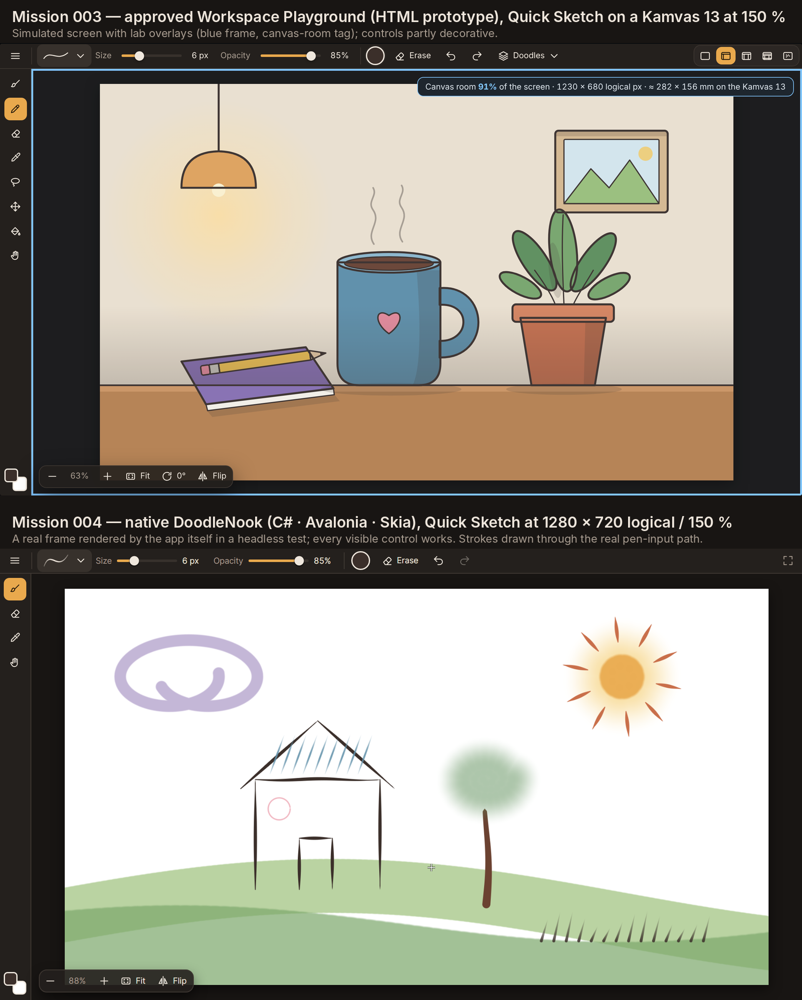

| | |
|---|---|
| 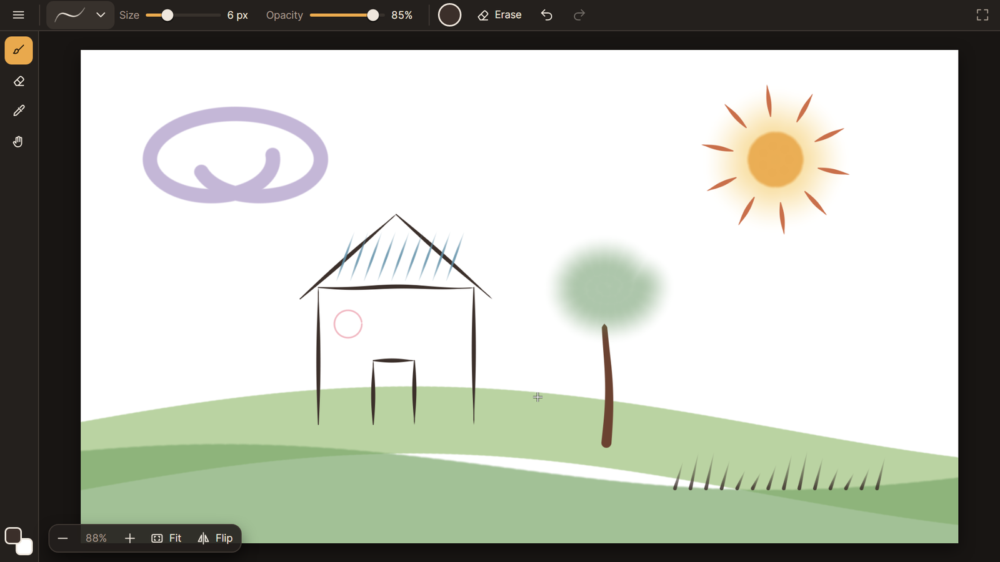 Quick Sketch at 1280 × 720 / 150 % (Kamvas 13, full screen) | 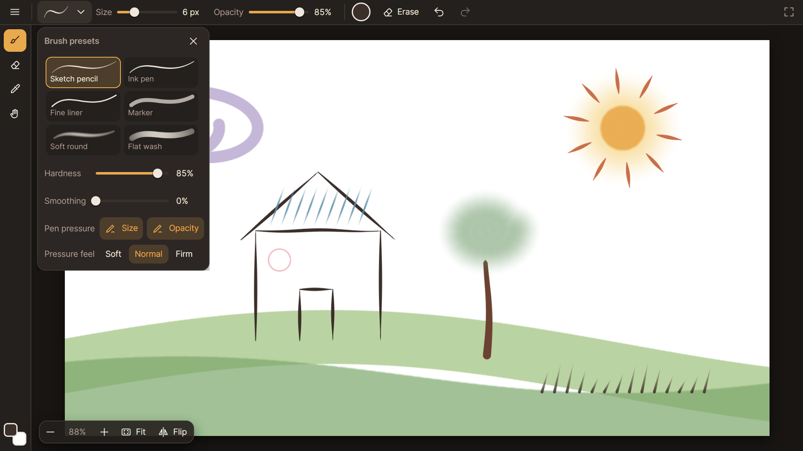 Brush presets and settings (previews are drawn by the real brush engine) |
| 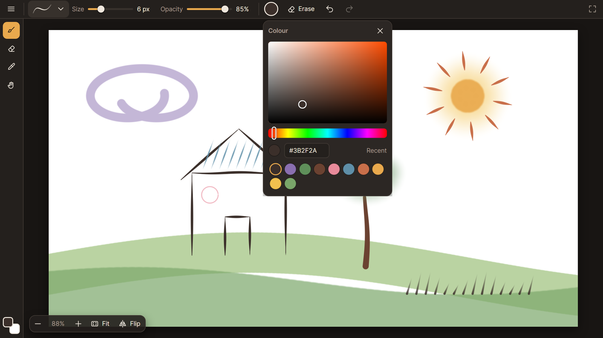 Colour pop-over | 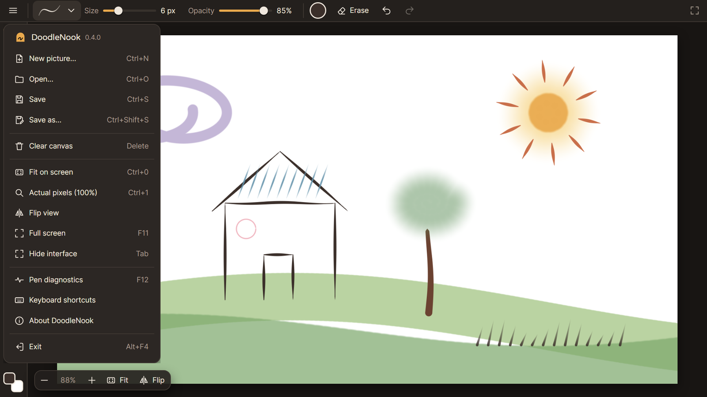 The app menu |
| 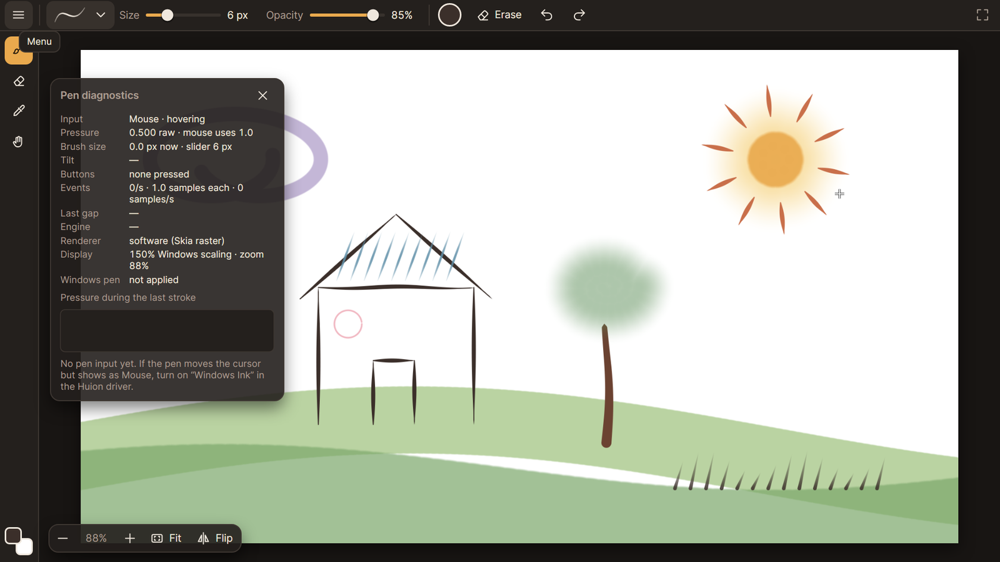 Pen diagnostics (F12). A test without a pen, so it reports "Mouse". | 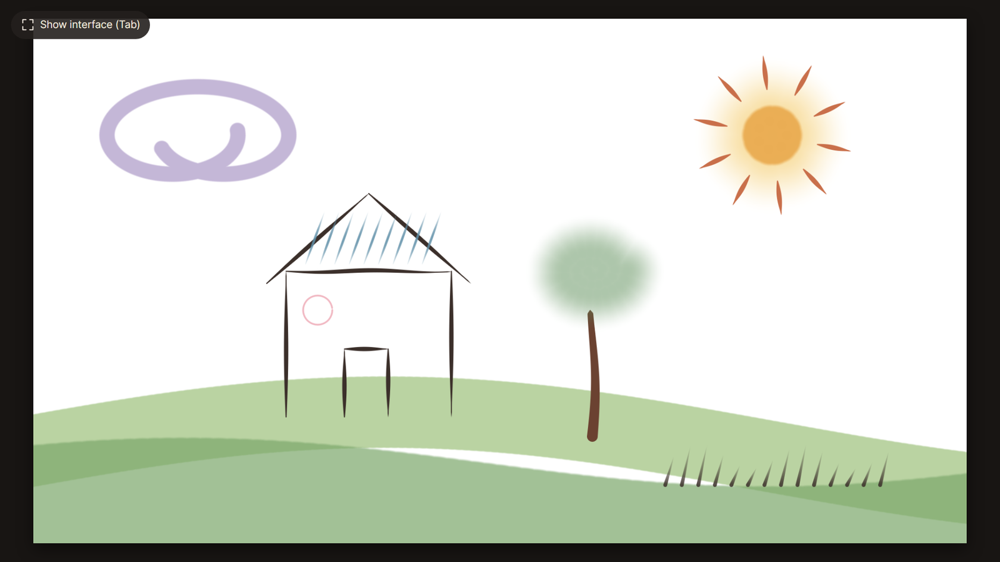 Tab: canvas only |
| 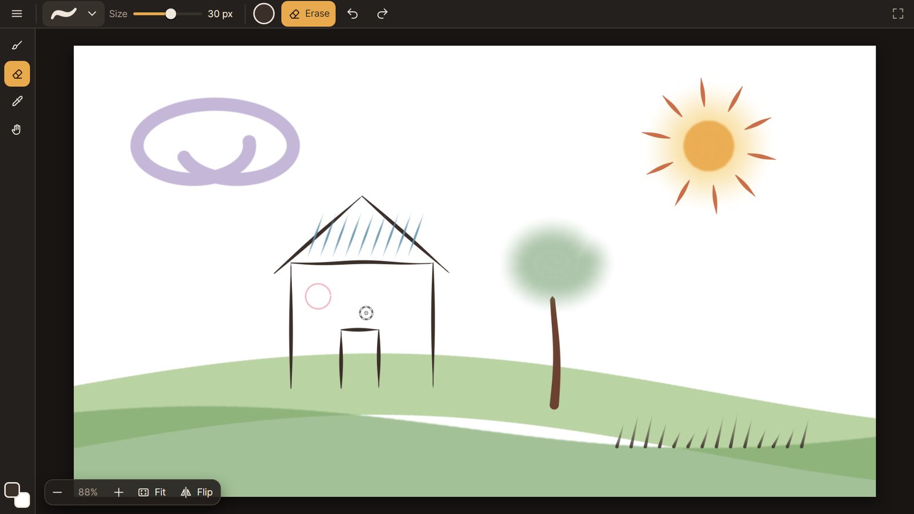 Eraser active | 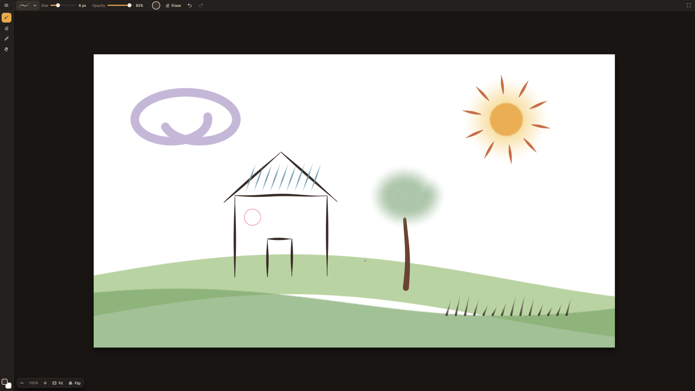 27″ 2560 × 1440 monitor at 100 % |
| 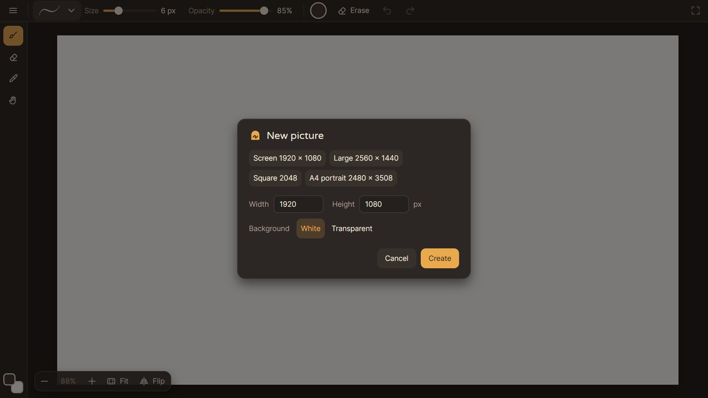 New picture dialog | 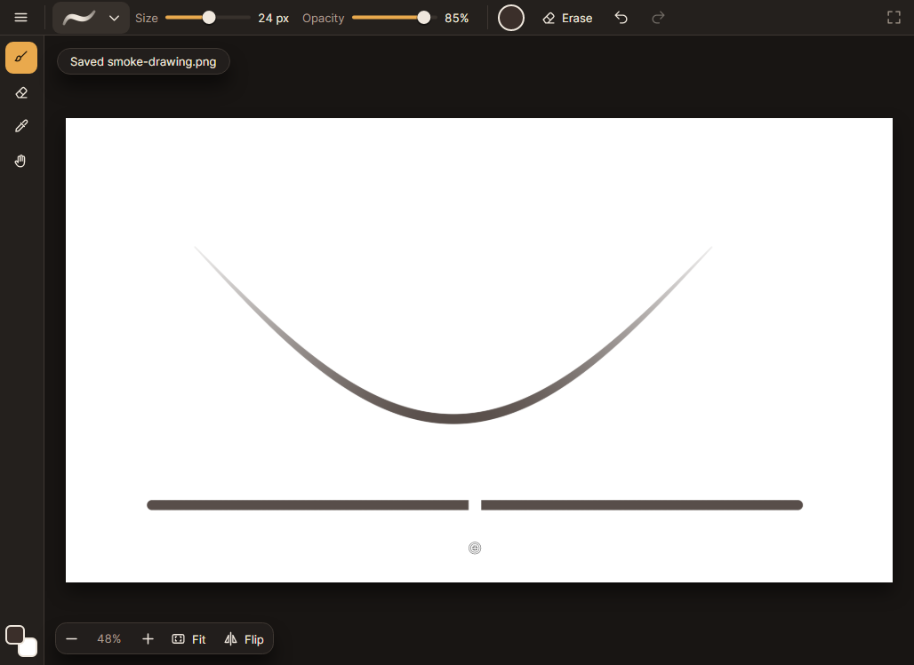 **Rendered on Windows**: the packaged `DoodleNook.exe` on the CI runner, after its smoke test |

**How the screenshots were made**
- All except the last are real frames of the native app, rendered by the app's own code (Avalonia + Skia) in headless tests.
- The scene was drawn through the same input path a pen uses, with pressure.
- They are not the HTML prototype. Text is rasterised by the test machine, so it may look slightly different on Windows.

## Technology (provisional until the Kamvas test)

| Part | Choice |
|---|---|
| Language / runtime | C# on **.NET 10 LTS** (supported to November 2028) |
| UI framework | **Avalonia 12.1.6** (MIT) with its Win32 backend; Fluent theme as a base, fully restyled with the Mission 003 tokens |
| Rendering | Skia via **SkiaSharp 3.119.4** (MIT; the version Avalonia 12 ships with). GPU through ANGLE/Direct3D 11, with a software fallback |
| Pen input | **Windows Ink (`WM_POINTER`)** through Avalonia, plus window-level pen-gesture suppression via `SetWindowFeedbackSetting` and `MicrosoftTabletPenServiceProperty` |
| Drawing engine | DoodleNook's own, in a separate library with no UI or graphics dependencies |
| Files | PNG via SkiaSharp's codecs |
| Packaging | Self-contained, single-file `win-x64` publish (ReadyToRun), no trimming, no AOT |

### Why Avalonia and not WPF

Mission 001 named WPF and Avalonia as the two candidates and suggested measuring both on the Huion. Without the hardware, the deciding facts were:

- **You said extreme pressure resolution doesn't matter.** Avalonia's main input disadvantage, Windows Ink's 1024 pressure steps instead of the raw 8192, is therefore not a concern.
- **Rendering.** Avalonia draws with Skia on the GPU (Direct3D 11 via ANGLE) and gives direct access to Skia's GPU context. That allows uploading only the changed part of the picture each frame. WPF's path is CPU Skia → `WriteableBitmap` → DirectX 9-era composition, which Mission 001 identified as its weak point.
- **The approved look.** Avalonia's CSS-like styles map closely onto the prototype's CSS.
- **Verifiability.** Avalonia runs headlessly, so the *real* window could be tested in this environment: drawing, keyboard shortcuts, pop-overs, rendered pixels and screenshots. A WPF app can only be compiled here, not run.

**The targeted experiment**: instead of building two apps, I decompiled Avalonia 12.1.6's shipped Windows backend to confirm the pen path Mission 001 could only infer. It confirmed the following:

| Question | Answer in Avalonia 12.1.6 (`Avalonia.Win32`) |
|---|---|
| Does it use Windows Ink pointer messages for pens? | Yes, `WM_POINTERDOWN/UPDATE/UP` on Windows 8+ |
| Pressure | `GetPointerPenInfo` → `pressure / 1024` |
| Coalesced samples (fast strokes) | Yes, `GetPointerPenInfoHistory` (up to 512 per event), exposed through `GetIntermediatePoints`, oldest first |
| Sub-pixel positions | Yes, HIMETRIC locations converted to client coordinates |
| Tilt, rotation | `tiltX/tiltY`, `rotation` |
| Barrel button, eraser, inverted | Yes, from `PEN_FLAGS_BARREL/ERASER/INVERTED` |
| Mouse messages Windows synthesises from pen/touch | Ignored (the `0xFF515700` signature check) |

### Known technical limitations and risks
- **Input arrives on the UI thread.** WPF's default stack has a separate pen thread. Here, if the UI thread stalls, ink waits, although no samples are lost because the coalesced history catches up. DoodleNook keeps UI-thread work small:
  - only the area under the brush is recomposited;
  - only the changed rows are handed to the GPU.
- **No WinTab.** If Windows Ink is switched off in the Huion driver, DoodleNook sees a mouse without pressure. Diagnostics will say "Mouse". A WinTab path could be added later if Windows Ink disappoints.
- **Pressure is 1024 steps** (Windows Ink normalisation).
- **Real GPU performance is unmeasured.** The GPU path was exercised on the CI runner, which has no GPU (Direct3D runs in software there), not on a real graphics card.
- **Avalonia's single vendor.** The core is MIT, but its roadmap is set by one company.

### Questions only the Kamvas can answer
1. Does diagnostics show **Pen (Windows Ink)** with pressure changing smoothly from light to firm?
2. Does the ink keep up with fast strokes, or is there visible lag? Is there jitter on slow strokes, which would argue for a little default smoothing?
3. Do strokes start on the very first touch, with no press-and-hold ring and no missing start?
4. What do the PW517 side buttons arrive as (diagnostics *Buttons*: barrel, right, middle)? Which do you want them to do?
5. Which pressure feel suits your hand: Soft, Normal or Firm?
6. At your Windows scaling, are the bar and buttons comfortable to hit with the pen?
7. Is the brush outline cursor helpful, or would you prefer the plain Windows pen dot?

## How the drawing works

```
 Huion pen ──Windows Ink──▶ Avalonia pointer events (all coalesced samples, pressure, tilt, buttons)
                                   │
                         CanvasView (UI)  ── translates to view coordinates ──▶ CanvasInputController
                                   │                                              (paint / erase / pan / pick / resize)
                                   ▼                                                        │
                         ViewTransform: view ↔ document pixels (zoom, pan, flip)            │
                                                                                            ▼
                         EditorSession (tool, brush, colours) ──▶ StrokeEngine ──▶ Document (layer + undo)
                                                                         │
                       changed area ──▶ DocumentTexture: copy rows ──▶ render thread uploads only that area
                                                                         to a GPU texture ──▶ screen
```

1. **Dabs**: round brush stamps placed along straight segments between samples. Their spacing is relative to the current diameter, at most 10 % of it, and close enough that the scallops between dabs stay under about 0.1 px. Pressure is interpolated along each segment.
2. **Per-stroke coverage mask**: each dab raises a mask to its own coverage. It takes the maximum rather than adding. That is why a stroke doesn't darken where it overlaps itself while separate strokes still build up. (GIMP's "constant" paint mode is the same idea, written independently here.)
3. **Compositing**: only the changed rectangle is recomposited, as the original pixels plus colour × coverage × opacity. The eraser reduces the original pixels instead.
4. **Undo**: the 64 × 64 tiles a stroke touched are saved once, so one stroke is one step. Undo and redo swap the tiles back. History keeps 200 steps or 768 MB, whichever comes first.
5. **Pixels**: 8-bit premultiplied BGRA, Skia's and Windows' native format. Pixels are crisp at 100 % and from 200 % up, and smoothly filtered (mipmapped) when zoomed out.

No code from GIMP, Krita or any GPL project was used. The ideas come from the Mission 001 research and common practice.

## Architecture

```
src/DoodleNook.Engine     Pixels, brush, strokes, document, undo, view transform. References only .NET itself.
src/DoodleNook.App        Avalonia app (DoodleNook.exe): window, theme, controls, canvas view, input
                          controller, editor session, PNG files, settings, diagnostics, smoke test.
tests/DoodleNook.Engine.Tests   Engine behaviour (strokes, pressure, rendering, coordinates, undo, architecture).
tests/DoodleNook.App.Tests      Input controller, files and settings, and the real window driven headlessly.
.github/workflows/windows-build.yml   Windows CI: build, test, publish, verify, smoke test, artifact.
```

Rules enforced by tests:
- The engine references nothing but .NET.
- The input controller doesn't hold the document, the pixels or the stroke engine.
- The editor session has no UI-framework types.

Future workspaces (Pure Sketch, Painting, Editing, Pixel Art) can share the same `Document`, `StrokeEngine` and `EditorSession`.

## Verification

| What | How | Result |
|---|---|---|
| Engine | 74 deterministic tests: single dab, sparse/rapid/slow strokes, direction changes, clean ends, no gaps, pressure min/max/ramps/disabled/invalid, opacity and self-crossing, eraser transparency, pixel placement, premultiplication, zoom/flip-independent coordinates, undo/redo/invalidation, dirty state, memory limits, architecture | Pass (Linux and Windows CI) |
| App | 36 tests:<br>• input controller with synthetic pen/mouse/touch (pressure use, coalesced samples, stray pointers, eraser end, pan, resize, Alt-pick, interruption, lift-off taper)<br>• PNG transparency round trip and atomic save; settings<br>• the **real window driven headlessly**: drawing, Ctrl+Z / Ctrl+Shift+Z / Ctrl+Y, B/E/I/H, [ ], slider, Tab, wheel zoom, Space-pan, unsaved-changes prompt, Alt eyedropper, focus after pop-overs, colours on screen | Pass (Linux and Windows CI) |
| Packaged app on Windows | CI extracts the ZIP and runs `DoodleNook.exe --smoke-test`. The real window opens on Windows Server 2025 and draws a pressure stroke in coalesced batches, a mouse stroke, erases, undoes/redoes, saves a PNG, reopens it, and captures its own window. | Pass. Windows accepted all pen-gesture settings. Canvas frames came from the GPU-texture path. A 400-sample pen stroke took about 4–5 ms to process (input + engine, not drawing to screen) on the runner. |
| Real app on Linux | The same smoke test under a virtual X display | Pass |
| Engine cost per pen event | A fast 2000 px curve fed as 200 events of 2 coalesced samples (as a 200 Hz pen delivers them), Release build, 2.3 GHz Xeon container CPU. Excludes drawing to the screen. | Average (worst) per event: 6 px brush 0.04 ms (0.11); 24 px 0.09 ms (0.21); 120 px 0.18 ms (0.36); 300 px soft 0.37 ms (1.3); 500 px 1.8 ms (4.1). A 200 Hz pen sends an event every 5 ms. |
| **Pen feel on the Kamvas 13** | Only you can test this | **Not yet tested** |

Issues the GUI tests found and that were fixed:
- the canvas stopped taking presses when zoomed in until the picture filled the view;
- brush previews showed a quarter of their bitmap;
- the colour pop-over captured the keyboard;
- Alt (eyedropper) was cancelled by pen movement, because Windows pen events carry no Alt flag.

## Departures from the Mission 003 prototype

- **Only what works is shown.**
  - The workspace switcher and the layers chip are left out, since there is one workspace and one layer. A *Hide interface* button sits where the switcher was.
  - The tool strip has Brush, Eraser, Eyedropper and Hand.
  - The view chip has zoom, Fit and Flip, but no rotation yet.
- **The brush chip also works for the eraser** and then shows eraser settings. The prototype hid it, but the eraser's hardness and pressure need a home.
- **Six presets instead of eight.** *Chalky* and *Airbrush* need a textured or build-up brush, so they wait for a later brush.
- **Windows' own title bar is kept** for now, with standard move, snap and close behaviour. F11 gives the prototype's chrome-free look.

## Known limitations (expect these in the playtest)

- One layer; no layer panel. Only the Quick Sketch workspace.
- Brush:
  - one round brush with no texture;
  - tilt is shown in diagnostics but doesn't affect the brush;
  - no view rotation;
  - no radial quick palette.
- Files:
  - PNG only for saving;
  - saving a white-background picture flattens it, so reopening it and erasing shows transparency, not white;
  - opened PNGs keep their own transparency.
- Undo history is per session and limited to 200 steps / 768 MB.
- The brush cursor is drawn by DoodleNook and may trail the system pointer by a frame.
- `[` and `]` follow the keys right of P. On some non-US layouts, use the slider, right-drag or an express key instead.
- No pinch-zoom (the Kamvas 13 has no touch).
- The test build is unsigned, so Windows SmartScreen asks once.

## Building from source

Requires the .NET 10 SDK.

```bash
dotnet test DoodleNook.slnx
```

```bash
dotnet run --project src/DoodleNook.App
```

```bash
dotnet publish src/DoodleNook.App -c Release -r win-x64 --self-contained true -p:PublishSingleFile=true -p:PublishReadyToRun=true -o publish/DoodleNook
```

Avalonia's optional build-time statistics are switched off by `Directory.Build.targets`. Third-party licences are in [`THIRD-PARTY-NOTICES.txt`](../../../THIRD-PARTY-NOTICES.txt).
