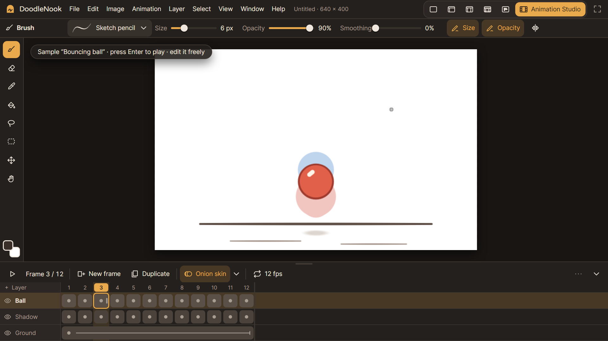
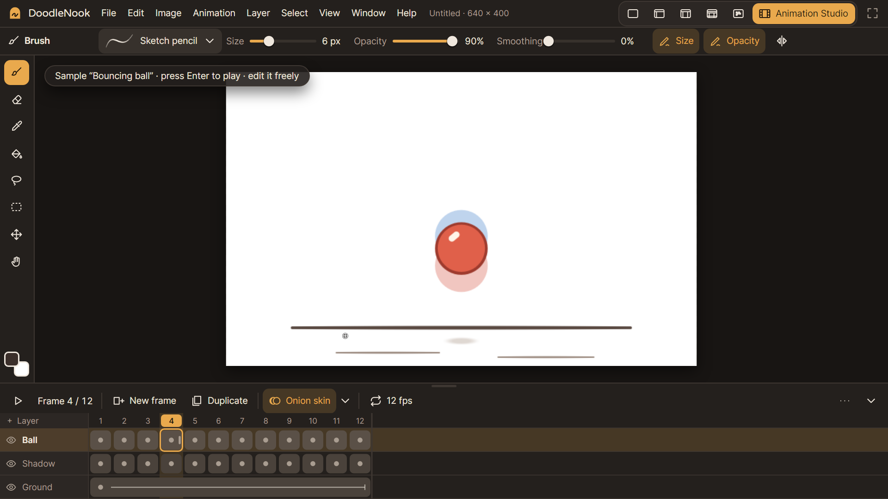
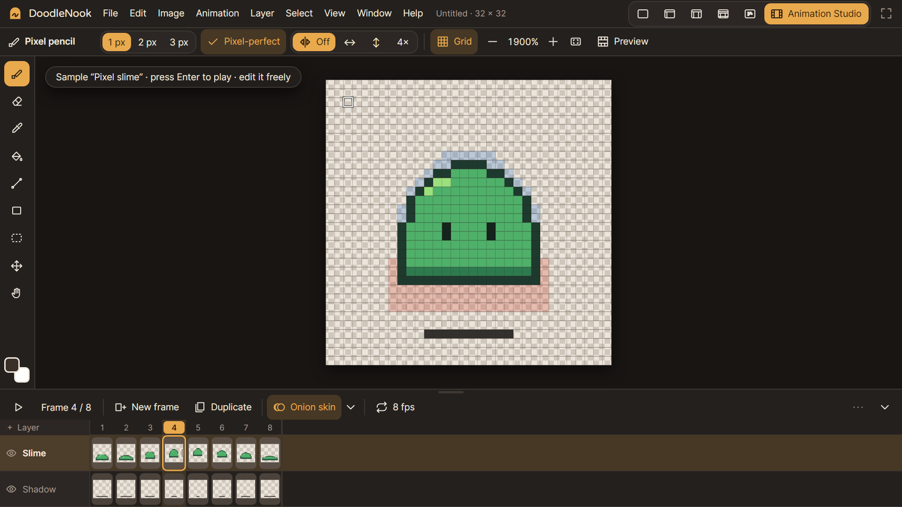
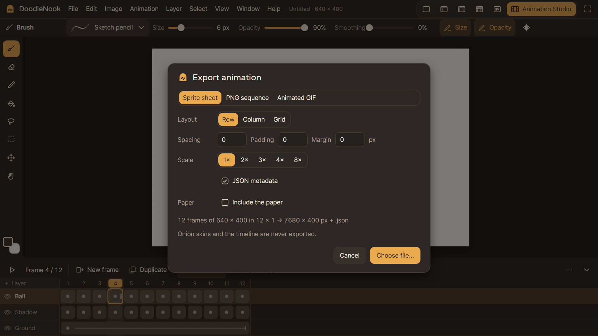
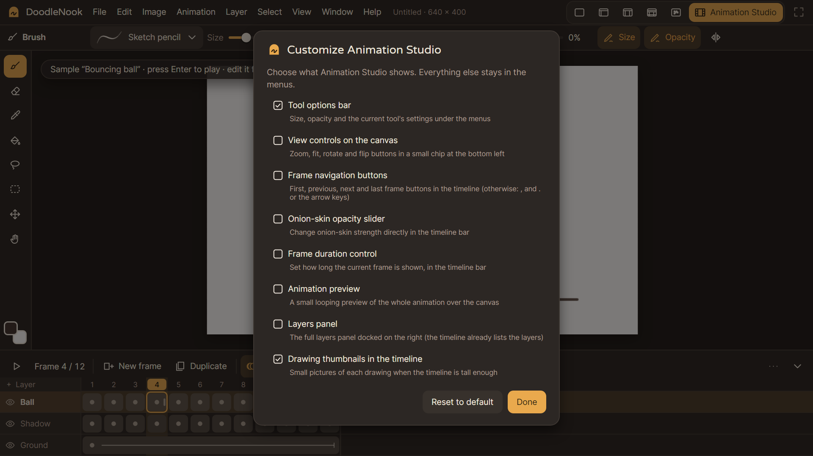
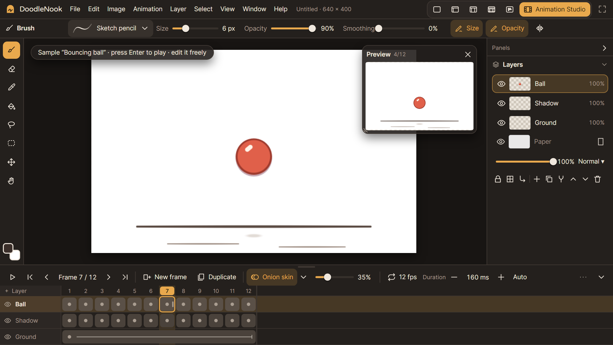

# Mission 006 — Make It Move

**Animation Studio**, DoodleNook's sixth workspace: frame-by-frame animation, hand-drawn or pixel art, on the
same document, canvas, brushes and undo history as the other five workspaces.

**Status:** implementation complete. Verified by automated tests on Linux and on Windows CI, and by a smoke test of
the packaged `DoodleNook.exe`. **Awaiting your hands-on playtest** ([playtest guide](PLAYTEST.md)).
The Huion Kamvas 13 experience is still unverified.

The interface rule behind this mission is now permanent: see [`CLAUDE.md`](../../../CLAUDE.md) and
[`docs/design/INTERFACE-PHILOSOPHY.md`](../../design/INTERFACE-PHILOSOPHY.md).

## Download and run

1. Open the [Windows build runs for this branch](https://github.com/crosenlund79/DoodleNook/actions/workflows/windows-build.yml?query=branch%3Aiteration%2F006-make-it-move) and pick the newest green run. You must be signed in to GitHub to download artifacts.
2. Under **Artifacts**, download **DoodleNook-win-x64** (delivered as `DoodleNook-win-x64.zip`).
3. Extract it and double-click **`DoodleNook.exe`**. Nothing to install.
4. If Windows says "Windows protected your PC", click *More info → Run anyway*. The test build is unsigned.
5. Press **Alt+6** for Animation Studio, or *Help › Sample animations*. The two samples are also in the `Samples` folder next to the exe.

## Animation Studio at a glance



The canvas stays the largest thing on screen: with the default timeline it gets about two-thirds of the window
height (a test checks that it never drops below 60 % in a 1280 × 800 window).

What you see, by the three access levels of the [interface philosophy](../../design/INTERFACE-PHILOSOPHY.md):

| Level | In Animation Studio |
|---|---|
| **1 · Visible** | The canvas; 8 drawing tools (9 pixel tools in pixel-art style); the brush options bar; the timeline with **Play/Pause**, the frame counter, **New frame**, **Duplicate**, **Onion skin** and the **fps** chip; the layer names in the timeline |
| **2 · Contextual** | Onion-skin settings (▾ beside the toggle) · frame rate, loop and ping-pong (click the fps chip) · right-click a cell, a frame number or a layer name for its commands · drag a drawing's right end to hold it longer or shorter · the "Held 3 frames · Make independent" hint appears only on a held drawing |
| **3 · Menus and optional** | The **Animation** menu · the timeline's **⋯** menu · *File › New animation / Export animation* · *Window › Customize workspace* to pin previous/next buttons, an onion-opacity slider, a frame-duration control, the preview panel or the full layers panel |

## How to animate

**The two everyday loops** need one key each:

- *Draw → **N** (new blank frame; the onion skin shows the last drawing faintly) → draw → **N** → … → **Enter** to play.*
- *Draw → **Shift+N** (duplicate: an independent copy of the drawing) → change it → **Shift+N** → … → **Enter**.*

A picture that isn't an animation yet becomes one the first time you press **N** (one undo step, so Ctrl+Z turns it
back into a still picture).

### Frames, drawings and holds

- Every **layer** is a row (track) in the timeline. Each **cell** of a row is one frame of that layer.
- A cell shows a **drawing** (a cel) or is **empty** (a small dot). Drawing on an empty cell creates its drawing.
- A **hold** shows the *same* drawing for several frames: a block with a line through it. Editing a held drawing
  changes every frame of the hold, because it *is* one drawing. Whenever the current drawing is held, the timeline
  says so ("Held 3 frames · Make independent"); one click gives this frame its own copy.
- **Duplicate** always makes an independent copy, so DoodleNook never changes several separate drawings when you meant one.
- Other layers keep showing their drawing on new frames (a background stays put while you animate the character).

**Timeline:** click a cell to go there and pick its layer · drag along the frame numbers to scrub · drag a
drawing's right end to hold it longer/shorter · drag a drawing to another frame of its row to move it there (it swaps
places) · wheel scrolls, **Ctrl+wheel** zooms, **Shift+wheel** scrolls layers · drag the timeline's top edge to resize
it, the chevron collapses it to its bar (both remembered) · "+ Layer" in the corner adds a layer; the eye hides one.

**Right-click** a cell for: make independent, new blank drawing, hold one frame longer/shorter, copy/paste drawing,
clear cell, insert/duplicate/delete/move frame, frame duration. The frame numbers and the ⋯ menu offer the frame
commands; a layer name offers the layer commands.

### Onion skin

On by default in Animation Studio (**O** or the toggle). It shows the neighbouring *drawings* (not repeated frames
of a hold) of the active layer, tinted: warm red-brown before, cool blue after. The ▾ pop-over sets how many before
and after (0–5), strength, both tints (4 choices each), fading of more distant drawings, and *whole frames* (all
layers instead of the active one).



Onion skins are display only: they are drawn between the paper and the layers, follow zoom, pan and rotation, are
hidden while playing and outside Animation Studio, and are never painted into a drawing or exported (tests check
both). Hand-drawn and pixel-art animation keep separate onion settings (pixel art defaults to an even 30 % with no
fading, which reads better on hard pixels).

### Playback

**Enter** plays and pauses; **Esc** stops and returns to the frame where you pressed play. Playback is driven by the
clock, not by screen refreshes: each tick shows the frame that is due for the elapsed time, so a slow redraw skips
frames instead of queuing them or drifting. Frame rate 1–60 fps (presets 6, 8, 12, 15, 24, 30), loop on/off and
ping-pong are on the fps chip. A single frame can be shown longer or shorter (*Frame duration…*, 10–10000 ms).

**Editing during playback** (decided and tested): touching the canvas, undoing, clicking the timeline or changing a
frame **pauses** on the frame being shown, and the edit applies to that frame. Press Enter to continue.
A non-looping animation ends on its last frame.

### Two styles

*Animation › Pixel-art animation* (also chosen in *New animation* and by the pixel sample) switches Animation Studio to
the pixel pencil, pixel eraser, line and rectangle tools, exact nearest-neighbour display, whole-number zoom and the
pixel grid. Hand-drawn style uses the normal brushes with pressure and anti-aliasing. It is one animation engine:
both styles use the same frames, cels, holds, onion skins, timing and files.



### Preview panel

A small looping preview of the whole animation over the top right of the canvas (*Animation › Preview panel*, the
Preview button in pixel style, or Customize workspace). It plays on its own while you draw, nearest-neighbour for
pixel art and smooth otherwise, on a checkerboard. Drag its lower-left corner to resize; size and visibility are
remembered.

### Exports — *File › Export animation…*



Pick one of three formats; only that format's options are shown, and your last choices are remembered.

| Format | Options | Notes |
|---|---|---|
| **Sprite sheet** (PNG) | Row, column or grid (columns) · spacing · padding · outer margin · scale 1–8× · JSON metadata · paper on/off | Frames in order, exact frame size; pixel art stays pixel-perfect (scaling is whole-number nearest neighbour) |
| **PNG sequence** | Scale · paper on/off | `walk.png` → `walk_0001.png`, `walk_0002.png`, …; asks before replacing existing files |
| **Animated GIF** | Scale · loop forever · smooth gradients (dither) · paper on/off | Per-frame timing (centiseconds, rounded without drift); up to 256 colours per frame: kept exactly when a frame has ≤ 255 colours, otherwise reduced (median cut, optional dithering); 1-bit transparency with "restore to background" disposal; identical consecutive frames are merged |

Every file is written to a temporary file first and then moved into place. The export dialog states that onion skins
and the timeline are never exported.

**Sprite-sheet JSON** (`walk_sheet.json` next to `walk_sheet.png`):

```json
{
  "format": "DoodleNook sprite sheet", "version": 1, "image": "walk_sheet.png",
  "size": { "w": 128, "h": 32 }, "frameSize": { "w": 32, "h": 32 },
  "columns": 4, "rows": 1, "fps": 8, "loop": true,
  "frames": [ { "index": 0, "x": 0, "y": 0, "w": 32, "h": 32, "durationMs": 125 }, … ]
}
```

In Godot, give a `Sprite2D` the PNG with `hframes`/`vframes` = columns/rows, or build `SpriteFrames` regions from
`frames[]` (use `durationMs` for per-frame timing).

### Saving, autosave and recovery

- Animations are saved in the **.dnk** format, now **version 2**: an `animation` section (fps, loop, ping-pong,
  current frame, per-frame durations), a list of drawings (cels, each a PNG cropped to its painted area, so a held
  drawing is stored once) and each layer's track. Pictures without animation are still written as **version 1**, so
  Mission 005's DoodleNook opens them. Mission 005 files open unchanged (tested with a real Mission 005 file).
  Damaged files are refused with a clear message instead of loading half a document.
- **Saving no longer blocks drawing**: the document is copied quickly on the UI thread (measured below), compressed
  and written in the background. Changes made while it writes stay marked unsaved. Closing waits for a running save.
  A failed save leaves the previous file untouched (temporary file, then replace).
- **Autosave** keeps a recovery copy of unsaved work every minute (*File › Preferences*: off, 30 s, 1, 2 or 5 min)
  in `%LOCALAPPDATA%\DoodleNook\Recovery`, never over your own file and only when something changed. Saving or closing
  normally removes it. If DoodleNook or Windows stops unexpectedly, the next start offers **Recover / Not now /
  Discard**. A copy is deleted only after it has been recovered (and protected by a new copy) or discarded. Several
  DoodleNook windows don't confuse each other (each session holds a lock file).

### Customize workspace — *Window › Customize workspace…*



A short list of check boxes, per workspace, applied immediately, remembered in `settings.json`, with **Reset to
default**. Only real controls are listed:

| Option | Workspaces | Default |
|---|---|---|
| Tool options bar | Painting, Editing, Pixel Art, Animation Studio | on |
| View controls on the canvas (zoom/fit/rotate chip) | Quick Sketch, Painting, Animation Studio | on in Quick Sketch and Painting |
| Status bar | Painting, Editing, Pixel Art | on in Editing |
| Layers button | Quick Sketch | on |
| 1:1 preview | Pixel Art | on |
| Frame navigation buttons (first, previous, next, last) | Animation Studio | off |
| Onion-skin opacity slider | Animation Studio | off |
| Frame duration control | Animation Studio | off |
| Animation preview | Animation Studio | off |
| Layers panel (docked) | Animation Studio | off |
| Drawing thumbnails in the timeline | Animation Studio | on |

Only choices that differ from the defaults are stored, per workspace. Options that a later version no longer knows
(or that don't belong to a workspace) are ignored, so an old or newer `settings.json` never breaks the layout.
*Window › Reset workspace layout* also restores panel widths, the timeline height and the preview size. Pure Sketch
has nothing to customize.



*With every Animation Studio option switched on (Kamvas 13, 150 %): everything still fits.*

### Keyboard (Animation Studio)

| Key | Action |
|---|---|
| **Enter** | Play / pause (applies a pending transform or crop first, as before) |
| **Esc** | Stop and return to the start frame (only while playing; otherwise Esc works as before) |
| **,** and **.** · **←** and **→** | Previous / next frame, wrapping around (arrows still nudge with the Move tool or during a transform) |
| **Home / End** | First / last frame |
| **N / Shift+N** | New blank frame / duplicate frame |
| **O** | Onion skin on/off |
| **Alt+6** | Animation Studio (from any workspace) |

None of these keys was used before (N, O, comma, period, Home, End) or they keep their old meaning first (Enter, Esc,
arrows). They work only in Animation Studio. Ctrl+N, Ctrl+Shift+N and all other shortcuts are unchanged.

### Samples — *Help › Sample animations*

- **Bouncing ball** (hand-drawn, 640 × 400, 12 frames, 12 fps): squash and stretch, a soft shadow that shrinks as
  the ball rises, one ground drawing held across all frames and a 160 ms pause at the top.
- **Pixel slime** (pixel art, 32 × 32, transparent, 8 frames, 8 fps): a hopping slime with an outline, highlight and
  eyes, and its shadow on a separate layer; the squash frames are held longer.

They are drawn by DoodleNook's own brushes and pixel pencil, so they are ordinary editable documents. Opening one
from the Help menu gives an untitled copy (saving asks for a name). The same two files are in the package's
`Samples` folder.

## Screenshots

All are real frames of the native app, rendered headlessly with Skia from the same code and styles as on Windows
(only text rasterisation differs). Full set in [`screenshots/`](screenshots/).

| | |
|---|---|
| Default, Kamvas 13 at 150 % | [native-kamvas13-150-F-animation-studio.png](screenshots/native-kamvas13-150-F-animation-studio.png) |
| Default, Kamvas 13 at 125 % | [native-kamvas13-125-F-animation-studio.png](screenshots/native-kamvas13-125-F-animation-studio.png) |
| Default, 27″ 2560 × 1440 at 100 % | [native-desktop27-F-animation-studio.png](screenshots/native-desktop27-F-animation-studio.png) |
| Compact (collapsed) timeline | [animation-timeline-collapsed.png](screenshots/animation-timeline-collapsed.png) |
| Expanded timeline with drawing thumbnails | [animation-timeline-expanded.png](screenshots/animation-timeline-expanded.png) |
| Onion-skin settings / playback settings | [animation-onion-settings.png](screenshots/animation-onion-settings.png) · [animation-playback-settings.png](screenshots/animation-playback-settings.png) |
| Animation menu | [animation-menu.png](screenshots/animation-menu.png) |
| Preview panel | [animation-preview-panel.png](screenshots/animation-preview-panel.png) |
| Customize workspace · every option on (150 % and 27″) | [animation-customize-workspace.png](screenshots/animation-customize-workspace.png) · [150 %](screenshots/animation-customized-kamvas13-150.png) · [27″](screenshots/animation-customized-desktop27.png) |
| Export dialog · New animation dialog | [animation-export-sprite-sheet.png](screenshots/animation-export-sprite-sheet.png) · [animation-new-animation.png](screenshots/animation-new-animation.png) |
| Pixel-art sample | [animation-pixel-sample.png](screenshots/animation-pixel-sample.png) |
| Real window (Xvfb, packaged code path) | [smoke-F-animation-studio.png](screenshots/smoke-F-animation-studio.png) |

## Architecture

- **Frames and tracks.** An `Animation` (fps, loop, ping-pong, current frame, optional per-frame durations) is
  attached to the ordinary `Document`. Each `Layer` gets a track: one entry per frame, each a `Cel` or empty. There is
  no second document type: a still picture simply has no animation.
- **Cels and holds.** A `Cel` owns one drawing. A hold is the *same* `Cel` object on consecutive frames, so a held
  drawing is stored and edited once. Duplicate and *Make independent* clone the pixels.
- **Editing.** `Layer.Image` always shows the current frame's drawing (or a blank for an empty cell), so every
  existing tool, filter and transform works unchanged on the current cel. Drawing on an empty cell turns the blank
  into a new cel within the same undo step. Picture-wide operations (image size, canvas size, rotate/flip picture)
  apply to every drawing of every frame; transforms, fills and adjustments apply to the current drawing.
- **Undo.** Pixel undo is tied to the cel, not the frame shown; structure commands (insert, delete, move, hold,
  independent, paste…) store the tracks before and after. Every history entry remembers its frame; undo and redo
  first go to that frame, so you see what changes.
- **Rendering.** Frames are composited by the same compositor. A frame cache (512 MB budget, evicting the frames
  farthest from the playhead) keyed by the drawings' identities and revisions, layer settings and paper makes
  revisiting frames and playback cheap; any edit changes the key, so stale frames are never shown.
- **Onion skin.** Built in the background after a frame change: the neighbouring distinct drawings are tinted into a
  single overlay that the compositor draws between paper and layers for display only.
- **Playback.** `PlaybackClock` maps elapsed time to a frame from the cumulative durations (loop, ping-pong, start
  frame); `AnimationController` ticks it from a timer and a stopwatch and pauses on any outside change.
- **Persistence.** `.dnk` v2 as above; `DnkSnapshot` copies only painted areas so compression and writing happen
  on a background thread; `RecoveryStore` handles autosave copies and locks.
- **Exports.** `AnimationExport` (frames, sprite sheets, JSON, PNG sequences) and DoodleNook's own `GifEncoder`
  (no new dependencies).
- **UI.** `TimelinePanel` (bar, pop-overs), `TimelineGrid` (one custom-drawn control for ruler, tracks, holds and
  thumbnails), `AnimationPreview`, `MainWindow.Animation.cs` (menus, dialogs, saving, recovery). Customize workspace is
  a small registry of optional controls (`CustomOptions`) plus per-workspace choices in `WorkspaceState`.
  The engine still references only .NET.

## Measured performance

Engine measurements from `AnimationPerformanceTests` (three layers each: a held background, a character drawn on
every frame and effects on every other frame). Full numbers: `tests/DoodleNook.Engine.Tests/out/animation-performance.json`
(uploaded with every CI run's test results). Measured on the Windows CI runner (Windows 10.0.26100, 4 logical
processors, Release build) in run #11; engine only, without drawing to the screen.

| | 64 × 64, 32 frames (pixel) | 256 × 256, 60 frames (pixel) | 1920 × 1080, 24 frames (hand-drawn) |
|---|---|---|---|
| Drawings (cels) | 49 | 91 | 37 |
| Show a frame, first visit (avg / max) | 0.03 / 0.06 ms | 0.26 / 4.9 ms | 10.8 / 21.7 ms |
| Show a frame again (frame cache) (avg / max) | 0.005 / 0.10 ms | 0.02 / 0.06 ms | 1.4 / 9.1 ms |
| Composite any frame (exports, preview) | 0.007 ms | 0.33 ms | 3.6 ms |
| Build onion skin, 2 before + 2 after | 0.03 ms | 0.5 ms | 8.9 ms |
| Pen event on a cel (2 samples, ink brush) | 0.016 ms | 0.37 ms | 0.41 ms |
| Save: copy on the UI thread / write in the background | 10 / 124 ms | 1.4 / 58 ms | 31 / 469 ms |
| `.dnk` size · open | 15 KB · 79 ms | 49 KB · 17 ms | 1.0 MB · 216 ms |
| Export: render all frames / sprite sheet / GIF | 19 / 0.3 / 48 ms | 16 / 48 / 122 ms | 92 / 150 / 3 684 ms |
| Memory after drawing (of which undo history) · frame cache | 2.1 (1.4) MB · 0.5 MB | 48 (4.7) MB · 15 MB | 506 (29) MB · 190 MB |
| Time available per frame at 12 fps | 83 ms | 83 ms | 83 ms |

The same test in this Linux container (Debug build) gave the same picture (for example 1.45 ms per cached 1080p frame,
14 ms first visit, 39 ms save copy). In the packaged app on Windows, the smoke test exported the 13-frame sample as a
sprite sheet in 336 ms, a PNG sequence in 126 ms and a GIF in 220 ms, and real-time playback reached frame 7 after
0.6 s at 12 fps, as it should.

What this means in practice: switching to a frame you have visited costs a few milliseconds even at 1080p, so
scrubbing and 12–24 fps playback stay well inside a frame's time; the first visit to a 1080p frame costs about one
recomposite. Onion skins are rebuilt in the background after the frame changes. Saving copies the document on the
UI thread in tens of milliseconds and writes it in the background. The big GIF is slow to encode, but that happens
in the background too.

Mission 005's stroke measurements still apply: drawing on a cel is the same brush code (the "pen event on cel" row).

## Verification

- **Engine tests:** 172 (including 1 Mission 005 measurement test and the new animation measurement test): animation
  model, holds, undo across frames, onion frames and pixels, playback clock (loop, ping-pong, holds, durations,
  drift), `.dnk` v2 round trips, the real Mission 005 file, damaged files, background snapshots, failed saves,
  sprite sheets, JSON, PNG sequences, GIF encoding (decoded back and compared), samples.
- **App tests:** 94 through the real window (headless Avalonia): Animation Studio layout and canvas share, both
  styles, every animation key and that it never replaces an older shortcut, frames from a still picture and undo,
  per-frame drawing and undo returning to its frame, held drawings and *Make independent*, timeline clicking,
  scrubbing, hold dragging and context menus, collapsing and remembered height, time-based playback and pausing on
  edit, onion skins only in Animation Studio and never in exports, Customize workspace (show/hide, per workspace,
  reset, persistence, unknown options), the export dialog showing only the chosen format, all three exports
  (GIF decoded with Skia), autosave → simulated crash → recover or discard, background saving, samples, and four
  complete workflows (pixel sprite → sprite sheet; hand-drawn with onion → play → save → reopen → GIF; Mission 005
  file → animation → save → reopen; switching workspaces keeps frame and history). All 72 earlier app tests still pass.
- **Smoke test** of the packaged `DoodleNook.exe` on Windows CI: everything from Mission 005, plus opening the sample,
  real-time playback (frame 7 after 0.6 s locally), onion skin, a new frame drawn on, save and reopen, and all three
  animation exports.
- **Visual review:** screenshots at 2560 × 1440 (100 %), 1920 × 1080 at 125 % and at 150 %, with every optional
  control on, checked by eye. Fixes that came out of it: menus and pop-overs now scroll on short screens (the first
  Animation menu was taller than a Kamvas screen at 150 %), the tool strip scrolls instead of running into
  the colour chips, toggles in dialogs and pop-overs became check boxes (an "off" toggle read as plain text), the hold
  handle shows only on the selected or hovered drawing, the Animation menu was halved, the preview panel got its
  card background, and the pixel grid now works in pixel-art animation.

## Known limitations

- **Pen hardware:** the Huion Kamvas 13 has not been tested; pen behaviour is unchanged from Mission 005 and unverified.
- **Memory at 1080p:** each drawing is a full-canvas image in memory. The 24-frame 1080p test animation (37 drawings)
  used about 0.5 GB including the frame cache (≈190 MB). Long 1080p animations will need a lot of memory; drawings
  are stored compactly on disk.
- **Hold dragging** creates one undo step per frame it moves (drag three frames → three Ctrl+Z).
- **Moving drawings** swaps two cells of one layer; there is no multi-cell selection, and copy/paste is one drawing at a time.
- **Timeline thumbnails** are small for wide pictures and appear only when rows are at least 44 px tall.
- **The preview panel** loops on its own clock; it doesn't follow the timeline's playhead.
- **Recovery** offers the newest copy first; other copies wait for the next start.
- **GIF** has 1-bit transparency (soft edges over transparency become hard) and at most 256 colours per frame.
- Screenshots are headless renders; the real window under Xvfb looks the same (see the smoke screenshot).

## Not included (deliberately)

Playback range and speed multiplier, animated WebP, registration guides and motion guides, reference images in the
timeline, audio, video, bones, 3D, vector animation, cloud, plug-ins and AI. Optional items were left out to keep the
required ones solid.

## Fine-tuning opportunities for the playtest

These are defaults, not decisions. Your preference wins:

1. **Onion colours and strength**: warm red-brown before, cool blue after, 35 % with fading (pixel art 30 %, even).
2. **Default timeline height** (168 px) and whether drawing thumbnails are worth their space.
3. **New frame vs Duplicate** as the main button, and whether N should insert a blank or a held frame.
4. **Pausing on edit** during playback, versus continuing to play.
5. **Arrow keys** for frames (they wrap around at the ends).
6. **Which optional controls** you pin; if you always pin one, it may deserve to be on by default.

## Building from source

```bash
dotnet test DoodleNook.slnx
```

```bash
dotnet run --project src/DoodleNook.App
```
