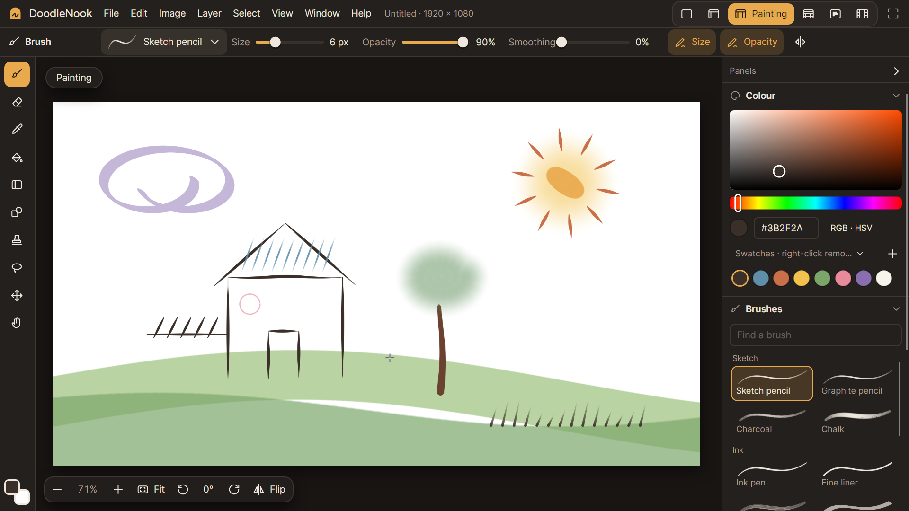
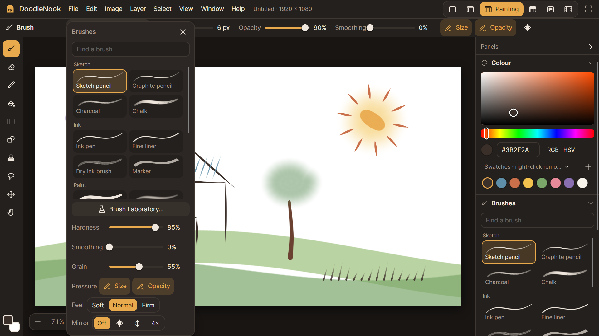
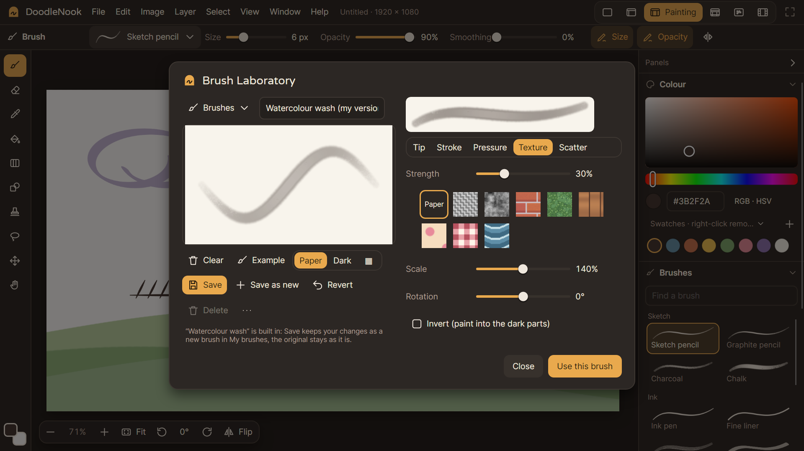
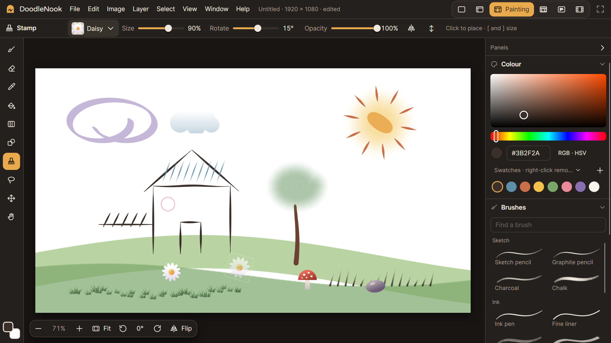
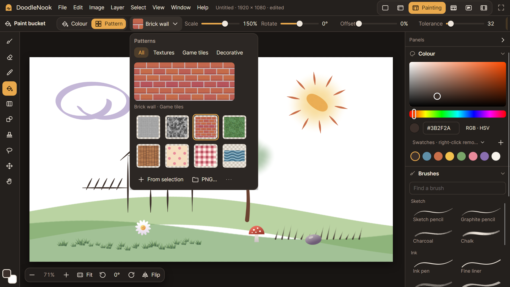
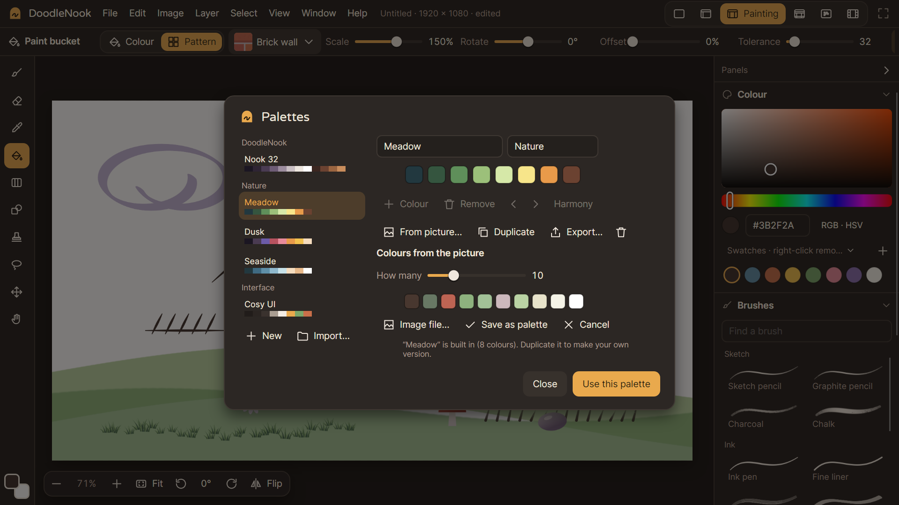
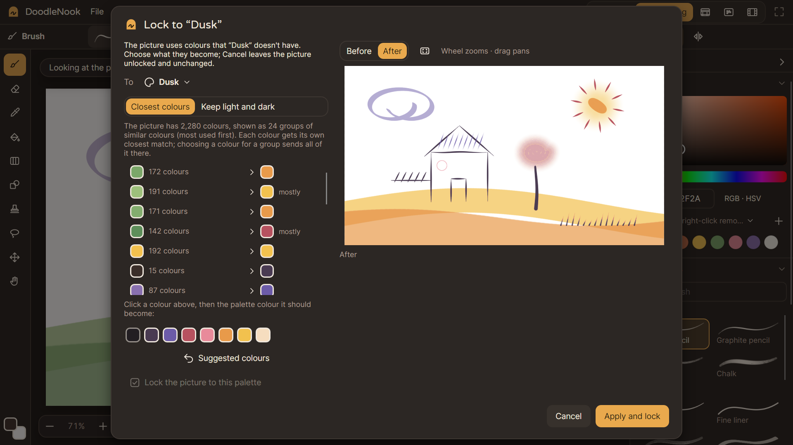
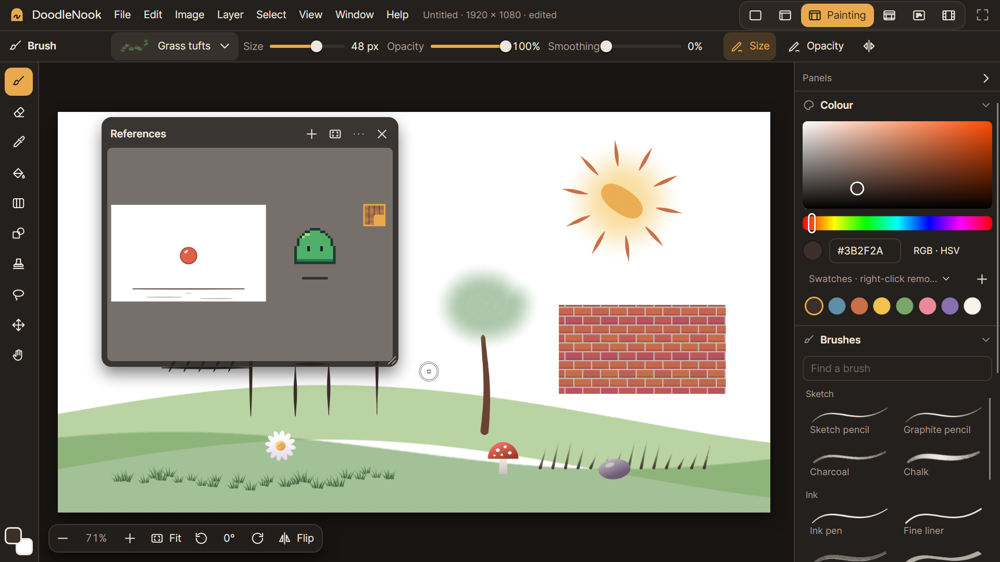

# Mission 007 — The Artist's Workshop

DoodleNook's creative toolkit: a **Brush Laboratory**, a starter collection of 17 brushes, **stamps**, **patterns**,
**palettes** and a **reference board**, all kept in one creative library. None of it is a new workspace: the six
workspaces are unchanged, and someone who never opens the Brush Laboratory sees the same calm Painting screen as
before, with a better brush picker.

**Status:** implementation complete. Verified by automated tests on Linux and on Windows CI, and by a smoke test of
the packaged `DoodleNook.exe`. **Awaiting your hands-on playtest** ([playtest guide](PLAYTEST.md)).
The Huion Kamvas 13 experience is still unverified.

The interface rules behind this mission are permanent: see [`CLAUDE.md`](../../../CLAUDE.md) and
[`docs/design/INTERFACE-PHILOSOPHY.md`](../../design/INTERFACE-PHILOSOPHY.md).

## Download and run

1. Open the [Windows build runs for this branch](https://github.com/crosenlund79/DoodleNook/actions/workflows/windows-build.yml?query=branch%3Aiteration%2F007-artists-workshop) and pick the newest green run. You must be signed in to GitHub to download artifacts.
2. Under **Artifacts**, download **DoodleNook-win-x64** (delivered as `DoodleNook-win-x64.zip`).
3. Extract it and double-click **`DoodleNook.exe`**. Nothing to install.
4. If Windows says "Windows protected your PC", click *More info → Run anyway*. The test build is unsigned.
5. The `Samples` folder next to the exe now also holds a starter asset pack, a palette file and a reference board.

## First: the export-dialog freeze (mandatory fix)

**What you saw.** In *File › Export animation…* with a 1920 × 1080, 21-frame animation, switching to or from
*Animated GIF* made the window "Not Responding".

**Root cause.** The dialog rebuilt its option area on every format switch, but reused the same four number boxes
(the sprite sheet's columns, spacing, padding and margin). Going from Animated GIF or PNG sequence **back to Sprite
sheet** put those boxes into new rows while the old rows still held them, and Avalonia threw *"The control already has a visual
parent"* from inside the click handler. Nothing caught it, so the process ended. On Windows that looks like a freeze:
the window stops responding while Windows Error Reporting records the crash, and then it disappears. The size of the
animation was not the cause, the order of clicks was: the error depends only on which layout was shown before.

**Fix.**
1. Each rebuild now creates fresh controls and carries the values over.
2. The export guard was tightened: only one export runs at a time, and a second click says so instead of starting
   another.
3. **A safety net:** an unexpected error in the interface is now written to `%LOCALAPPDATA%\DoodleNook\Logs\errors.log`,
   unsaved work is saved to the recovery folder, and DoodleNook tells you what happened instead of vanishing.

**Proof, not a one-off retry.**
- Two regression tests drive the real dialog with a 1920 × 1080, 21-frame animation. One clicks through
  GIF ↔ Sprite sheet ↔ PNG sequence ten times in a mixed order, checking that every switch shows the right options,
  stays fast and keeps the values. The other exports the 1080p GIF and decodes it back (all 21 frames, with their
  timing) and checks that a failed export leaves no file.
- The smoke test does the same in the real packaged `DoodleNook.exe` on Windows CI (section 10): eight switches
  between the three formats, then a real 1080p GIF export.

  | | slowest switch | 1080p GIF (21 frames, 186 KB) |
  |---|---|---|
  | Windows CI run #13 | 11 ms | 2.1 s |
  | Windows CI run #14 | 20 ms | 1.3 s |
  | Linux under Xvfb | 87 ms | 1.5 s |

  The GIF is encoded in the background, and every frame is in it with its timing.

### A second, older crash found on the way

While testing, the app test suite occasionally died with a segmentation fault. The cause was in Mission 005's
selection outline: when the selection changed, the old outline (`SKPath`) was disposed while the render thread could
still be drawing it (`sk_path_clone` on a thread-pool thread in the crash dump). The fix keeps the old path alive
for the pending frame and lets the garbage collector free it. Since the fix, the full app suite (111 tests) has passed
in every run. On Windows this could have been a rare crash right after selecting.

## The workshop at a glance



What you see, by the three access levels of the [interface philosophy](../../design/INTERFACE-PHILOSOPHY.md):

| Level | What's there |
|---|---|
| **1 · Visible** | The **Stamp** tool (S) in Painting and Pixel Art. The brush dock and brush picker now have a search box, categories and a *Brush Laboratory…* button. The paint bucket's options bar has a **Colour / Pattern** switch. Nothing else is added to any workspace by default. |
| **2 · Contextual** | Stamp options (stamp, size, rotation, opacity, flips) only with the Stamp tool. Pattern options (pattern, scale, rotation, offset, opacity) only in the bucket's Pattern mode. Right-click a brush, stamp or pattern for favourites, editing, duplicating, *Make a brush from this stamp*, *Use as the brush texture*, rename, move, export and delete. The palette chooser sits on the colour panel's swatch row. A small lock appears by the colour chips only while a picture is palette-locked. |
| **3 · Menus and optional** | *Window › Creative tools*: Brush Laboratory, Palettes, Reference board, Creative library. *Edit*: Fill with pattern, Save selection as stamp / pattern. *Image/Sprite*: Remap to palette, Lock to palette. *Window › Customize workspace*: the Stamp tool in Quick Sketch, Editing and Animation Studio; favourite brushes as one-click buttons (Quick Sketch, Painting, Animation Studio); the reference board. |

**The UI decision checklist** for the permanently visible additions:

- **Stamp tool button** (Painting and Pixel Art).
  1. Frequent in decorating, game art and pixel work.
  2. Relevant there and not elsewhere: optional through *Customize workspace* in Quick Sketch, Editing and Animation
     Studio.
  3. Also on the **S** key.
  4. It is a tool, and tools live in the strip; its options are contextual.
  5. One button in the existing tool column, so the drawing area is not reduced.
  6. Comfortable at 150 %: the strip scrolls if it must ([screenshot](screenshots/workshop-kamvas13-150-painting.png)).
- **Brush search box and *Brush Laboratory…* button.** Only inside the existing brush dock and brush picker, where
  brushes are chosen anyway. The Lab is also in *Window* and in every brush's right-click menu. Nothing on the canvas.
- **Colour / Pattern switch.** Visible only while the paint bucket is selected (contextual), in the options bar that
  already exists.

## Brushes

### The starter collection (17 brushes)

| Category | Brushes |
|---|---|
| **Sketch** | Sketch pencil · **Graphite pencil** · **Charcoal** · Chalk |
| **Ink** | Ink pen · Fine liner · **Dry ink brush** · Marker |
| **Paint** | Hard round · Soft round · **Soft paint brush** · **Watercolour wash** · Flat wash · Airbrush |
| **Texture & stamps** | **Spatter** · **Grass tufts** · **Leaves** |

The **8 new brushes** (bold) each use something the old engine couldn't do:
- **Graphite pencil**: a pressure response curve.
- **Charcoal**: a picture tip on rough paper texture.
- **Dry ink brush**: bristles that turn with the stroke.
- **Soft paint brush**: canvas weave.
- **Watercolour wash**: wet edges.
- **Spatter**: scattered dots.
- **Grass tufts** and **Leaves**: stamp brushes in their own colours.

**The nine Mission 005/006 brushes are unchanged, pixel for pixel.** A frozen copy of the Mission 006 stroke engine
is kept in the tests (`Reference/Mission006StrokeEngine.cs`). Every classic brush paints the same pressure stroke with
both engines in three styles (plain; smoothed with Soft feel and mirror symmetry; Firm feel as an eraser), on an empty
layer and on a filled layer with a selection, and the pixels must be identical. New features are off unless a brush
asks for them, so the old code path is the one that runs.

### Brush picker



- **Search** by name.
- **Categories**: Sketch, Ink, Paint, Texture & stamps, My brushes.
- **★ Favourites** first. Right-click a brush to add it.
- Every tile shows a real preview stroke.
- **Brush Laboratory…** at the bottom.
- With *Customize workspace › Favourite brushes*, your starred brushes appear as one-click buttons next to the brush
  chip.

### Brush Laboratory (*Window › Brush Laboratory…*, the picker's button, or right-click a brush)



A dialog, not a workspace. On the left, a **scribble area** with its own little document: draw on it with the pen,
press *Example* for a standard S-curve, clear it, or switch between paper, dark and checkerboard backgrounds. It
never touches your picture or its undo history (a test and the smoke test check both).

On the right, a live stroke preview and **five sections**, each showing only the controls that apply:

| Section | Controls |
|---|---|
| **Tip** | Round (hardness, squash, angle) or **Picture**: a built-in tip, any stamp, *From selection* or a *PNG…*; *Paint in the picture's own colours* (a stamp brush); *Turn with the stroke* |
| **Stroke** | Size, opacity, automatic or manual spacing, smoothing, build-up (then flow and *keep spraying*), wet edges |
| **Pressure** | Pressure → size (then smallest size), → opacity, → flow (when building up), and the **response** curve with a small graph (on top of the Soft / Normal / Firm feel from the brush settings) |
| **Texture** | Strength, paper grain or **any pattern**, scale, rotation, invert |
| **Scatter** | Scatter, count, size / angle / opacity jitter. "Random, but the same stroke always gives the same marks." |

**Managing brushes.**
- **Save** changes your own brush. On a built-in brush, Save makes *"… (my version)"* in My brushes, and the original
  stays as it is.
- **Save as new**, **Revert**, rename (type in the name box), and a two-step **Delete** for your own brushes.
- **⋯ › Restore the built-in settings.**
- Duplicate and export from the picker's right-click menu.

Built-in brushes can't be changed or deleted, so "restore built-ins" is always available.

**Custom tips.**
- A picture with transparency paints its shape. A fully opaque picture paints where it is dark, so a scanned
  pencil mark works.
- Tips are trimmed, kept as a size pyramid for quality at every size, and stored in the library (copied, so the
  original file can move).

## Stamps



- **The Stamp tool (S).** A live preview follows the pen, and a click places one stamp as one undo step. *[* and *]*
  resize. The options bar holds the stamp chip, size, rotation, opacity and flips. In Pixel Art the options become
  1× to 4× and quarter turns, and stamps copy whole pixels (no blur).
- **The stamp picker** ([screenshot](screenshots/workshop-stamp-picker.png)): collections, favourites first,
  *From selection*, *PNG…*, and right-click for the rest.
- **Built-in stamps**, drawn by code and original: grass tuft, leaf, daisy, mushroom, pebble, cloud, star.
- **Your own stamps**:
  - *Edit › Save selection as stamp…* (or the whole layer);
  - *PNG…* in the picker;
  - packs.
  Stamps are trimmed to their content and you can rename them, move them between collections, delete them and export
  them.
- **Stamp brushes**: right-click a stamp › *Make a brush from this stamp* gives a brush in My brushes that paints the
  stamp along the stroke, with the Brush Laboratory's spacing, scatter and jitter.

Stamps respect the selection, locked layers and transparency lock, and on an animation they change only the current
frame's drawing.

## Patterns



- **Pattern fill.** The paint bucket's **Pattern** switch fills the clicked area with a pattern (same tolerance
  rules as colour), and *Edit › Fill with pattern* fills the selection or layer. Both are one undo step. Options
  appear only in Pattern mode: pattern, scale, rotation, offset, opacity. Fills keep inside the selection, respect
  transparency lock, and on animations change only the current drawing.
  [After a fill](screenshots/workshop-pattern-fill.png).
- **Tiled preview.** The picker shows the chosen pattern repeated, so seams are visible before you fill.
  *Save selection as pattern…* shows the same tiled preview before you name it.
- **Built-in patterns** (all seamless, a test checks the edges):
  - Textures: canvas weave, rough paper.
  - Game tiles: brick wall, grass ground, wood planks.
  - Decorative: polka dots, picnic check, waves.
- **Pixel art.** At whole-number scale and quarter-turn rotation the fill copies exact pixels.
- **Patterns as brush textures.** Right-click a pattern › *Use as the brush texture*, or choose it in the Lab's
  Texture section.

## Palettes



- **The palette manager** (*Window › Palettes…*):
  - create, rename, move to a collection, add the current colour, remove, reorder (‹ ›), duplicate, delete
    (two clicks), import and export;
  - built-in palettes are protected: *Duplicate* makes your own copy.
- **Built-in palettes**: Nook 32, Meadow, Dusk, Seaside and Cosy UI.
- **Palette from a picture.** *From picture…* proposes 2–32 colours from the open picture, or *Image file…* from
  another file. The proposal is shown first and saved only on *Save as palette*, as a new palette, so existing
  swatches are never overwritten.
  - Pictures with few colours (pixel art) keep their exact colours.
  - Others are reduced with median cut refined by k-means.
- **Harmony** (one focused action): adds complementary, analogous or triadic colours for the current colour.
- **Using a palette.** The colour panel's swatch row can show any palette. In Pixel Art (and pixel-art animation),
  choosing a palette makes it the picture's palette with **exact RGB values**
  ([screenshot](screenshots/workshop-pixel-art.png)).
- **File formats:**
  - **GIMP `.gpl`** in and out (name, `Columns`, `R G B` lines; comments ignored).
  - **`.hex`**: one `RRGGBB` per line; `#` and `AARRGGBB` accepted on import.
  - Palettes also travel in asset packs.

## Palette Lock and Remap to Palette (addendum)



Two connected tools, added to Mission 007 at your request:
- **Palette Lock** keeps a picture (every layer, every drawing of an animation) to the colours of one palette.
- **Remap to Palette** translates existing artwork into another palette through a mapping you can review and change.

DoodleNook proposes the mapping; you decide.

### Colour and transparency stay separate

**Only RGB is ever restricted or converted. Alpha is never changed.**
- A pixel at alpha 73 stays at 73, opaque stays opaque, and transparent stays transparent.
- Brush opacity, pressure transparency, soft edges, layer opacity, clipping and alpha lock all keep working.

How it's kept exact:
- DoodleNook stores pixels premultiplied (8 bits per channel), which can't hold every RGB value of a faint pixel
  exactly.
- A locked picture therefore stores each pixel in one canonical form: the palette colour premultiplied by the
  pixel's own alpha.
- Exports and the eyedropper decode that back into exactly the palette colour and the same alpha.

The brief's critical case is tested in the engine and in the packaged app's smoke test: RGB (200, 100, 50) at alpha 73,
remapped to (40, 80, 120), exports as **RGBA(40, 80, 120, 73)**. A test also walks every alpha level from 1 to 255.

At very low alpha, the stored value of a faint pixel can't tell its colour apart (at alpha 1, most colours are
"almost black"). So a faint pixel that matches, within that rounding, one of the picture's solid colours is treated as
that colour. That's how a soft edge follows its stroke when you remap.

### Palette Lock

**Where:**
- the colour panel's palette menu;
- the Pixel Art palette column's ⋯ menu;
- *Image* (or *Sprite*) › *Lock to…*.

**When locked:**
- A small lock appears above the colour chips. The colour panel shows "Locked to “Dusk”" in place of the free colour
  picker, and its swatches are the allowed colours ([screenshot](screenshots/palette-lock-painting-kamvas13-150.png)).
- Pixel Art shows the lock by the palette name ([screenshot](screenshots/palette-lock-pixel-art.png)).
- Nothing is added to an unlocked picture's interface.

**Enabling it:**
- If the picture already uses only the palette's colours, it locks at once (one undo step).
- Otherwise the remap preview opens first: *Apply and lock* converts and locks as one undo step, and *Cancel* leaves
  the picture unlocked and unchanged. A lock never pretends to be strict while prohibited colours remain.

**While locked:**
- **Colours you can pick.** The eyedropper, the hex box, the quick palette, the recent colours and restored settings
  all resolve to the nearest allowed colour.
- **Everything that creates pixels keeps to the palette:** brushes, the eraser, both buckets (colour and pattern),
  shapes, gradients, stamps, patterns, adjustments, transforms, image size/rotation, merging, pasted and placed images,
  and pasted animation drawings.
- **One rule for every tool.** The pixel keeps its alpha and takes the nearest palette colour in OKLab, inside the
  same undo step.
- **Live strokes.** Strokes are conformed as you paint (not at pen-up), so you see the real result.
- **Soft paint over other colours.** Antialiased edges and soft brushes over other colours resolve to whichever palette
  colour they're nearest, like indexed-colour painting. Over transparency, soft edges keep all their transparency.
- **Placing an outside picture** converts its colours (its toast says so).

**Changing the palette is always explicit:**
- **Add a colour…** (the colour panel's "+", or the lock menu) asks for a colour and adds it. Nothing is recoloured.
- **Right-click a swatch:**
  - *Replace this colour…* asks for the new colour and opens the remap preview, with the old colour already sent to
    the new one.
  - *Remove from the palette…* previews where its pixels go.

  Pixel Art has both in its ⋯ menu.
- **The palette is the picture's own snapshot.** Editing a palette in the library never recolours a picture, and the
  palette manager says so. When the library version differs, the lock menu offers *Update from “…” in your
  palettes…*, which opens the preview with each replaced colour going to the colour now in its place.
- **Choosing another saved palette** for a locked picture also goes through the preview.

### Remap to Palette

**Where:**
- *Image › Remap to palette…*;
- the palette menus;
- *Remap the picture…* in the palette manager.

All of them open the same dialog. It works on still pictures, layered pictures and whole animations.

**Left: the mapping.**
- **Which palette.** Choose the target palette at the top.
- **Two suggestion styles:**
  - *Closest colours* (perceptual OKLab; colours already in the palette stay);
  - *Keep light and dark* (the picture's dark-to-light range is stretched over the palette's, which keeps contrast).
- **Rows.** A picture with up to 48 colours (pixel art, flat colours) gets one row per exact colour. Paintings and
  photos with thousands of colours get 24 groups of similar colours (weighted k-means in OKLab), most used first.
  - Inside a group, every colour still gets its own closest match. The row shows where *most* of it goes ("mostly").
  - Choosing a colour for a group sends all of it there ("your choice").
- **Changing the mapping.** Click a row, then a palette colour. Several colours may share one target, and a target
  needn't be used. *Suggested colours* resets everything.
- **Hidden layers too** appears when there are hidden layers (always included when locking). *Lock the picture to
  this palette* is optional for a plain remap.

**Right: the preview of the real picture.**
- *Before* / *After*.
- The wheel zooms around the pointer, drag pans, and double-click fits. Pixel art stays crisp when enlarged.
- For animations: a frame slider and a play button. Frames are computed in the background and cached, so the dialog
  stays responsive.

**Apply** is one undo step for the whole conversion: pixels of every layer and drawing, the palette and the lock.
**Cancel** changes nothing.
- **Animations** keep their frames, timing and held drawings; a held drawing stays one drawing.
- **Layers** keep their order, opacity, blend modes and clipping.
- **Alpha** is untouched.

| | |
|---|---|
| Painting → Dusk, 150 % · 1080p · "Before" view | [150 %](screenshots/palette-remap-painting-kamvas13-150.png) · [1080p](screenshots/palette-remap-painting-desktop1080.png) · [before](screenshots/palette-remap-painting-before.png) |
| Locked Painting, 150 % · 1080p | [150 %](screenshots/palette-lock-painting-kamvas13-150.png) · [1080p](screenshots/palette-lock-painting-desktop1080.png) |
| Pixel sprite → Seaside with one colour chosen by hand · the sprite locked afterwards | [remap](screenshots/palette-remap-sprite.png) · [locked](screenshots/palette-lock-pixel-art.png) |
| Animation (frame slider and playback) | [palette-remap-animation.png](screenshots/palette-remap-animation.png) |
| Real window (Xvfb), from the smoke test | [smoke-I-palette-remap.png](screenshots/smoke-I-palette-remap.png) |

### Files

- **`.dnk` version 3** is written only for a locked picture. It adds `palette.locked` and `palette.libraryId` next to
  the palette snapshot that `.dnk` has always stored.
- **Everything else keeps its old version:** version 1 for still pictures, 2 for animations. Mission 005 and 006
  builds keep opening those, and refuse a locked file with a clear message instead of silently dropping the lock.
- **Layer pixels are stored exactly as before.**

## Reference board (*Window › Reference board*)



- **Optional and hidden by default.** A floating panel over the canvas, not a workspace. It is shown per workspace
  (remembered like Customize workspace) and never shown in Pure Sketch.
- **Pictures.** Add pictures with **+**: they are copied in, so moving the originals breaks nothing. Drag a picture
  to move it and its corner to resize it. Drag the empty board to pan, and use the wheel to zoom. *Show all* fits
  everything.
- **Right-click a picture**: *Show only this picture*, *Actual size*, *Palette from this picture…*, *Remove*.
- **The ⋯ menu**: dark, grey or light background, *Open board…*, *Save board as…* (`.dnkboard`), *Remove all pictures*.
- **Moving and sizing the board.** Drag its title to move it and its corner to resize it.
- **Colour picking.** With the eyedropper, or Alt held, a click on a picture picks its colour.
- **Never part of your artwork.** Board pictures are not layers and are never saved into `.dnk` files or exports:
  a test compares the exported PNG with the artwork pixel for pixel. Hidden, the board is not on screen at all, so it
  can't take canvas input (tested).
- **Kept between sessions** in the library folder (`boards/current.dnkboard`).

## The creative library and its files

Everything you make lives in **`%APPDATA%\DoodleNook\Library`**:

```
Library\
  library.json      brushes, stamps, patterns, tips, palettes, favourites (version 1)
  images\<id>.png   every stamp, pattern and tip picture (copies, trimmed)
  boards\current.dnkboard
```

- **Updates never touch it:** built-in assets live in the program, drawn by code, and are only *referenced*
  (`builtin:…`), never copied.
- **Safe writes.** Every write goes to a temporary file first and then replaces the old one.
- **Damaged or invalid files.**
  - A `library.json` that can't be read is renamed to `library.broken-<time>.json` (never overwritten), and you're told.
  - A library from a newer DoodleNook opens read-only.
  - A brush whose tip picture went missing still paints (round) and says so.
- **Moved originals don't matter,** because pictures are copied in.
- ***Window › Creative library…*** shows where the library is and what's in it. It exports everything as one pack
  and imports packs.

**Asset pack (`.dnkpack`)**: a ZIP with `pack.json` and `images/`. It is modest and documented in
`src/DoodleNook.Engine/Library/AssetPack.cs`:

```json
{ "format": "DoodleNook asset pack", "version": 1,
  "brushes":  [ { "id": "…", "name": "…", "description": "…", "settings": { … } } ],
  "stamps":   [ { "id": "…", "name": "…", "collection": "…" } ],
  "patterns": [ … ], "tips": [ "…" ],
  "palettes": [ { "id": "…", "name": "…", "collection": "…", "colors": [ "#RRGGBB" ] } ] }
```

- **Exporting a brush brings along the pictures it uses.**
- **Importing never replaces anything:** every imported item gets a new id and the pack's internal references are
  updated.
- **Invalid packs fail cleanly** with a message and without changing the library: a file that isn't a ZIP and a
  pack with a missing picture are tested; a pack from a newer DoodleNook is refused.

**Reference board (`.dnkboard`)**: a ZIP with `board.json` (`format`, `version` 1, background, view, items with name
and position) and `images/`.

**`.dnk` pictures are unchanged** (still version 2). Brush settings live in the library and in settings, not in
pictures. Autosave and recovery are untouched, and Mission 005 and 006 files open as before.

## Integration: one thing becomes another

| From | To | How |
|---|---|---|
| Artwork | Brush tip | Brush Laboratory › Tip › Picture › *From selection* |
| Artwork | Stamp | *Edit › Save selection as stamp…* (or the picker's *From selection*) |
| Stamp | Brush | Right-click a stamp › *Make a brush from this stamp*, or Tip › Picture › any stamp |
| Artwork | Pattern | *Edit › Save selection as pattern…* (with a tiled preview) |
| Pattern | Brush texture | Right-click a pattern › *Use as the brush texture*, or Lab › Texture |
| Artwork | Palette | *Window › Palettes… › From picture…* |
| Reference | Palette | Right-click a board picture › *Palette from this picture…* |
| Reference | Colour | Eyedropper (or Alt) on a board picture |

## Samples

In the package's `Samples` folder, all drawn by code (original):
- **Woodland starter pack.dnkpack** (import it with *Window › Creative library… › Import a pack…*):
  - stamps: Pine sprig, Pixel heart;
  - a seamless *Pixel stones* game tile;
  - three brushes that use them: *Pine needles* (a stamp brush that turns with the stroke), *Stipple shading*
    (scatter) and *Cobbled paint* (the stones as texture);
  - the 12-colour *Pixel forest* palette.
- **Autumn walk.gpl**: a 10-colour GIMP palette (*Palettes… › Import…*).
- **Sample references.dnkboard**: five pictures to draw from (*board ⋯ › Open board…*).
- The Mission 006 animations: Bouncing ball, Pixel slime.

## Screenshots

Real frames of the app, rendered headlessly with Skia from the same code and styles as on Windows (only text
rasterisation differs). Two are from the real window under Xvfb. Full set in [`screenshots/`](screenshots/).

| | |
|---|---|
| Default Painting after integration: Kamvas 13 at 150 % · 1920 × 1080 · 27″ 2560 × 1440 | [150 %](screenshots/workshop-kamvas13-150-painting.png) · [1080p](screenshots/workshop-desktop1080-painting.png) · [27″](screenshots/workshop-desktop27-painting.png) |
| Brush picker (150 %) | [workshop-brush-picker.png](screenshots/workshop-brush-picker.png) |
| Brush Laboratory: tip · texture · scatter (150 %), 1080p, 27″ | [tip](screenshots/workshop-brush-lab.png) · [texture](screenshots/workshop-brush-lab-texture.png) · [scatter](screenshots/workshop-brush-lab-scatter.png) · [1080p](screenshots/workshop-desktop1080-brush-lab.png) · [27″](screenshots/workshop-desktop27-brush-lab.png) |
| Stamp picker · stamp preview | [picker](screenshots/workshop-stamp-picker.png) · [preview](screenshots/workshop-stamp-preview.png) |
| Pattern picker with tiled preview · after a pattern fill | [picker](screenshots/workshop-pattern-picker.png) · [fill](screenshots/workshop-pattern-fill.png) |
| Palette manager with colours from the picture | [workshop-palette-manager.png](screenshots/workshop-palette-manager.png) |
| Reference board | [workshop-reference-board.png](screenshots/workshop-reference-board.png) |
| Pixel Art: Meadow palette, pixel stamp at 1× | [workshop-pixel-art.png](screenshots/workshop-pixel-art.png) |
| Real window (Xvfb): Brush Laboratory · reference board | [smoke-G-brush-lab.png](screenshots/smoke-G-brush-lab.png) · [smoke-H-reference-board.png](screenshots/smoke-H-reference-board.png) |

## Architecture

- **Engine brushes.**
  - `BrushSettings` gained optional fields: tip, tip colours, follow direction, spacing, scatter, count, size /
    angle / opacity jitter, texture, texture rotation, invert, pressure response, pressure → flow, wet edges.
  - `UsesExtendedDynamics` keeps the old code path for brushes that use none of them.
  - `BrushTip` (alpha mask or colour picture, trimmed, mip levels), `BrushTexture` (document-space tiling with rotation)
    and `BrushRandom` (deterministic xorshift seeded by the stroke's first sample) live in `Painting/BrushTip.cs`.
- **Stamp brushes.** These are colour tips: dabs are layered into a premultiplied colour buffer and composited once per
  update. The per-stroke coverage mask still gives one clean undo step.
- **Resources.** `StrokeStyle` carries optional `BrushResources(Tip, Texture)`, which the app resolves from the
  library (`CreativeLibrary.Resolve`, once when a stroke begins; pictures are loaded on first use and then kept in
  memory). The stroke engine itself never touches files.
- **Library** (`Library/`):
  - `CreativeLibrary`: storage, ids, favourites, import/export plumbing.
  - `BuiltInAssets` and `ArtKit`: the built-in brushes, tips, stamps, patterns and palettes, drawn by code.
  - `AssetPack` and `PaletteFiles`; `ReferenceBoard`.
- **Operations.** `StampsAndPatterns` places stamps and fills patterns through the normal `LayerEdit`, so undo,
  selections, locks and animation drawings work like every other tool. Large areas are painted a row per thread
  (a test compares a large rotated, faded, soft-selected fill with a pixel-by-pixel reference). `ColorQuantizer` extracts palettes and makes
  harmonies.
- **Palette Lock and remapping.**
  - `PaletteConformer` (canonical palette encoding, exact decode, nearest OKLab colour, direct-mapped caches) and
    `OkLab`.
  - `Document.Palette.cs`: lock state; undoable palette changes as `PaletteAction`, combined with pixels in one step;
    hooks in `LayerEdit.Changed`, new layers, whole-picture operations, animated merge and cel paste.
  - `PaletteRemap`: analysis, groups, suggestions, overrides, preview and apply.
  - Exports read exact colours through `RasterImage.ExactPalette`.
  - In the app: `PaletteRemapDialog` with `RemapPreview`, and `MainWindow.PaletteLock.cs`.
- **App.**
  - `BrushLab` and its `BrushPlayground`; `PaletteManager`; `AssetPicker` (stamps and patterns, tiled preview);
    `ReferenceBoardPanel`; `MainWindow.Library.cs` for menus, packs and saving assets.
  - The Stamp tool in `EditorSession` and `CanvasInputController`, and the stamp preview in `CanvasView`.
  - Customize workspace gained three options (Stamp tool, Favourite brushes, Reference board).
  - The engine still references only .NET (architecture test).

## Measured performance

Engine measurements from `WorkshopPerformanceTests`, taken on the **Windows CI runner** (Windows 10.0.26100,
4 logical processors, Release build) in run #14, on the same code as the final commit. Engine only, without drawing to
the screen. Full numbers are in `tests/DoodleNook.Engine.Tests/out/workshop-performance.json`, uploaded with every CI
run's test results.

The documents are painted with broad strokes on every layer, so compositing has real work everywhere. A **pen event**
is two coalesced samples of a fast 2000 px curve with changing pressure, which is how a 200 Hz pen delivers it, so the
budget is 5 ms per event.

The measurement tests now run on their own: a non-parallel test collection, with CI running the two test projects one
after the other. In run #13 they still shared the CPU with other tests, and the same brushes showed averages up to
1.6 ms and peaks up to 68 ms. That is why the isolation was added.

| Brush · ms per pen event (avg / max) | 1920 × 1080, 1 layer | 1920 × 1080, 6 layers | 2560 × 1440, 12 layers | 1920 × 1080 animation, 3 layers |
|---|---|---|---|---|
| Sketch pencil | 0.01 / 0.03 | 0.02 / 0.04 | 0.04 / 0.10 | 0.01 / 0.03 |
| Ink pen | 0.01 / 0.05 | 0.02 / 0.04 | 0.04 / 0.08 | 0.01 / 0.03 |
| Soft round | 0.07 / 0.14 | 0.13 / 1.77 | 0.24 / 2.65 | 0.07 / 0.14 |
| Graphite pencil (new) | 0.01 / 0.04 | 0.03 / 0.05 | 0.05 / 0.10 | 0.02 / 1.14 |
| Charcoal (new: picture tip + texture) | 0.20 / 5.80 | 0.12 / 5.24 | 0.13 / 0.21 | 0.05 / 0.08 |
| Chalk | 0.04 / 0.08 | 0.07 / 0.12 | 0.12 / 0.24 | 0.04 / 0.08 |
| Dry ink brush (new: bristle tip) | 0.19 / 0.28 | 0.08 / 0.12 | 0.16 / 3.33 | 0.06 / 0.12 |
| Soft paint brush (new: canvas texture) | 0.06 / 0.09 | 0.09 / 0.14 | 0.15 / 0.26 | 0.06 / 0.09 |
| Watercolour wash (new: wet edges) | 0.09 / 0.14 | 0.14 / 0.22 | 0.24 / 0.39 | 0.09 / 0.15 |
| Spatter (new: scatter) | 0.04 / 0.15 | 0.04 / 0.20 | 0.11 / 1.37 | 0.02 / 0.09 |
| Grass tufts (new: stamp brush) | 0.05 / 1.48 | 0.09 / 5.56 | 0.10 / 0.28 | 0.03 / 0.12 |
| Leaves (new: stamp brush, scatter) | 0.07 / 0.15 | 0.05 / 0.14 | 0.12 / 1.46 | 0.03 / 0.07 |

| ms | 1920 × 1080, 1 layer | 1920 × 1080, 6 layers | 2560 × 1440, 12 layers | 1920 × 1080 animation, 3 layers |
|---|---|---|---|---|
| Place a stamp (daisy at 50 %) | 0.84 | 0.52 | 0.32 | 0.14 |
| Place a large stamp (grass tuft at 400 %) | 18 | 7.55 | 11 | 3.35 |
| Undo a stamp | 1.34 | 5.06 | 9.70 | 0.61 |
| Pattern bucket, whole empty layer | 141 | 47 | 80 | 41 |
| … colour bucket, same layer (for comparison) | 30 | 24 | 44 | 24 |
| Pattern fill of an 80 % selection, rotated and faded | 118 | 56 | 123 | 34 |
| Undo a pattern fill | 5.46 | 30 | 86 | 3.52 |

| Other | ms |
|---|---|
| Pixel art 64 × 64: exact stamp · pattern bucket | 0.06 · 0.03 |
| Palette from a 1920 × 1080 painting: 8 colours · 32 colours | 44 · 67 |
| One brush-picker preview tile (fastest – slowest of the 12 measured) · all 17 built-in previews | 0.19 – 1.35 · 11 |
| Open the library and resolve a brush | 0.83 |
| First use of every built-in stamp and pattern picture (largest: grass tuft) | 44 (20) |

What this means in practice:

- **Brushes.** Every new brush costs well under a millisecond per pen event on average, in every document, including
  12 layers at 2560 × 1440 and an animation frame. The classic brushes are unchanged (0.01–0.24 ms). The slowest
  single event of any 200-event stroke was 5.8 ms.
- **Stamps.** A normal stamp takes under a millisecond. A grass tuft at 400 % (about 510 × 450 px) takes 3–18 ms.
  Undo is a few milliseconds.
- **Pattern fills.**
  - A whole empty 1080p layer took 41–141 ms, against 24–44 ms for the colour bucket, which does less per pixel.
  - This mission paints large stamps and pattern fills a row per thread. In this Linux container that took the 80 %
    rotated selection fill from 115–490 ms down to 62–201 ms, with pixel-identical results.
- **Palette extraction** from a 1080p painting takes 44–67 ms. It runs only when you ask for a proposal.
- **Brush picker and library.**
  - Brush-picker previews cost 0.2–1.4 ms each and are cached.
  - Built-in stamp and pattern pictures are drawn on first use: 44 ms for all of them, 20 ms for the largest. Before
    the painter learned to visit only each shape's bounding box it was about 0.6 s in this container; the pictures
    are pixel-identical (hashes compared).
  - Opening the library takes under a millisecond.

The same test in this Linux container (Release, shared CPU) gave higher but similar figures: pen events 0.01–0.4 ms
on average, and pattern fills 60–250 ms.

## Verification

- **Engine tests: 229** (172 from Mission 006 + 57 new), all passing on Linux and on Windows CI:
  - **Compatibility:** the nine classic brushes paint exactly as the frozen Mission 006 engine (9 cases × 3 styles × 2 layers).
  - **Brush Laboratory dynamics** (11): picture tips (shape and alpha, dark-on-opaque), colour tips, spacing,
    deterministic scatter and jitter, following the stroke, the pressure response, library textures, wet edges, one
    undo step per stroke, every built-in brush painting with its parts resolved.
  - **Creative library** (18): presets created, changed and kept across restarts; built-ins protected; a damaged
    library file set aside, not overwritten; a newer library opened read-only; a missing tip picture handled; stamps
    copied, trimmed, renamed, moved and deleted; asset packs carry brushes with their pictures and never replace
    anything; invalid packs fail cleanly; palettes keep exact colours and order through `.gpl` and `.hex`; colour
    extraction keeps pixel-art colours and reduces photos; stamps scale, rotate, fade, respect selections and undo;
    pixel-art stamps copy whole pixels; stamps on an animation frame change only that frame; pattern fills tile exactly
    with offset, scale, selection and transparency; the pattern bucket fills only the clicked region; a large
    (parallel) pattern fill matches a pixel-by-pixel reference; reference boards keep their own copies and sample
    colours; built-in stamps and patterns are drawn and tile seamlessly.
  - **Samples** (1, plus the extended sample-file test): the package's sample files are written and read back as the
    app does; pixel samples are hard-edged.
  - **Measurements** (1): `WorkshopPerformanceTests`, below.
  - **Palette Lock and remapping** (17):
    - alpha and exactness: the critical alpha test, every alpha level 1–255, a locked brush keeping the unlocked
      brush's exact alpha (soft, pressure-dependent), blending over colours, erasing;
    - tools and imports: fills, stamps, patterns, gradients, imports and resizing under the lock;
    - the palette itself: locking a picture that already conforms, adding a colour, replacing a colour;
    - the mapping: suggestions, manual overrides and reset, cancel versus one-step apply with undo/redo, layers
      (order, opacity, blend, hidden), many colours into a small palette;
    - animations: frames, timing, held drawings, alpha, and that the preview is exactly the result;
    - files and speed: reopening locked and the format versions, preview speed on a 1080p animation.
- **App tests: 120** (94 from Mission 006 + 26 new), through the real window, headless:
  - **Workflows A–F** from the brief:
    - **A.** a custom pencil saved and still there after a restart;
    - **B.** a grass stamp becomes a brush that survives a restart;
    - **C.** a drawn tile becomes a pattern, fills exactly and exports;
    - **D.** a palette from a picture is used in Pixel Art with exact colours and kept;
    - **E.** references stay beside the artwork and out of exports, and take no input when hidden;
    - **F.** brushes and stamps on an animation frame change only that frame.
  - **Other workshop tests:**
    - the Lab's scribble area never touches the artwork;
    - the brush picker's favourites and search;
    - the stamp tool's preview, placing, resizing and undo;
    - the bucket's pattern mode from the options bar;
    - the palette manager's editing, reordering and protection of built-ins;
    - new tools stay out of the way until asked for;
    - every existing shortcut keeps its meaning.
  - **The two export-dialog regression tests** (above).
  - **Palette Lock and remapping** (9):
    - a conforming picture locks at once, and painting stays in the palette;
    - a picture with other colours asks first: Cancel changes nothing, Apply is one step;
    - the dialog from the Image menu (compare, reset, another palette);
    - colours added or replaced only explicitly;
    - library edits never recolour until *Update from…*;
    - reopening locked;
    - animation remap keeping frames and holds;
    - no lock clutter in any workspace until used;
    - screenshots.
  - **Two screenshot tests.**
- **Smoke test of the packaged `DoodleNook.exe` on Windows CI: 45 checks** (32 from Mission 006, 2 for the export
  freeze, 7 for the creative tools, 4 for Palette Lock):
  - a brush tip made from the artwork paints as one undo step;
  - a stamp with undo and redo;
  - a pattern fill inside a selection only;
  - a palette from the picture becomes the swatches;
  - the Brush Laboratory leaves the picture and its history alone;
  - the reference board is shown but not exported;
  - the library is written to disk and reads back;
  - Palette Lock through the real dialog, one undo step;
  - **RGBA(200,100,50,73) → RGBA(40,80,120,73) in an exported PNG**;
  - a pen stroke while locked stays in the palette;
  - reopening a locked `.dnk`.

  Section 10 repeats the export-dialog freeze scenario at 1080p × 21 frames (Windows figures in the freeze section
  above). Runs #13 and #14 passed all 41 checks.
- **Visual review:** every screenshot above was looked at, at 2560 × 1440, 1920 × 1080 and Kamvas 13 at 150 %.
  Fixes that came out of it:
  - the reference board panel had no background (a `Border` subclass doesn't pick up `Border.float` styles);
  - the palette manager clipped its buttons and its *How many* slider ignored a programmatic change;
  - the chosen stamp, pattern, tip and texture tiles weren't highlighted (`DnButton` draws no border);
  - a render-pass invalidation in the stamp preview and the board (render options are now pushed, not set);
  - the sample brushes were re-tuned after looking at their strokes.

## Known limitations

- **Pen hardware:** the Huion Kamvas 13 has not been tested. Pressure response and the new brushes are unverified
  with a real pen.
- **Pattern fill of a whole 1080p layer** took 41–141 ms on the CI runner, 1.7–4.7 × the colour bucket. It's a
  single click, but on a slower PC with a large picture it may not feel instant.
- **Very large stamp brushes with many scattered copies** cost more per pen event than round brushes. The built-in
  ones stay far below a millisecond on average; a home-made 500 px stamp brush with eight copies per dab will be
  heavier (not measured).
- **Brush Laboratory** edits one brush at a time; there is no side-by-side comparison of two brushes.
- **No nested dialogs:** renaming and deleting inside the Lab and the palette manager happen inline (two-click delete)
  rather than in a confirmation box.
- **Palettes** have no per-colour names (`.gpl` names are not kept). Harmony adds colours; it doesn't build a
  palette on its own.
- **The reference board** is one board at a time (open/save switches boards). It has no rotation, cropping or
  greyscale view, and picture order is changed only by clicking a picture (it comes to the front).
- **Palette Lock, soft paint over other colours.** A low-opacity stroke over another colour resolves to the nearest
  palette colour, so it may not show at all (as in indexed-colour painting). Over transparency it keeps its full
  softness.
- **Palette Lock, composites.** The paper colour and the mixing from layer opacity or blend modes happen in the
  composite, not in the layers, so an export can contain those mixed colours. Everything painted into the layers is
  palette-exact.
- **Exact RGB of faint pixels** is guaranteed while the picture is locked: exports then decode the palette colour.
  After a remap *without* locking, an export un-premultiplies as usual, so partly transparent pixels can be a rounding
  step off the palette colour.
- **The mapping editor** uses click-then-click rather than drag and drop, and groups can't be split into smaller
  groups.
- **Asset packs** have no conflict merge. Importing twice gives two copies (by design: nothing is ever replaced).
- Screenshots are headless renders; the real window under Xvfb looks the same (see the two smoke screenshots).

## Not included (deliberately)

- Smudge and blending brushes, dual brushes and colour dynamics.
- Brush-tip editing tools inside the Lab.
- Vector stamps, pattern editors, online asset sharing.
- AI features, cloud services and telemetry.

The brief's optional ideas were left out to keep the required ones solid. Mission 008 is reserved for your feedback.

## Fine-tuning opportunities for the playtest

These are defaults, not decisions. Your preference wins:

1. **Brush picker order and categories**: Sketch, Ink, Paint, Texture & stamps. Is anything misplaced?
2. **The eight new brushes' defaults**: sizes, grain strengths, the watercolour's wet edges, the dry ink's bristles.
3. **Brush Laboratory sections**: five tabs with only the relevant controls. Too much, too little, or the wrong place?
4. **Stamp tool placement**: visible in Painting and Pixel Art, optional elsewhere.
5. **Pattern mode on the paint bucket** versus a separate tool.
6. **Reference board** size, background and where it first appears.
7. **Palette Lock and remapping**: are the suggestions useful (*Closest* versus *Keep light and dark*)? Is
   click-a-row-then-a-colour intuitive? Is 24 groups the right number for paintings? Where would you expect the lock?
8. **Which optional items** you pin in Customize workspace. If you always pin one, it may deserve to be on by default.

## Building from source

```bash
dotnet test DoodleNook.slnx
```

```bash
dotnet run --project src/DoodleNook.App
```
