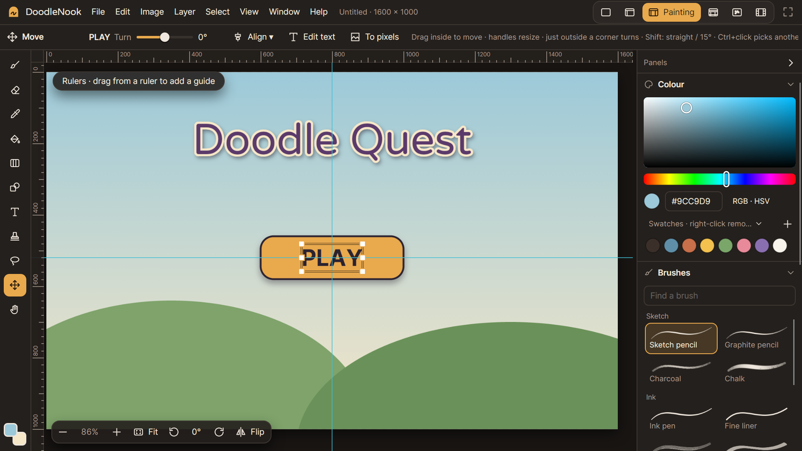
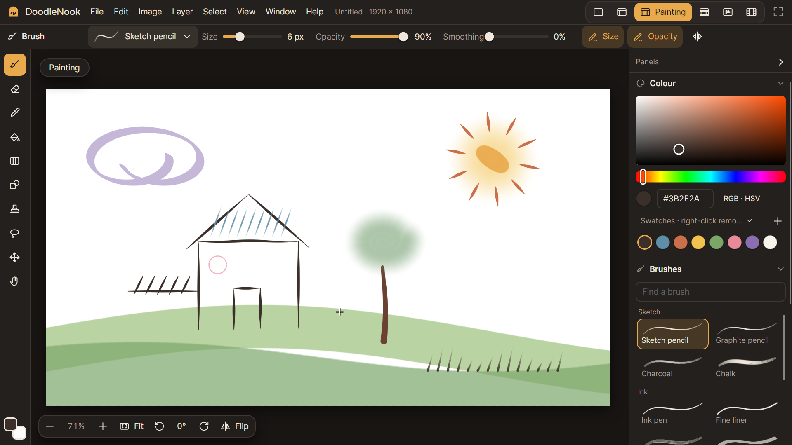
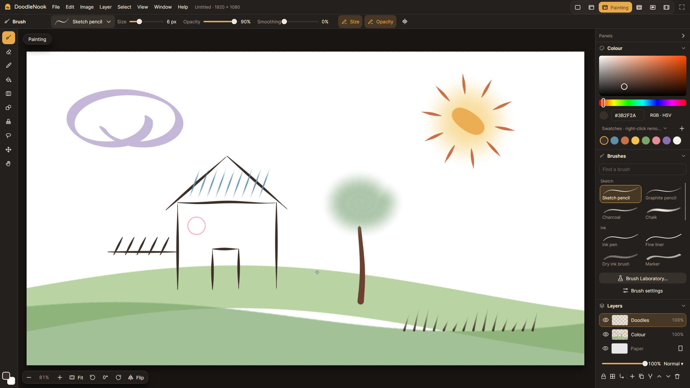
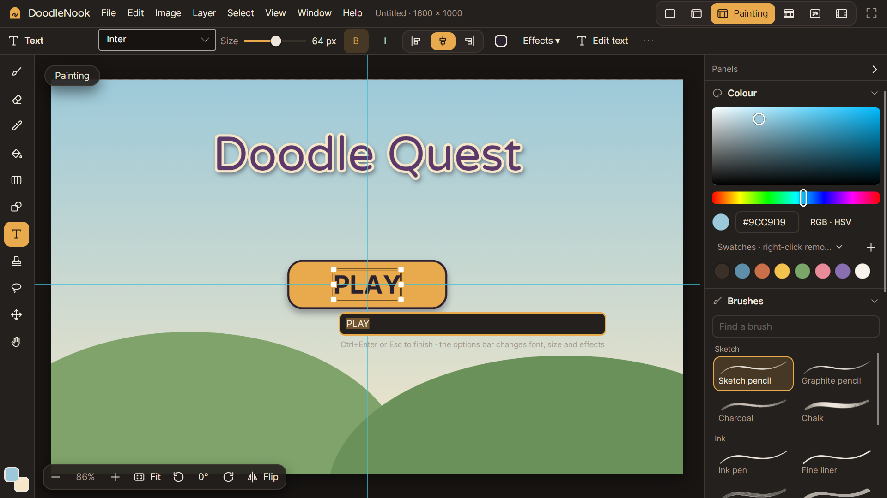
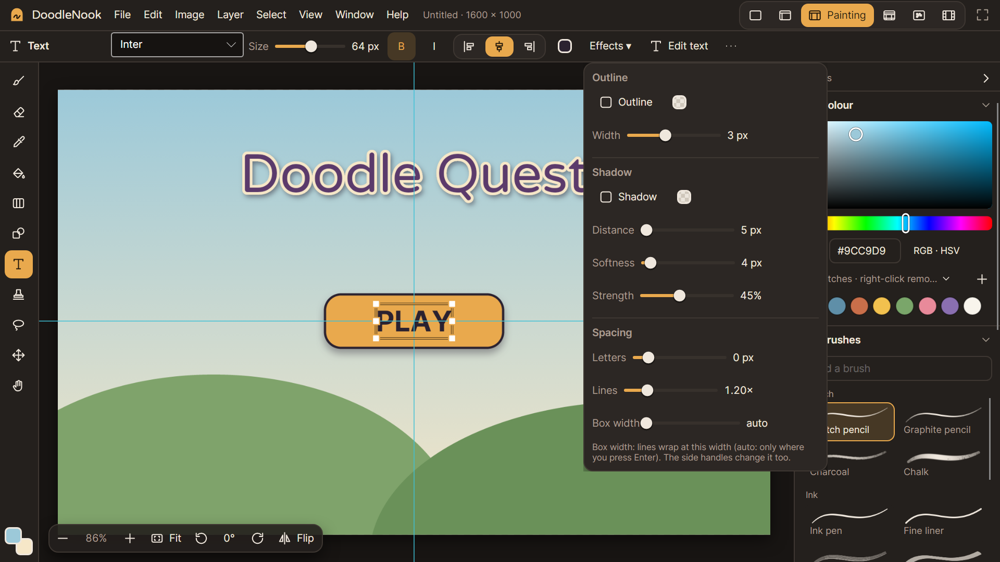
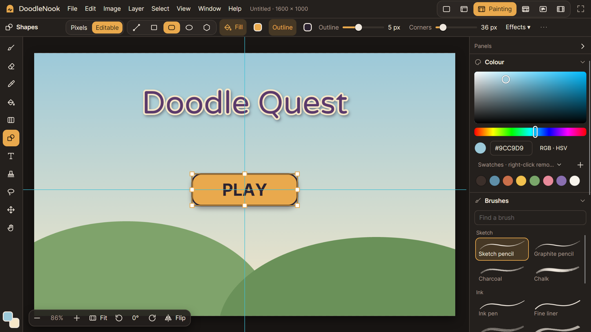
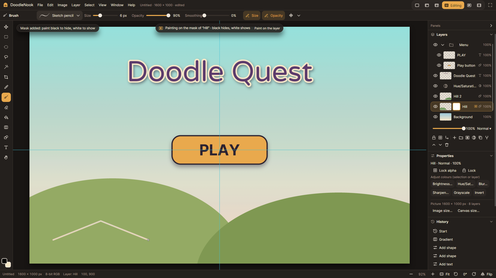
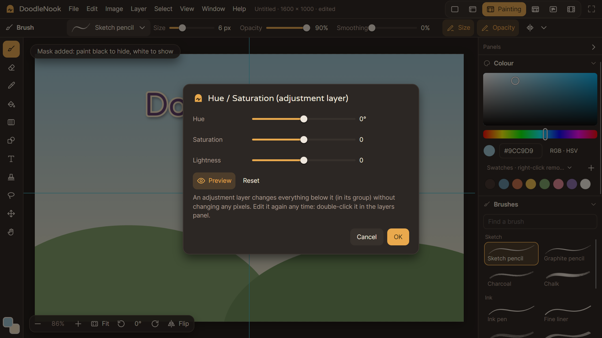
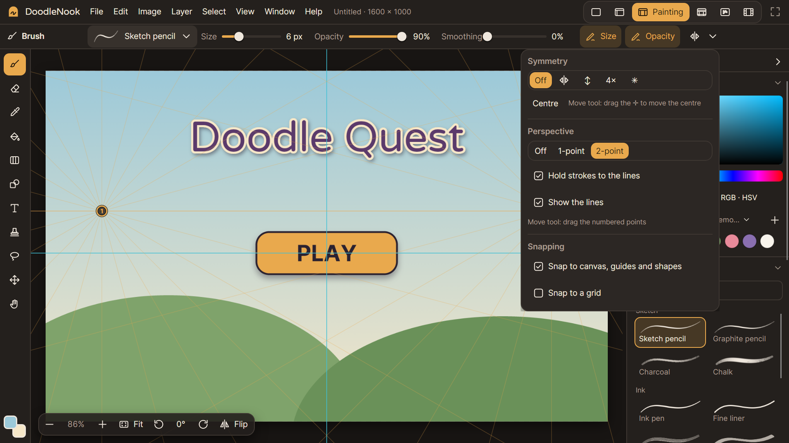

# Mission 008 — The Designer's Toolkit

Editable **text**, editable **shapes**, **layer groups**, **masks**, non-destructive **adjustment layers**, and
**drawing assistants** (rulers and guides, snapping, symmetry with a movable centre and radial symmetry, one- and
two-point perspective, Shift for straight lines). No new workspace: everything lives in the existing tools, the
layers panel, the options bar, pop-overs and menus. A new picture in a workspace you already use looks exactly as before.

**Status:** implementation complete. Verified by automated tests on Linux and on Windows CI, and by a smoke test of
the packaged `DoodleNook.exe`. **Awaiting your hands-on playtest** ([playtest guide](PLAYTEST.md)).
The Huion Kamvas 13 experience is still unverified.

This mission also adds **The Personal Tool Principle** to [`CLAUDE.md`](../../../CLAUDE.md) and to the
[interface philosophy](../../design/INTERFACE-PHILOSOPHY.md) (section 13 and checklist question 10): "Does this make
something the owner actually enjoys doing easier, or does it merely make DoodleNook bigger?"

## Download and run

1. Open the [Windows build runs for this branch](https://github.com/crosenlund79/DoodleNook/actions/workflows/windows-build.yml?query=branch%3Aiteration%2F008-designers-toolkit) and pick the newest green run. You must be signed in to GitHub to download artifacts.
2. Under **Artifacts**, download **DoodleNook-win-x64** (delivered as `DoodleNook-win-x64.zip`).
3. Extract it and double-click **`DoodleNook.exe`**. Nothing to install.
4. If Windows says "Windows protected your PC", click *More info → Run anyway*. The test build is unsigned.

## The toolkit at a glance



*A title screen made only with Mission 008 tools: the title is a text layer with an outline and a shadow, the button
is an editable rounded rectangle with a shadow, "PLAY" is centred on it, both are in a "Menu" group, the hills are
editable ellipses, and two guides come from the rulers. The Move tool shows the label's handles.*

Where everything lives, by the three access levels of the [interface philosophy](../../design/INTERFACE-PHILOSOPHY.md):

| Level | What's there |
|---|---|
| **1 · Visible** | The **Text** tool (T) in Painting and Editing. Three small buttons under the layers (new group, add mask, new adjustment layer ▾). A ▾ beside the mirror button. Nothing else is added to any workspace by default; rulers are hidden. |
| **2 · Contextual** | Text options (font, size, bold, italic, alignment, colour, *Effects ▾*) only with the Text tool or a chosen text. Shape options (*Pixels / Editable*, five shapes, fill, outline, corners, sides, *Effects ▾*) only with the Shapes tool. A chosen text or shape gets a frame with handles (Move tool) and *Turn*, *Align ▾*, *To pixels* in the options bar. Masks show as a second thumbnail; a chip on the canvas says when you paint on a mask. The drawing assistants pop-over. Right-click a layer for group, mask and adjustment commands. |
| **3 · Menus and optional** | *Layer › Group ▸, Mask ▸, New adjustment layer ▸, Text/Shape ▸*. *View › Rulers, Guides ▸, Snap, Drawing assistants…*. *Image › Levels…, Colour balance…* (destructive versions, the same dialogs). *Window › Customize workspace*: the Text tool in Quick Sketch, Pixel Art and Animation Studio. |

**The UI decision checklist** for the permanently visible additions:

| Control | Daily use? | In this workspace? | Elsewhere already? | Better as pop-over/menu? | Pinnable instead? | Drawing area | 13.3" at 150 % | Discoverable if hidden | Mission 003 look | Makes the owner's work easier? |
|---|---|---|---|---|---|---|---|---|---|---|
| Text tool (Painting, Editing) | Whenever lettering is needed: titles, labels, UI mock-ups | Yes: finished artwork and editing | No | No: it is a tool | Yes for the other workspaces (Customize) | None (tool strip) | One more tool button | T, tooltip, F1 | Same tool buttons | Yes: no more painting letters or importing text from elsewhere |
| Group / mask / adjustment buttons under the layers | Often in layered work | Where the layers panel is | Menus, right-click | The menus have them too | — | None (inside the panel) | The footer wraps to two rows | Tooltips, Layer menu | Same footer icons | Yes: the usual layered-work actions are one click |
| ▾ beside the mirror button | Only when setting up symmetry or perspective | Painting tools | View › Drawing assistants | It *opens* a pop-over | — | None (options bar) | 22 px | Tooltip, View menu | Same options-bar style | Yes: symmetry gets a centre and radial mode without a new panel |

Rulers, guides, snapping and perspective stay out of sight until asked for (View menu, Ctrl+R).

**The default screens.** With the same picture as Mission 007's screenshots, Painting differs only by the **T** in the
tool strip and the small ▾ beside the mirror button; Quick Sketch is unchanged:

| | Mission 008 | Mission 007 |
|---|---|---|
| Painting, Kamvas 13 at 150 % |  |  |
| Painting, 1920 × 1080 |  |  |

Quick Sketch: [Kamvas](screenshots/design-kamvas13-150-quick-sketch-default.png) ·
[1080p](screenshots/design-desktop1080-quick-sketch-default.png) · [2560 × 1440](screenshots/design-desktop27-quick-sketch-default.png).
The title screen at the three sizes: [2560 × 1440](screenshots/design-desktop27-menu.png) ·
[1920 × 1080](screenshots/design-desktop1080-menu.png) · [Kamvas 13 at 150 %](screenshots/design-kamvas13-150-menu.png).
From the real packaged window (smoke test, Windows-style fonts may differ): [smoke-J-design.png](screenshots/smoke-J-design.png).

## Text



- **Text tool (T).** Click to start typing; drag sideways first for a text box that wraps at that width. A small box
  opens under the text and the canvas follows every key; **Ctrl+Enter**, **Esc** or clicking elsewhere finishes. New text
  is **one undo step** ("Add text"); new text left empty disappears without a trace. Click existing text with the Text
  tool (or *Edit text* in the options bar) to change it: one "Edit text" step.
- **Options bar** (with the Text tool, or a chosen text): font, size, **B**old, *I*talic, alignment (left, centre, right),
  colour swatch (foreground colour or the colour dialog), *Effects ▾*, *Edit text* and ⋯ (centre on the canvas or the
  layer below, duplicate, convert to pixels). The settings change the chosen text and are remembered for the next text.
- **Effects ▾:** an outline (colour, width), a soft shadow (colour, distance, softness, strength), letter spacing, line
  spacing, and the box width lines wrap at (*auto*: only where you press Enter).
- **Move, scale, turn:** with the Move tool, drag inside to move, a corner handle to scale the lettering, a side handle
  to set the wrap width, and just outside a corner to turn (Shift: 15° steps). Opacity, visibility and blend mode are
  the layer's, as for any layer.
- **Fonts:** every font installed on the computer, plus Inter and Varela Round, which come with DoodleNook. When a
  picture uses a font that isn't installed, opening it says which text asks for which font and what it is shown in
  instead (Inter). The text keeps asking for its own font, so installing it later brings it back; the layers panel marks
  such text with a yellow ⓘ.
- **Text stays text.** It is saved as text (not pixels) and drawn again when opened. A brush can't paint on it (it says
  how to edit it, or to use *Layer › Text › Convert to pixels*).



## Editable shapes



- The **Shapes tool (U)** has a new switch in its options bar: **Pixels** (the shapes as before, painted into the layer)
  or **Editable** (each shape is a layer that stays a shape). The switch remembers your choice; Pixels is the default,
  so the tool behaves as before until you choose Editable. Choosing an existing editable shape shows its options
  whatever the switch says. Pixel Art keeps its pixel shape tools.
- **Five shapes:** line, rectangle, rounded rectangle, ellipse, polygon. Drag to draw (Shift: square, circle, or a line
  in 15° steps). Fill uses the foreground colour and the outline the background colour; afterwards each has its own
  swatch (foreground colour or the colour dialog). Outline width, corner radius, number of sides and a soft shadow
  (*Effects ▾*) can be changed at any time.
- **Handles** (Shapes or Move tool): move, resize from any corner or side (Shift keeps proportions), turn just outside a
  corner. Lines have a handle at each end. With the Move tool, the **arrow keys** nudge 1 px (Shift: 10 px). **Ctrl+J** duplicates.
  **Align ▾** lines it up with the canvas (left, centre, right, top, middle, bottom) or with the layer below (centre a
  label on its button). **Ctrl+click** with the Move tool picks the text or shape under the pointer.
- Each drag, setting or alignment is **one undo step**. Drawing a new shape is one step even though it previews live.

## Groups

- **Ctrl+G** puts the chosen layer in a new group (the folder button under the layers makes an empty one). **Drag** a
  layer onto a group's row to put it inside (on top), or between rows to place it. **Ctrl+Shift+G** ungroups. *Layer ›
  Group ▸ Move out of group*. Groups can be nested.
- The group row has a fold arrow, a name (double-click to rename), visibility, opacity and blend mode (the footer), like
  any layer. Hiding or fading a group hides or fades everything inside it as one; its blend mode applies to the group's
  combined result.
- **Ctrl+[ / Ctrl+]** move a layer among the layers of its own group. Merge down works within a group; a group itself
  can't be merged down. Duplicating or deleting a group includes everything inside it. Each change is one undo step.

## Masks



- **Add mask** (the mask button under the layers, *Layer › Mask ▸*, or right-click a layer). With a selection, the
  button makes the mask from the selection (*Mask from selection*).
- **Painting a mask:** black hides, white shows, the eraser shows again, grey and soft brushes partly hide. Nothing is
  erased: the layer's pixels stay as they were.
- **Which one you paint on** is always clear: the thumbnail you paint on has the accent ring, a mask symbol appears after
  the layer's name, and a chip at the top of the canvas says "Painting on the mask of …" with a button to go back.
  Click the layer thumbnail to paint on the layer, the mask thumbnail to paint on the mask.
- **Shift+click** the mask thumbnail turns the mask off and on (a red ✕ while off). *Invert mask*, *Apply mask* (makes the
  hiding permanent; pixel layers) and *Delete mask* are in the menus. Every change is undoable.
- Masks work on pixel layers, text, shapes, groups and adjustment layers (on an adjustment layer, the mask says where it
  applies).

## Adjustment layers



- **Brightness / Contrast, Hue / Saturation, Levels and Colour balance**, from the ◐ button under the layers or *Layer ›
  New adjustment layer ▸*. The settings dialog previews live; Cancel removes the layer again.
- An adjustment layer changes **everything below it in its group** (or the whole picture at the top level) without
  changing any pixels. Its opacity and mask say how much and where. Double-click its symbol in the layers panel (or
  *Layer › Edit adjustment…*) to change it again; it is saved with the picture.
- *Image › Levels…* (Ctrl+L) and *Image › Colour balance…* (Ctrl+B) are the same adjustments applied to the pixels.

## Drawing assistants



- **Rulers** (*View › Rulers*, Ctrl+R; hidden by default) show picture pixels along the top and left. **Drag from a
  ruler** onto the picture for a guide: the top ruler gives horizontal guides, the left one vertical.
- **Guides:** move them with the Move tool; drag one off the picture to remove it. *View › Guides ▸* shows or hides them
  (Ctrl+;), locks them, or clears them. Guides are saved with the picture and **never exported**. Adding, moving and
  removing a guide are undoable.
- **Snapping** (*View › Snap*, Ctrl+Shift+;, on by default): moving text and shapes, drawing shapes and dragging guides
  stick to the canvas edges and centre, guides, and the edges and centres of other text and shapes (a pink line shows
  what it stuck to). An optional grid of any size can be added in the assistants pop-over. Brush strokes are never
  snapped.
- **The drawing assistants pop-over** (the ▾ beside the mirror button, or *View › Drawing assistants…*):
  - **Symmetry:** off, ↔, ↕, both, or **radial** (2–16 repeats around the centre). The centre is shown as ✛ while a
    painting tool is chosen; drag it with the **Move tool** anywhere on the picture, *Centre* puts it back. With the
    centre in the middle, mirroring is pixel-for-pixel identical to Mission 007.
  - **Perspective:** off, one-point or two-point. Faint lines fan out from the numbered vanishing points (drag them with
    the Move tool). With *Hold strokes to the lines*, a brush stroke waits for a little movement, then follows the
    perspective line nearest its direction (towards a vanishing point, vertical, or for one-point also horizontal).
  - **Snapping** on/off and the grid.
- **Straight lines:** hold **Shift** while dragging a brush or eraser stroke for a straight line (Ctrl as well: 15°
  steps). **Shift+click** draws a straight line from where the last stroke ended.

## Animation

Text, shapes, groups and adjustment layers are **the same on every frame**: the timeline shows them as a thin bar
across the frames. Frame timing, holds and drawings are untouched (workflow E checks frame by frame that removing an
added title gives back the original frames exactly). In Animation Studio, the Text tool is one tick away in *Customize
workspace*. Merging text or a shape down onto an animation layer merges it into every drawing of that layer.

## Palette Lock

Everything keeps to a locked palette, with transparency untouched: text and shapes are drawn in the nearest palette
colour (their soft edges keep their alpha), adjustment-layer results are snapped to the palette, and *Remap to palette*
also changes the colours text and shapes ask for. Unlocking draws them in their own colours again. (Workflow D.)

## Files: `.dnk` version 4

- A picture is saved in **version 4** only when it uses something from this mission (groups, masks, text, shapes,
  adjustment layers, guides or perspective). Everything else is written exactly as before (version 1, 2 or 3), so older
  DoodleNook builds keep opening those. Mission 007 builds refuse a version 4 file with a clear message instead of
  dropping its text or groups silently.
- New in version 4, inside the ZIP's `document.json`: each layer's `kind`, `parent` (the group), `collapsed`,
  `maskEnabled`, and its `text`, `shape` or `adjustment` description; `masks/mask-NNN.png` (white shows); `guides`,
  `guidesLocked` and `perspective`. Text and shapes are stored as descriptions and drawn again when opened.
- Ctrl+S never flattens text, shapes, masks or guides into a PNG: such a picture goes to *Save as* a `.dnk`, as layered
  pictures already did.
- Whole-picture operations (image size, canvas size, crop, rotate, flip) move masks and editable content with the
  picture (text stays readable when the picture is flipped), as one undo step.

## A bug fixed on the way

**Brightness / Contrast and Hue / Saturation did almost nothing** (since Mission 005). Their sliders showed −100 to +100
but passed −1 to +1 to an engine that expects −100 to +100, so "+100 brightness" brightened by half a percent. The
shared adjustment dialog now passes the right units. A regression test drags the brightness slider to its end and checks
that a mid grey becomes light.

Two problems were found and fixed while checking this mission's own screenshots: adding an adjustment layer did not
refresh the picture on screen until something else redrew it (exports were right), and finishing the text editor
straight after typing could miss the last key press. A new engine test now checks, after each of 14 operations and
their undo and redo, that the screen shows exactly what an export would.

## Architecture

| Part | Where | What it does |
|---|---|---|
| Layer kinds and content | `Engine/Documents/LayerContent.cs`, `Layer.cs` | `LayerKind` (raster, group, text, shape, adjustment); immutable `TextContent`, `ShapeContent`, `AdjustmentContent`; masks; groups by `ParentId` in the one flat layer list |
| Compositor | `Engine/Documents/Compositor.cs` | Recursive per group (each group composites into a pooled buffer of the changed area), masks, adjustment layers with a small colour cache, palette conformance |
| Document operations | `Engine/Documents/Document.Design.cs` | Groups, masks, text/shape/adjustment layers, content changes with live preview and one undo step, guides, perspective, align, version 4 loading |
| Editable shapes | `Engine/Operations/ShapeRasterizer.cs` | Signed-distance shapes, 4 × 4 supersampling only along edges, shadows |
| Assistants | `Engine/Geometry/Assistants.cs` | Snapping, perspective lines, straight lines, alignment |
| Symmetry | `Engine/Painting/StrokeEngine.cs`, `PixelStroke.cs` | Movable centre (`2·origin − x`) and radial repeats |
| Text drawing | `App/Canvas/SkiaTextRenderer.cs` | Skia with the system's fonts (the engine stays .NET-only: it calls an `ITextRenderer`) |
| Interaction | `App/Input/CanvasInputController.Design.cs` | Handles, Text tool, new shapes, guides, assistant handles, perspective-held strokes, Shift lines |
| Interface | `App/Shell/OptionsBar.Design.cs`, `LayersPanel.Design.cs`, `TextEditorOverlay.cs`, `Rulers.cs`, `AssistantsPanel.cs`, `MainWindow.Design.cs` | The options, layers panel, text box, rulers, pop-over, menus |

## Measured performance

Engine only (no screen drawing), Release build. The "designed" picture has six painted layers, three of them in a
group at 90 % with a mask on one, a Hue/Saturation adjustment layer over everything, and an editable shape with a shadow;
the brush paints inside the group. Pen event = 2 coalesced samples of a fast 2000 px curve, compositing included.

| | plain picture | with group, mask, adjustment layer |
|---|---|---|
| Pen event, 1920 × 1080 (Linux, 4 cores) | 0.05 ms | 0.12–0.28 ms |
| Pen event, 2560 × 1440 (Linux, 4 cores) | 0.09 ms | 0.11–0.18 ms |
| Whole-picture composite, 1920 × 1080 | 51–74 ms | 101 ms |
| Whole-picture composite, 2560 × 1440 | 85–103 ms | 183 ms |
| Dragging an editable shape (one step) | — | 14–24 ms (1080p), 22–31 ms (1440p) |

Painting stays far below a frame (16 ms) in both. The whole-picture composite (used when a layer's opacity, visibility
or order changes) costs about 1.4–1.8 × with an adjustment layer; a small colour cache brought this down from 3.4 ×.
Windows CI numbers: see *Verification*.

## Verification

See the completion report in the conversation for the Windows CI run, the artifact check and the test counts; this
section is filled in when the final run is green.

## Known limitations

- **Text is smooth (anti-aliased)**, also in Pixel Art; there are no pixel fonts. Under Palette Lock its soft edges keep
  their alpha in palette colours.
- **Text is typed in a small box under the text**, not directly on the canvas with a caret; formatting applies to the
  whole text layer (no mixed fonts or colours within one text).
- **One layer is chosen at a time** in the layers panel: group a layer, then drag others onto the group. Align lines up
  with the canvas or with the layer below (enough for a label on its button), not with several chosen layers.
- **Flipping the whole picture** moves text to its mirrored place but keeps it readable instead of mirroring the letters.
- **Rulers follow the unrotated picture**: with the view rotated, their numbers are approximate.
- The adjustment-layer dialog dims the canvas behind it (like the other adjustment dialogs), so the live preview is seen
  through the dimming.
- **Copy and paste** copy pixels (Paste makes a pixel layer), also from text and shapes.
- Perspective has one and two vanishing points; no three-point or curved perspective.

## Not included (deliberately)

Per the Personal Tool Principle: text on a path, vertical text, rich text, layer styles beyond outline and shadow,
smart objects, vector paths with Bézier editing, three-point perspective, clipping groups, multi-layer selection. Each
would make DoodleNook bigger without making the owner's current work clearly easier; any of them can be reconsidered
after the playtest.

## Fine-tuning opportunities for the playtest

- Default font size (48 px) and font (Inter) for new text; whether new text should take the background colour for its
  outline.
- Whether the Shapes tool should default to *Editable* in Painting (it starts on *Pixels* to keep Mission 007 behaviour).
- The size of the handles (10 view units) and the turn zone outside the corners (30 view units) on the Kamvas.
- Snapping distance (6 view units) and whether snapping should start on or off.
- How much movement the perspective assistant waits for before choosing a line (10 view units).

## Building from source

```bash
dotnet test DoodleNook.slnx
```

Screenshots: `tests/DoodleNook.App.Tests/out/screenshots/design-*.png` (DesignScreenshots). Measurements:
`tests/DoodleNook.Engine.Tests/out/design-performance.json` (DesignPerformanceTests).
