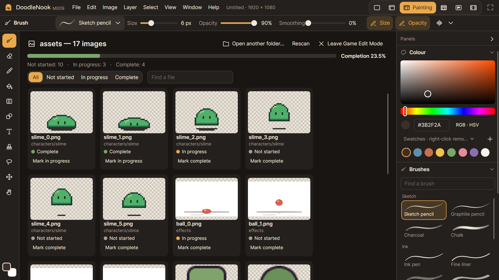

# Mission 009 — Game Edit Mode

A simple way to replace the graphics of a game: choose the game's graphics folder, browse its PNGs, edit one in the
normal workspaces, and **Ctrl+S** saves an editable `.dnk` and replaces the game's PNG in place. DoodleNook tracks
which images are untouched, in progress, or explicitly complete. No new workspace; when Game Edit Mode isn't in use,
DoodleNook is exactly as before.

**Status:** implementation complete, verified by automated tests on Linux and Windows CI and a smoke test of the
packaged `DoodleNook.exe`. Awaiting your playtest ([PLAYTEST.md](PLAYTEST.md)). Pen use with the Kamvas is unverified.



## Using it

1. **File › Game Edit Mode…** and choose the folder with your game's graphics. The first time, DoodleNook says how many
   PNGs it found and offers **Back up original PNG files before replacing them** (on by default). The folder is
   remembered: next time *Game Edit Mode…* opens it straight away; *Open another folder…* in the catalog changes it.
2. **The catalog** shows every PNG in the folder and its subfolders: thumbnail, file name, folder, status and a
   *Mark complete* / *Mark in progress* button. At the top: the folder name and image count, a progress bar,
   *Completion* (complete ÷ all × 100), the three counts, filters (*All, Not started, In progress, Complete*) and
   *Find a file*. *Rescan* picks up added or removed files.
3. **Click an image** to edit it with everything DoodleNook has (brushes, layers, selections, palettes and Palette Lock,
   text, shapes, masks, adjustments, undo). If it has an editable `.dnk` from an earlier session, that opens, with its
   layers; otherwise the PNG opens as a new picture. Unsaved changes get the usual *Save / Don't save / Cancel* question.
4. A small chip at the top right shows **`player.png — In progress`** with **Mark complete** and **Catalog** (Esc in the
   catalog goes back to the image).
5. **Ctrl+S** saves both (below). *Leave Game Edit Mode* in the catalog returns Ctrl+S to its usual behaviour.

The window title now shows the milestone: **DoodleNook — M009**, and with a picture **DoodleNook — M009 — player.dnk**
(one value in `Directory.Build.props`; also shown small next to the DoodleNook name in the menu bar).

## Saving: the `.dnk`, then the PNG

For `assets/characters/player.png`, Ctrl+S:

1. saves the editable document as `assets/_DoodleNook/characters/player.dnk` (the usual safe save: a temporary file,
   then replace);
2. if backups are on and this image has none yet, copies the original PNG's exact bytes to
   `assets/_DoodleNook/Originals/characters/player.png`. An existing backup is **never** overwritten;
3. writes the flattened picture as a PNG (transparency kept, the picture's current size) to a temporary file and
   replaces `assets/characters/player.png` with it;
4. only then records the save: *Not started* becomes *In progress*.

No dialog appears for an ordinary save. If step 2 or 3 fails, the game's PNG is left untouched, the status doesn't
change, and DoodleNook says what happened with **Try again** (the `.dnk` is already safe; the chip shows *PNG not
updated* with *Try again* until it works). If the backup is on but can't be made, the PNG is not replaced.

**Changed elsewhere:** DoodleNook remembers each PNG as it last wrote it. If another program changed it since, saving
asks first (*Replace the PNG* / *Save my editable version only* / *Cancel*), and opening an image whose `.dnk` is older
than that change asks whether to open the editable version or the changed PNG. An unreadable `.dnk` is reported and the
PNG can be opened instead (the broken file is only replaced when you save).

## Progress

| Status | Means |
|---|---|
| **Not started** | Not yet saved in Game Edit Mode. Opening or looking doesn't change this. |
| **In progress** | Saved (both files) at least once. More saves keep it here. |
| **Complete** | You chose *Mark complete*. Saving keeps it complete; *Mark in progress* reopens it. |

The progress bar and percentage count only images marked complete. Everything is kept in
`assets/_DoodleNook/catalog.json` (statuses, the backup choice, and the size and time of each PNG as DoodleNook last
wrote it). A rescan adds new PNGs as *Not started*, keeps every other status, and stops counting files that are gone
(their status is kept in case they come back). If `catalog.json` can't be read, it is kept aside and a fresh one is started.

## The working folder

```
assets/                      ← the folder you chose
  characters/player.png      ← replaced in place by Ctrl+S
  _DoodleNook/               ← never scanned, never in the catalog
    catalog.json
    characters/player.dnk    ← your editable version
    Originals/characters/player.png   ← the untouched original (when backups are on)
```

## Verification

| | |
|---|---|
| Game Edit tests | 9 window and file tests + 1 screenshot run: recursive discovery, relative paths, `_DoodleNook` skipped, opening a tile, the `.dnk` and the PNG written (size, transparency, pixels), the backup made once and never overwritten, Not started → In progress on a complete save only, Mark complete / Mark in progress, saving a complete image keeps it complete, progress %, statuses after reopening and rescans, reopening a `.dnk` with its layers, the unsaved-changes question, a failed backup leaving the PNG and status alone and *Try again*, a PNG changed elsewhere, an unreadable `.dnk`, filters and search, the remembered folder, the window title |
| All suites | see the completion report (engine and app tests on Windows CI) |
| Smoke test (packaged exe on Windows) | 4 new checks: subfolder discovery, Ctrl+S writes the `.dnk` and replaces the PNG (size, transparency, pixels), the byte-exact backup and *In progress*, the milestone in the title |

## Known limitations

- PNG only. Animated pictures are saved as their current frame.
- The catalog loads all thumbnails in the background; with thousands of images it may take a while to fill in, and the
  tiles aren't virtualised.
- "Changed elsewhere" compares the PNG's size and time with DoodleNook's last write; a change that keeps both identical
  isn't noticed.
- The catalog covers the canvas only; the workspace's panels stay at the side.
- Thumbnails show the game's PNG (the result), not the layered `.dnk`.

## Ideas noticed, not built

A keyboard shortcut for *Mark complete*; *Next image* from the chip; sorting by status or date; showing which images
have a `.dnk`.
