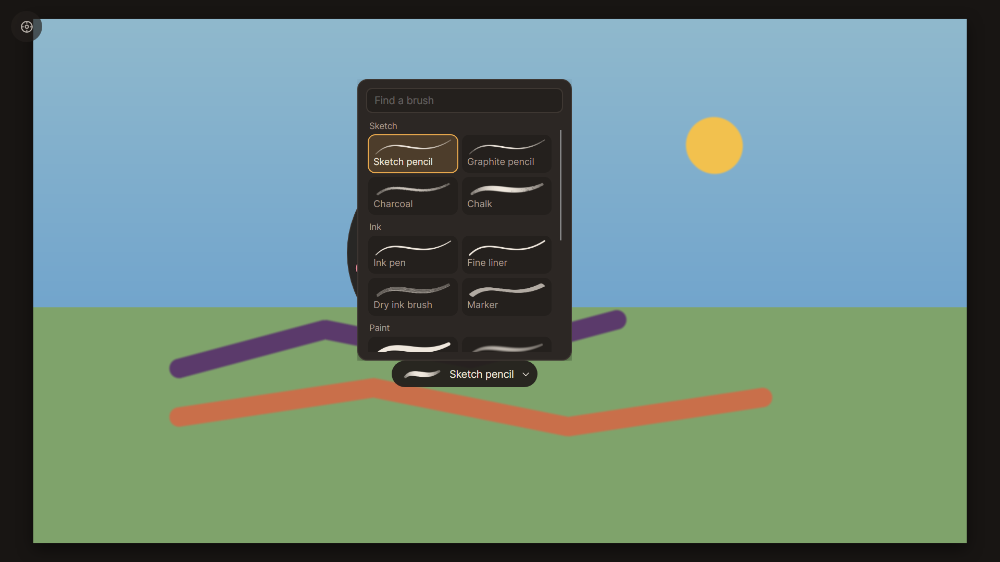
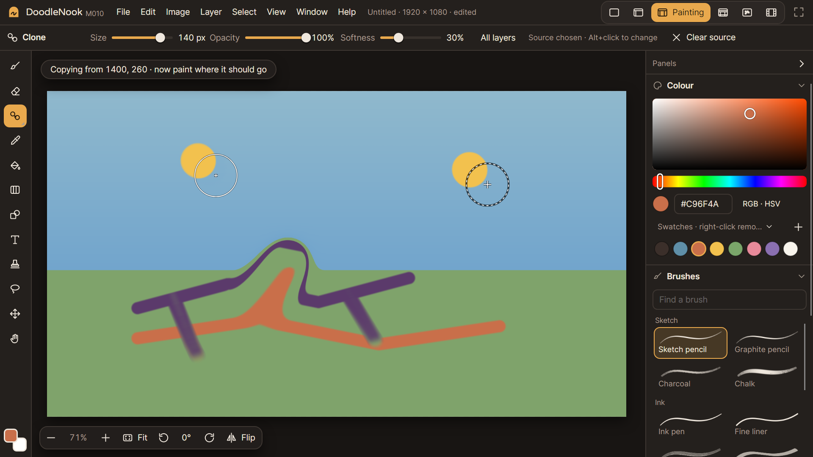
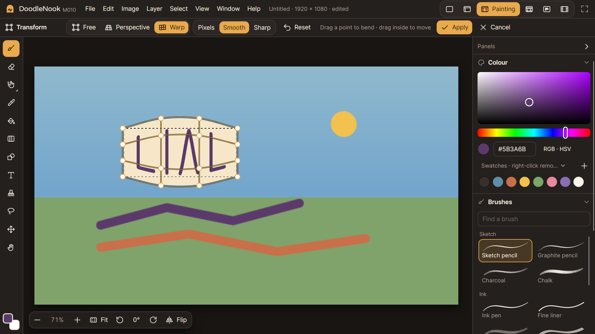
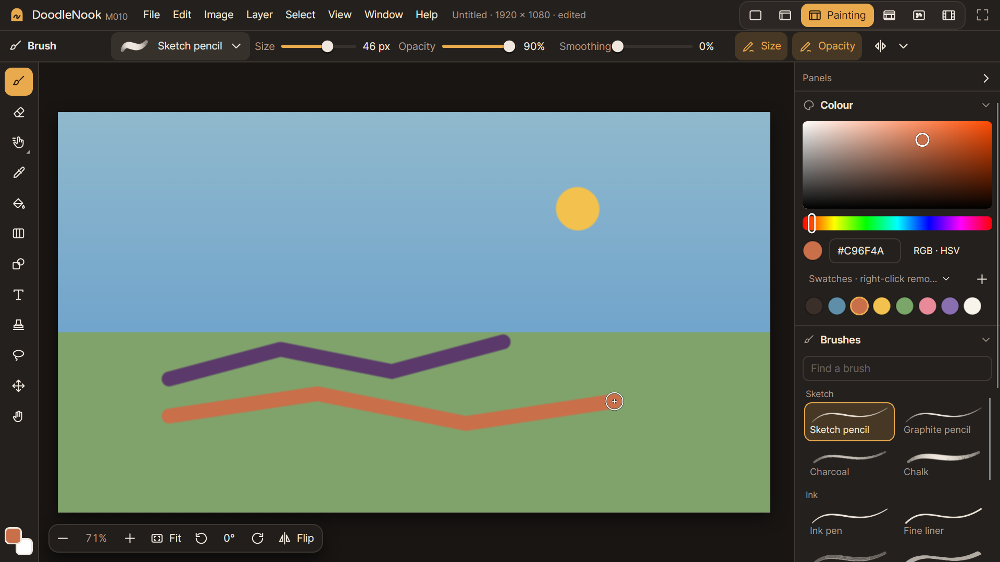

# Mission 010 — The Finishing Touches

Reshape. Blend. Repair. Refine. Five tools for improving artwork that already exists, built into the existing drawing
engine, with no new workspace: the quick palette's brush sizing and brush choice, Smudge, Clone and Repair, Liquify,
and Perspective and Warp transforms.

**Status:** implemented and verified by automated tests on Linux and Windows CI and a smoke test of the packaged
`DoodleNook.exe`. Awaiting your playtest ([PLAYTEST.md](PLAYTEST.md)). Pen feel on the Kamvas 13 is unverified: every
test used a mouse or simulated input.

## 1. The quick palette (the Alt+1 wheel)

The wheel (right-click or the pen's button; Pure Sketch's whole interface) looks as before, with two improvements.

**Brush size.** The old centre rebuilt the whole wheel on every size change, which dropped the drag as soon as the
pointer left the small centre. Now:

- Press the centre and drag: right or up is bigger, left or down smaller.
- Short moves fine-tune (15 view units ≈ +8 %), and long drags change a lot (300 units ≈ ×10). Shift is four times
  finer, and the mouse wheel steps.
- A small wobble (under 3 units) changes nothing.
- The centre shows the number and a dot of the brush's on-screen size. Once larger, the real size is drawn on the
  canvas around the wheel.
- The drag keeps working well outside the wheel. Pixel sizes move in whole pixels.

**Choosing a brush.** A pill under the wheel shows the current brush. Tapping it opens a compact picker: *Recent* (the
last brushes used), your favourites, then every brush including your own Brush Laboratory brushes, with search.
Choosing one keeps the wheel open, so the flow is wheel → brush → size → draw.

**Each brush keeps its size.** Switching brushes (in the wheel or the dock) remembers the size the brush you leave was
at; coming back restores it. A brush's first use takes its preset size; its other preset settings never change.
Recent brushes and sizes survive restarts.

Wheel controls don't take keyboard focus. Near the edges the wheel and pill stay fully on screen (tested in all four
corners).

## 2. Smudge, Clone and Repair

One button in the **Painting** and **Editing** tool strips, under the eraser, shows the group's last-used tool.
Right-click it (or use the pen button) to list all three; the small corner mark says there is more. Shortcuts:
**Shift+B** Smudge, **Shift+S** Clone, **J** Repair. Quick Sketch and Animation Studio can add the button through
*Customize workspace*; Pixel Art doesn't offer it.

All three use the painting path:

- **Dab spacing:** dabs sit at a fixed spacing along the gesture, so the result follows the stroke, not the number of
  events Windows delivers. Tests compare 3 events with 100.
- **Undo:** each stroke is one undo step.
- **Where they work:** on the active layer, its mask, or the current animation drawing.
- **Locks and selections:** a selection limits them, a transparency-locked layer keeps its shape, and a palette-locked
  picture keeps only its palette colours (alpha free).

- **Smudge:**
  - A small buffer of *carried paint* moves with the brush. Each dab mixes the canvas toward it, and it picks up what
    it passes over.
  - *Strength* is how far paint travels; *Softness* sets the edge; *Finger painting* starts each smear with the
    foreground colour.
  - Pen pressure lightens it.
  - It is not a blur: colour is physically carried along.
- **Clone:**
  - **Alt+click** where to copy from (the cursor becomes a crosshair), then paint. The offset is fixed by the first
    stroke and kept for later strokes (aligned).
  - It copies whole pixels, so no resampling blur. It copies the layer as it was before the stroke, so overlapping a
    source doesn't repeat itself.
  - *All layers* copies what you see instead.
  - A dashed ring with a cross shows the source, moving with the brush.
  - Without a source, a hint says to Alt+click first.
  - The bar offers *Opacity*, *Softness*, *All layers* and *Clear source*.
- **Repair:**
  - *Surroundings* (the default) fills the painted spot smoothly from the colours around it: specks, marks, small gaps.
  - *Source* (or simply Alt+click) brings in another area's texture, matched to the colours around the spot.
  - It uses a small pull-push interpolation (a pyramid of averages), not content-aware generation.

## 3. Liquify

**Edit › Liquify…** (Ctrl+Shift+X) turns the canvas into Liquify. Dragging reshapes, and the options bar swaps in
Liquify's controls:

- **Modes:** Push, Inflate, Pinch, Twirl, Smooth and Restore (icons with names in their tooltips).
- **Sliders:** Size, Strength, Softness.
- **Buttons:** Reset, Cancel, Apply.

Keys:

- **Enter** applies the whole session as **one undo step**; **Esc** cancels and leaves the layer exactly as it was.
- **Ctrl+Z** takes back the last Liquify stroke.
- **Alt** reverses: twirl anticlockwise, inflate ↔ pinch.
- **[ ]** and right-drag size the brush; the outline shows the Liquify brush.
- Choosing another tool or saving applies it, like a free transform.

How it works:

- **The model:** the layer's pixels are copied once as a stable source, and the reshaping is a displacement field.
  The field is stored in 64 px tiles only where the brush has been, and each dab composes its move with what is
  already there.
- **Drawing:** only the dab's area is drawn again, from the original. There's no repeated resampling and no blur that
  builds up.
- **Pen resting:** Inflate, Pinch, Twirl, Smooth and Restore keep working at a steady rate (every 30 ms) while the pen
  rests.
- **Sampling:**
  - Painted artwork is sampled bilinearly.
  - Pixel art takes exact pixels.
  - A palette-locked picture takes colour from the nearest pixel and smooths only transparency, so edges stay soft
    and colours stay in the palette.
- **Target:** the active layer, its mask, or the current drawing (a held drawing changes in every frame it's held, as
  with painting). Selections limit it, and a transparency lock keeps the shape.
- **Text and shapes:** these are only liquified after you agree to turn them into pixels.

## 4. Perspective and Warp

These are modes of the existing free transform, so it keeps the same conventions: Ctrl+T, Enter applies, Esc cancels,
and Apply is one undo step.

**Where:** the transform bar has **Free / Perspective / Warp**, and **Edit › Perspective** and **Edit › Warp** start a
transform in that mode.

- **Perspective:**
  - Drag the four corners; drag inside to move.
  - Crossed or flat corners are refused, and the picture stays as it was.
  - Exact four-corner projective mapping (a full 3 × 3 homography, so a vanishing line through the origin works too).
- **Warp:**
  - A 4 × 4 grid of points; drag one and the picture bends smoothly with it (a Catmull-Rom surface drawn as small
    triangles). An untouched grid changes nothing.
  - Drag inside to move. *Reset* straightens the grid again.

Both modes:

- **Dragging:** a quick draft preview (nearest pixels, about a quarter of a million samples at most) while a handle
  is dragged, and the real preview when it is let go.
- **Selection:** follows the new shape.
- **Pixel art:** exact (nearest pixels).
- **Locked palette:** kept in the preview and on Apply.

## Measurements (Windows CI, Release, engine only)

These come from `FinishingTouchesPerformanceTests` (results in `tests/DoodleNook.Engine.Tests/out/finishing-performance.json`, CI run
#26). Each picture has six painted layers.

- **Pen events:** a pen event is 2 coalesced samples of a fast curve across the picture.
- **Liquify moves:** one Liquify event is one move of a 200-move curve.

| | 1920 × 1080 | 2560 × 1440 |
|---|---|---|
| Smudge 40 px / 150 px, per pen event (max) | 0.78 (1.2) / 1.9 (4.3) ms | 0.71 (1.4) / 2.4 (3.9) ms |
| Clone 60 px, per event (max) | 0.25 (3.6) ms | 0.21 (0.3) ms |
| Clone *All layers*: composite copied at stroke start | 26 ms (engine flatten; the app copies the on-screen composite) | 49 ms |
| Repair 24 px, surroundings / 60 px with a source, per event | 0.31 / 1.9 ms; stroke end 0.3 / 0.6 ms | 0.28 / 1.9 ms; end 0.6 / 0.8 ms |
| Liquify Push 150 px, per move (max) | 1.0 (14) ms | 1.2 (2.9) ms |
| Liquify Push 400 px, per move (max) | 2.4 (14) ms | 3.2 (14) ms |
| Liquify Inflate while resting, per 30 ms tick: 150 / 400 px | 1.3 / 8.7 ms | 1.2 / 8.4 ms |
| Liquify memory: displacement field after a stroke across the picture (150 / 400 px) + one copy of the layer | 5.2 / 10.6 MB + 7.9 MB | 6.8 / 14.2 MB + 14.1 MB |
| Liquify Apply / Cancel | 3.3 / 31 ms | 1.2 / 46 ms |
| Perspective, 800 × 500 selection: dragging / let go / Apply | 8.8 / 14 / 28 ms | 8.3 / 13 / 27 ms |
| Warp, 800 × 500 selection: dragging / let go / Apply | 11 / 18 / 28 ms | 9.1 / 16 / 27 ms |
| Perspective, whole layer: dragging / let go / Apply | 43 / 73 / 121 ms | 70 / 128 / 218 ms |
| Warp, whole layer: dragging / let go / Apply | 43 / 83 / 121 ms | 73 / 146 / 218 ms |

The working copies (layer copy and field) are released when Liquify is applied or cancelled. Whole-layer transforms
also redraw the whole picture under the moving pixels on every update, as the free transform already did.

## Compatibility

| | |
|---|---|
| Layers, masks, selections | All tools work on the active layer or its mask (Liquify and the brushes through the same `LayerEdit` as painting); selections limit them; locked, hidden and group layers are refused with a message. |
| Animation | The current drawing only; a held drawing changes in every frame it is held (as with painting); frame timing untouched. Tested on a held drawing and an independent copy. |
| Palette Lock | Brushes: every committed pixel is conformed (alpha free). Liquify: nearest colour, smoothed transparency. Transforms: the preview and Apply keep to the palette. Tested by exporting after smudge, clone, liquify and warp. |
| Game Edit Mode | Tested: open a game image, Liquify and Smudge, Ctrl+S: the `.dnk` and the PNG are written, the original backed up, the image In progress (not Complete). |
| Documents | No `.dnk` format change: every result is ordinary pixels. Existing documents open as before. |

## Interface

The default workspaces changed by one tool-strip button in Painting and Editing (the retouch group). Everything else is
contextual:

- Liquify's bar appears only while Liquify runs, and Perspective / Warp only while transforming.
- The source controls appear only with Clone and Repair.
- The brush pill sits on the wheel.

Menus (Edit › Liquify…, Perspective, Warp), tooltips and *Keyboard shortcuts* (F1) list everything.

## Verification

| | |
|---|---|
| Engine tests (new) | Retouch 11 (smudge carry and strength, independence from input rate, transparency, finger painting, selection, palette lock; clone offsets, no feedback, edges, all layers, selection, transparency lock; repair from surroundings and with a source; pull-push), Liquify 7 (push, input rate, inflate/pinch/twirl, restore/reset/cancel, selection and transparency lock, pixel art and palette, text and locked layers), Perspective/Warp 5, animation 1, measurements 1 |
| App tests (new) | Quick palette 4 (drag curve, drag beyond the wheel without rebuild, edges and focus, brushes and size memory incl. restarts), retouch 4, Liquify 3, transform modes 2, workflows F and G 2, screenshots 3 |
| All suites, Windows CI run #26 (Release) | engine **276 / 276**, app **173 / 173** |
| Smoke test of the packaged `DoodleNook.exe` on Windows | **63 / 63** (58 before + Smudge, Clone, Liquify, Perspective, brush size memory); title "DoodleNook — M010" |

## Known limitations

- The Huion pen is untested: pressure lightens Smudge, Clone and Liquify, but how that feels is for your playtest.
- Liquify has no mesh view or freeze mask. With very large brushes (400 px on 2560 × 1440), a resting Inflate dab
  costs about 9 ms.
- Repair is deliberately simple. Without a source it fills smoothly from the surroundings, so on strong textures a
  source (Alt+click) works better. It is not content-aware fill.
- Clone and Repair offsets are whole pixels. There is no scaling, rotating or "sample current and below" mode.
- Warp has one fixed 4 × 4 grid; Perspective and Warp are for raster pixels (text and shapes keep their own handles).
- Whole-layer transforms of a 2560 × 1440 picture redraw the picture on each update (about 70 ms while dragging).
- Smudge, Clone and Repair aren't in Pixel Art (Liquify and the transforms are, pixel-exact).
