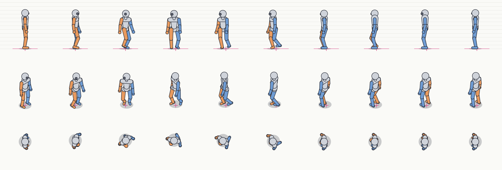
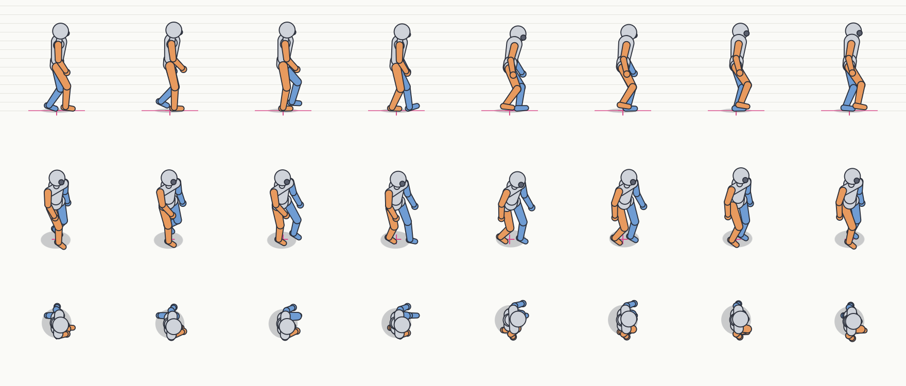
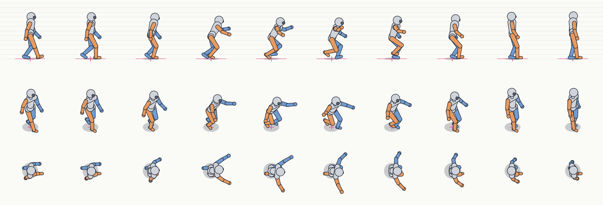
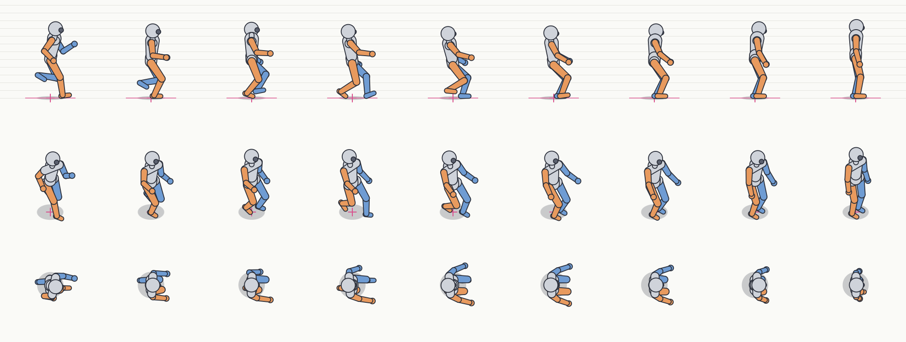

# Animation Reference Library: Expansion Pack 1

Purposeful movement, emotion and body language, and transitions between the cycles: 15 references in the same
library, with the same mannequin and the same rules as the refined cycles ([NATURAL-MOTION.md](NATURAL-MOTION.md)).
Feet stay where they stand, hands hold what they hold, and everything plays in place. Not a new milestone: same
window, same Insert and Adjust, same `.dnk` format.

Two of the fifteen, **Push** and **Pull**, already existed. Rather than add near-duplicates with the same names, they
were reviewed against this brief:

- **Push** already drives from the back leg through a leaning body into the crate, so it is unchanged.
- **Pull** is rebuilt as a lean-back rope haul. The old crate drag couldn't lean back, because the crate is low.

The other 13 are new, in Movement and in two new categories, **Emotion** and **Transitions**.

## The fifteen

All are drawn in side, top-down and three-quarter view. Each is one 3-D motion seen from each camera, not a redrawn
side view, so the top-down view shows foot placement and turning and the three-quarter view shows depth.

| Reference | Drawings | Plays | Movement | Assessment |
|---|---|---|---|---|
| **Carry heavy** | 8 @ 8 fps | loop | Load against the belly; leans back over the hips to balance it; short, wide steps; the weight rolls side to side and dips onto each foot | Good |
| **Push** | 8 @ 8 fps | loop | Unchanged: body leaning into the crate, hands on its face, back leg driving, steady planted steps | Good |
| **Pull** | 8 @ 8 fps | loop | Rope hauled hand over hand; front heel dug in, toes up; hips sit back and the body leans back against the rope; the lean deepens at the end of each haul | Good |
| **Limp walk** | 8 @ 8 fps | loop | Sore right leg: short, stiff stance, landing toes first, swung out around, a hand pressing on the thigh; the good leg hurries in and the head drops onto it | Good |
| **Stumble** | 10 @ 12 fps | once | Mid-walk the left toe catches; the body pitches forward, arms flung out; two quick catch steps, low; straightens, rocks back, looks back | Good |
| **Fear / startle** | 8 @ 12 fps | once | One-drawing flinch: head ducked, chest turned away, forearm across the face, other hand fending, a step back; frozen; slow, wary settle | Good |
| **Hesitation** | 10 @ 10 fps | once | Weight forward, a foot starts a step, hangs, is drawn back; hand to the chin, head lowered, then down again | Good (deliberately subtle) |
| **Sadness / crying** | 8 @ 8 fps | loop | Slumped, head down, a hand over the eyes; two catches of breath lift the chest and head, then a long sag | Good (restrained) |
| **Laughing** | 8 @ 10 fps | loop | Irregular bursts (one big, two smaller, a breath in): folding onto a hand on the belly, rocking back, slapping the thigh | Fair: reads as laughing, though without a face it relies on rhythm |
| **Exhausted idle** | 8 @ 8 fps | loop | Bent over, hands on the knees, weight sunk into the legs; a quick heavy breath in, a long breath out | Good |
| **Idle → walk** | 9 @ 10 fps | once | From Idle's first drawing: weight settles onto one foot, the heel peels, the first step falls forward and speeds up; ends just before Walk's first drawing | Good |
| **Walk → run** | 8 @ 12 fps | once | From Walk's first drawing: longer, quicker steps, a higher knee, the heel kicking up, more lean, arms bending; ends on Run's last drawing | Good |
| **Run → stop** | 9 @ 12 fps | once | From Run's first drawing: the leg comes through low and brakes far ahead with a lean back, a shorter second step, the trunk pitching forward as it settles | Good |
| **Stand → crouch** | 6 @ 10 fps | once | Hips back, knees forward, heels up together; faster as it drops; a small dip past the crouch, then settled | Good |
| **Turn 180°** | 10 @ 10 fps | once | Head first, then shoulders, then hips; one foot pivots on its ball while the other steps around, the first adjusts; ends facing back | Good |

## Transitions chain at the same spot

Like the walk and the run, the transitions play in place. They were planned on the ground: each planted foot has a
fixed place there, and the body's travel follows a real acceleration or deceleration. So in place, a planted foot
moves back exactly at the speed the character should be moved. In Idle → walk that is 0, 0.005, 0.02, 0.05, then
0.075 body heights per drawing, which is the walk's own speed.

Their first and last drawings are the cycles' own:

- **Idle → walk** starts on Idle's first drawing and ends on the drawing before Walk's first.
- **Walk → run** starts on Walk's first drawing and ends on Run's last.
- **Run → stop** starts on Run's first drawing.

So Idle, Idle → walk, Walk, Walk → run, Run and Run → stop can be inserted one after another at the same anchor.
Tests check that the joining drawings match.

## What changed underneath

Everything is still data in the library (`ReferenceLibrary.ExpansionPack1.cs`). Three small things were added to make
these motions possible:

- **The mannequin can turn on the spot** (`Pose.Turn`). Turn 180° needs the whole body to rotate; only Turn 180°
  uses it. The 21 earlier references (all but the replaced Pull) render byte-for-byte as before.
- **Two neutral props in the existing wood colour:** a carried box (Load) and a rope.
- **The pose solver can turn a foot as well as place it,** so a foot can pivot on its ball. The step generator
  can also run uneven, for the limp.

## Limitations

- **Laughing and Sadness rely on posture and rhythm.** There is no face, by design. They read best with "Each drawing
  lasts 2" on slow scenes.
- **Hesitation is small on purpose,** made for ordinary scenes; it is easy to miss at a glance.
- **Climb, Pull and the loops are in place.** A held rope or rung moves at the pulling speed, as a planted foot does in
  a walk.
- **The old crate-dragging Pull is gone,** replaced by the rope pull.
- **Nothing was deferred:** every reference is in all three views.

## Playtest

1. In Animation Studio, open **Animation › Insert reference cycle…** and scroll the list: Movement now ends with Carry
   heavy, Limp walk and Stumble, followed by Combat, Interaction, **Emotion** and **Transitions**.
2. Look at each new one in all three views. Top-down shows the limp's swung-out leg and the turn's feet; three-quarter
   shows the stumble's catch steps.
3. Chain **Idle**, **Idle → walk** and **Walk** at the same anchor, with "Repeat to the end" off for the first two:
   insert Idle at frame 1, go to the frame just after it ends (add a frame if there isn't one), insert Idle → walk
   starting at that frame, then Walk the same way. The steps should join without a jump.
4. Insert one into a started animation: it arrives as its own locked, faint layer; change its opacity; save, close and
   reopen.
5. Judge the feel: do the emotions read without a face, and does anything look mechanical? Say which ones to change.

## Verification

- **Visual:** every reference was rendered as contact sheets in all three views, as a loop at its own speed (side and
  three-quarter), and as a trace of the head, pelvis, hands and ankles. Each was inspected that way and corrected
  where it fell short:
  - the rope pointed sideways when the hands met;
  - the limp looked like an ordinary walk;
  - a hand pointed at the end of Hesitation;
  - the sobs were too faint;
  - the transitions started off the cycles' widths;
  - Idle → walk now starts from Idle itself.
- **Automated (engine):**
  - the library's categories and counts;
  - loop flags;
  - feet on the ground;
  - planted feet still in the cycles that stay put;
  - steady planted-foot speed in Carry heavy and Limp walk;
  - in travelling transitions, planted feet move only back and together with the ground;
  - transitions start and end on the joined cycles' drawings;
  - Turn 180° ends facing back and turns head first;
  - Pull leans back with the rope running ahead;
  - every new reference inserts into a started scene without touching it, as one undo step, and saves and reopens.
