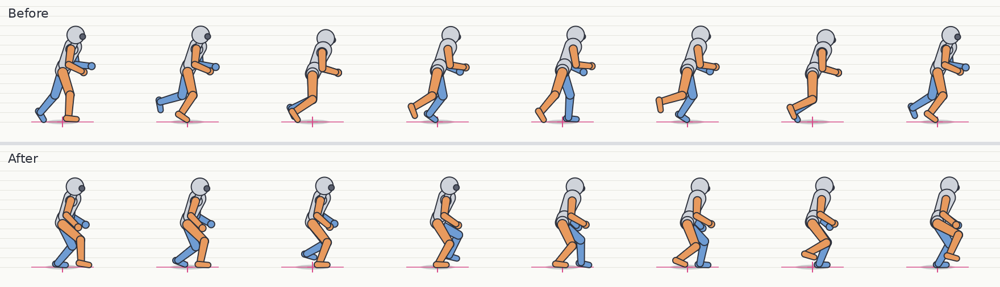
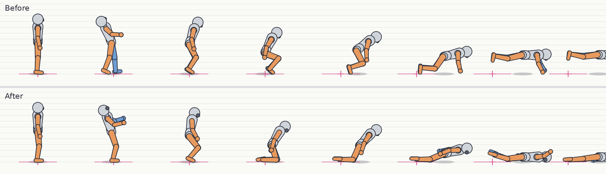
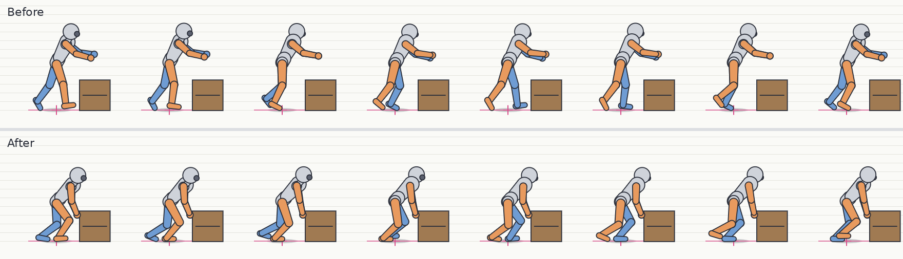

# Natural motion: the reference library, refined

A refinement of the Mission 013 library after the owner's review of Sneak and Death. It is not a new milestone. The
mannequin, its look, the cycle names, ids, categories, views, drawing counts and speeds are all unchanged. Only the
poses and their timing changed.

All 22 cycles were rendered and reviewed: contact sheets in every view, playback at their own speed, and motion traces
of the head, pelvis, hands and ankles. Measurements of foot contact went alongside.

## What was wrong across the library

- **Sliding and floating feet.** Legs were posed by joint angle, and the whole body was then dropped until its lowest
  point touched the floor. So a foot that should stay planted slid between drawings (up to 0.17 body heights in Hurt,
  0.15 in Death, 0.13 in Pick up and 0.09 in Idle), and the other foot often hovered.
- **Skating walk cycles.** In Walk, Run, Sneak, Push and Pull the leg swung on a cosine, so the supporting foot moved
  back at an uneven speed (0.08, 0.16, 0.13, 0.03 per drawing in Walk). Moved along at a steady speed in a game, the
  feet skate.
- **Hands not holding things.** Push and Pull hovered about 0.25 above the crate. Dig's shovel ran sideways between
  the hands and never reached the ground. Climb's feet dangled behind the ladder.

## How it was fixed

Feet and hands are now placed by **where they are**: a planted foot stays exactly still from one drawing to the next,
rolls from heel to toe about a fixed point, and rests flat on the ground. Hands go onto the crate, the shovel shaft,
the box and the ladder rungs. A small solver (`src/DoodleNook.Engine/References/PoseSolver.cs`) works out the
mannequin's joint angles from those positions, measuring the real mannequin. The mannequin and the renderer are
untouched.

The stepping cycles share one step generator. The supporting foot travels back at one steady speed, so the cycle can
be moved along without skating. The pelvis dips as weight is taken and rises over the standing leg, and shifts
sideways over it. The arms follow the legs a little late.

## Audit

Every cycle is one motion drawn in side, top-down and three-quarter view (Climb: side and three-quarter). Drawing counts
and speeds are unchanged.

| Cycle | Before | Problems | Change | After |
|---|---|---|---|---|
| **Sneak** | Weak | A jog with bent knees: pelvis barely lowered, back foot kicking up behind, feet behind the body, "boxer" arms, skating | Low hunched posture, long double support, careful high step with pointed toes set down ball first, weight shifting side to side, hands low and out for balance, head level | Cautious and quiet |
| **Death** | Weak | Collapsed into a push-up: ended propped on stiff arms with the legs floating; no gravity in the fall; feet slid | Hit → knees buckle → knees hit the ground (the drop speeds up) → topples from the knees, accelerating → chest hits the ground, lower legs bounce → rests flat, head turned | Convincing, not graphic |
| Idle | Fair | Feet slid with every breath; one foot floated | Weight on one leg, feet planted; breathing in chest, shoulders and knees, slightly offset | Calm and planted |
| Walk | Good | Uneven planted-foot speed (skating); heel and toe roll vague | Steady planted-foot speed; heel strike, flat foot, heel off, toe off; pelvis down after contact, up at passing; sideways weight shift | Natural |
| Run | Fair | Never left the ground; overreaching leg dropped the body at contact; swing leg didn't fold | One flight drawing per step; heel kick, then knee drive; lands under the body; steady ground speed | Reads as a run |
| Jump | Good | Feet slid in the crouch and push-off | Feet planted until take-off; airborne heights on a gravity arc; poses kept | Good |
| Fall | Good | None that matter: a loose airborne flail | Unchanged | Unchanged |
| Land | Good | Feet slid while absorbing | Feet planted where they land; quick drop, slower rise | Good |
| Attack (slash) | Good | Back foot slid; front foot hovered | Planted stance; weight back on the wind-up and forward into the strike, back heel rising | Grounded |
| Attack (thrust) | Fair | Torso lunged but the feet slid; no real step | Front foot lifts, lands a real lunge step with the back heel up, steps back to guard | A proper lunge |
| Hurt | Fair | Feet slid 0.17 | Planted: the hit pushes the hips back and rocks the body onto its heels, the knees absorb it | Good |
| Cast | Good | Feet slid; the step forward had no lift | Back foot planted; front foot lifts while the power is raised, then steps into the push | Good |
| Shoot | Good | Recoil moved the feet | Planted bladed stance; recoil in the hips and shoulders | Good |
| Pick up | Fair | Feet slid; the box jumped up into the hands | Squat with hips over planted feet and knees forward over the toes; hands on the box's sides at its height; lift with the legs | Good lifting technique |
| Drop | Fair | Pick up backwards | Follows Pick up | Good |
| Push | Fair | Hands above the crate; skating steps | Hands on the crate's face, strong lean, back leg driving, steady planted steps | Good |
| Pull | Weak | Arms reaching at chest height above the crate, not holding it | Straight arms gripping the crate's top edge, hips low and sitting back, steady backward steps | Acceptable |
| Climb | Weak | Feet dangled behind the ladder; hands not on the rungs | Hands grip rungs, feet stand on rungs, hand and opposite foot move together, one rung per half cycle | Good |
| Sit down | Fair | Feet slid 0.24 forward while sitting | Feet planted; lowers onto the stool from a stand just in front of it | Plausible |
| Stand up | Fair | Sit down backwards | Follows Sit down | Plausible |
| Hammer | Good | Small foot drift | Planted; the body drops into the strike | Good |
| Dig | Weak | Shovel sideways between the hands: invisible from the side, never touching the ground | Hands one above the other on the shaft: set the blade, push in, lift the load, toss it aside, come back | Readable |

## Still artificial, or limited

- **Pull** is the least expressive cycle. The crate is low (it is part of the mannequin's props), so the body has to
  crouch to hold it and can't lean back much.
- **Sit down and Stand up** lower straight down. The stool is attached to the hips in the mannequin model, so the hips
  can't travel back onto it without the stool moving too. A natural sit needs a small change to how the mannequin
  places the stool. That is outside this refinement, so it hasn't been made.
- **Climb** is in place, like every loop. The held rungs therefore move down the drawn ladder at climbing speed, as a
  planted foot moves back in a walk.
- **Idle** breathes once per 0.75 seconds at its 8 fps. That is fine as a game "ready" idle; for a slow, calm idle, use
  "Each drawing lasts 2".
- **Fall** was left as it was: a simple, symmetric flail.

## Verification

- **Tests (engine):**
  - planted feet stay put (to under a pixel at 170 px tall) in all 15 non-stepping cycles;
  - stepping cycles move the planted foot at one steady speed;
  - the run has one low flight drawing per step;
  - Death speeds up as it drops, kneels on both shins, and ends lying on the ground;
  - hands stay on the crate and the ladder;
  - the solver puts feet and hands exactly where asked.
- **Unchanged checks still pass:** insertion, Adjust, save and reopen, exports, Palette Lock. The smoke test still
  inserts a walk into an animation, undoes and redoes it, and saves and reopens it.
