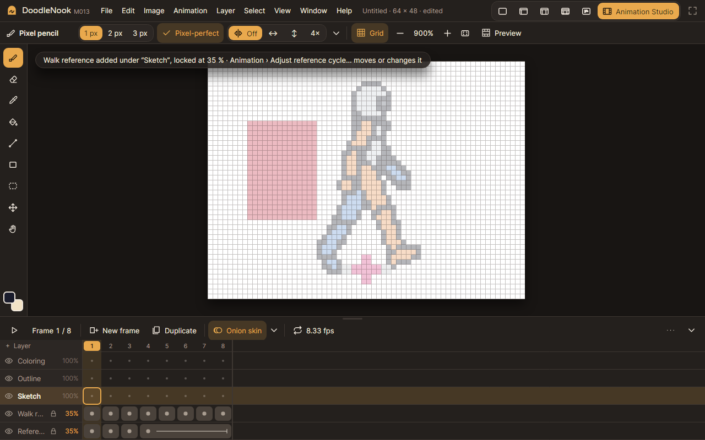

# Mission 013 — Animation Reference Library

Ready-made motion guides for game animation. **Animation › Insert reference cycle…** adds a walk, run, attack, jump,
pick up or another common cycle, drawn as a simple mannequin in side, top-down or three-quarter view. It goes into
the animation you are working on, new or already started, as a faint, locked layer under the layer you draw on.
Nothing that is already there changes. Then you draw over it:

Reference → Sketch → Outline → Coloring.

**Status:** implemented and verified by automated tests on Linux and on Windows CI, plus a smoke test of the packaged
`DoodleNook.exe`. Awaiting your playtest ([PLAYTEST.md](PLAYTEST.md)). The pen hasn't been tested: every test used a
mouse or simulated input.

**Refined since:** the motion of the whole library was reviewed and made more natural (planted feet, steady
walk speeds, a new Sneak and Death, hands on what they hold). See [NATURAL-MOTION.md](NATURAL-MOTION.md).
**Expanded since:** 13 new references and a rebuilt Pull (carrying, limping, stumbling, emotions, transitions), 35 in
all. See [EXPANSION-PACK-1.md](EXPANSION-PACK-1.md).

## The library

22 cycles in three categories at first (Expansion Pack 1 later added 13 more in Movement, Emotion and Transitions), each
in every view where it makes sense:

| Category | Cycles (drawings) |
|---|---|
| Movement | Idle (6) · Walk (8) · Run (8) · Sneak (8) · Jump (8) · Fall (4, loops) · Land (4) |
| Combat | Attack, slash (7) · Attack, thrust (6) · Hurt (4) · Death (8) · Cast (6) · Shoot (6) |
| Interaction | Pick up (7) · Drop (7) · Push (8) · Pull (8) · Climb (6) · Sit down (6) · Stand up (6) · Hammer (6) · Dig (6) |

**Views and facings:**

- **Side:** right or left.
- **Top-down:** right, down, left or up.
- **Three-quarter:** towards you or away from you, to the right or left.

Climb isn't offered from straight above.

The contact sheets show every drawing of every cycle: [side](library/side.png), [top-down](library/top-down.png),
[three-quarter](library/three-quarter.png).

**Frame counts:** 4–8 drawings per cycle, made for 8–12 frames per second, as game sprites usually are. Loops are
coherent: the last drawing leads back into the first. Readable key poses matter more than smoothness, and a short
cycle is quick to trace and redraw. "Each drawing lasts 2 frames" (on twos) slows any cycle down without new
drawings.

**The figure:** a neutral mannequin about six heads tall, in flat colours with a dark outline:

- the right arm and leg are orange and the left ones blue, so you always know which limb is which;
- a dot on the head shows where it faces;
- props make the action read: a sword, a crossbow or gun, a hammer, a shovel, a box, a crate, a stool, a ladder, and
  a glowing orb for casting;
- a soft shadow sits under it, and a small cross with a ground line marks where its feet stand. The marker can be
  turned off.

It is reference material, not finished art.

**How it is made (and how it grows):**

- **One pose, every view.** Each cycle is a handful of poses for a small 3-D mannequin: a drawing per pose, or a step
  cycle for walk, run, sneak, push and pull. Feet and hands are placed where they should be (a planted foot stays put
  and rests flat on the ground; hands hold the crate, the shovel, the ladder), and the joint angles follow. The same
  pose is drawn from the side, from above or at three-quarter view, so each cycle exists in every view without being
  drawn three times.
- **Crisp at any size.** It is drawn at the size you choose, with hard pixel edges in pixel art.
- **Easy to extend.** Adding a cycle is one entry in `src/DoodleNook.Engine/References/ReferenceLibrary.cs`. Drop and
  Stand up are Pick up and Sit down played backwards.

It's a small renderer of about 600 lines in the engine, and a small solver that places feet and hands. There is no
rigging, no skeleton editor and no assets to download.

## Inserting into a scene

**Animation › Insert reference cycle…** opens one compact window:

- **On the left:** the cycles by category, with their drawing counts.
- **The preview:** the current frame of your animation with the cycle playing over it at your frame rate. **Drag in
  the preview** to place the figure's feet next to your floor, props or character.
- **Below it:**
  - view and facing;
  - height in pixels;
  - **Starts at:** frame 1, or the frame you are on;
  - **Each drawing lasts:** 1, 2 or 3 frames;
  - **Repeat to the end;**
  - **Add frames if needed;**
  - opacity;
  - the ground marker.
- **A plain sentence** says what will happen to the timeline before anything changes, for example: "8 drawings, made
  for 10 fps · frames 3–24 · plays 2.8 times. Existing layers and drawings are not changed."

**How existing work is preserved:**

- The cycle is always **a new layer**: no layer is replaced and no drawing is changed or copied over.
- It goes **just under the layer you draw on**, in its group, and that layer stays active, so you keep drawing.
- Inserting is **one undo step**, and undo restores everything exactly as it was. That includes frames that were
  added, and a still picture that became an animation.
- In a reconstruction document from Mission 012, it lands above the imported Reference and under Sketch. Both
  references stay.

**Placement rules (time):**

- The cycle starts at frame 1 or at the current frame. It is empty before that.
- A repeating cycle (the default for loops) fills the animation to its last frame. A one-shot cycle (jump, death,
  pick up…) plays once.
- If the animation is shorter than the cycle, frames are added at the end, and every other layer holds its last
  drawing there. Untick **Add frames if needed** and the cycle stops at the last frame instead. Frames are never
  removed.
- Frames that show the same drawing share it (holds and repeats), so a long repeat costs no extra memory.
- An empty new animation simply gets the whole cycle. A still picture becomes an animation first.

**Adjusting later:** **Animation › Adjust reference cycle…** (also on the reference layer's right-click menu in the
timeline) reopens the same window for that layer. You can move, resize, turn, retime or swap the cycle. It is one undo
step; the layer's lock, visibility and opacity stay, and a name you gave it is kept.

## Layer behaviour

A reference cycle is an ordinary animation layer, so everything that works on layers works on it:

- **Defaults:** visible, **locked** (painting on it is refused with the usual "is locked" message) and at **35 %**
  opacity, as in Mission 012.
- **Name:** for example "Walk reference (side)".
- **Changing it:** the timeline's eye hides it; the percentage changes the opacity on every frame; the lock mark
  unlocks it; the layer menu locks it again.
- **Playback, frame switching, onion skin, the preview panel and exports** show it according to visibility and
  opacity, as for any layer. A hidden reference isn't exported.
- **Save and reopen** keep its drawings, and also the cycle's settings, so Adjust still works.
- **Duplicate layer** copies it with its settings.
- **Palette Lock:** in a picture locked to a palette, its drawings use only that palette's colours.

## The file format

`.dnk` **version 5** stores, per layer, the settings of a library cycle: the cycle, view, facing, height, anchor and
timing. It is written **only** for animations that contain such a layer. Everything else is written exactly as before
(versions 1–4), and every older file opens as before. A Mission 012 build refuses a version-5 file with its usual
"saved by a newer DoodleNook" message instead of silently dropping the cycle's settings. The layer's drawings are
stored like any other animation layer's.

## Quick Start

The guide (`docs/QUICK-START.md`, and Help › Quick Start Guide) has a new section, **"7. Reference cycles"**, with a
real screenshot of the Insert reference cycle window. The other pictures were captured again with this build.

## Verification

**Engine** (`ReferenceLibraryTests`, 15 tests):

- **The library:** every cycle, category and count; every drawing of every cycle draws in every view and facing,
  with differing drawings; reversed cycles are exact reverses.
- **The figure:** feet on the ground while grounded, off it in the air, a standing height of one body height.
- **Rendering:** exact and repeatable, hard edges in pixel art, the asked-for size, mirrored facings.
- **Timeline plans:** start, hold, repeat, grow or stop.
- **Insertion:**
  - in a started scene (existing drawings are the very same objects afterwards, one undo step, undo and redo);
  - growing a short scene, where the others hold;
  - an empty animation and a still picture;
  - a Mission 012 reconstruction document.
- **Other:** save and reopen (version 5, settings and pixels); exports (visible at 35 %, hidden left out); Adjust
  with undo and a kept name; Palette Lock.

**App** (`ReferenceCycleWindowTests`, 4 tests):

- Through the real dialog: choosing Run, facing left, dragging in the preview, the preview playing, inserting under
  the Ball layer of a sample, with nothing else changed and the layer locked.
- Adjust from the layer menu, with undo.
- A new 64 × 64 pixel-art animation: hard edges, a sensible height, the whole cycle.
- Cancel, and Climb not offered from above.

The Quick Start tests check the new section's shortcuts and menu paths.

**Smoke test section 18 (packaged app):**

- a walk cycle inserted through the window into the animation from section 17, which has an imported reference,
  drawings and pasted layers: under the drawing layer, locked, 35 %, nothing else changed, one undo step;
- undo and redo;
- saved and reopened with its settings and drawings.

## Known limitations and things left out

- **One body type and no weapons beyond the props listed.** No left-handed or two-weapon variants, and no
  four/eight-direction sets in one go (choose a facing per insert). These are the obvious next steps if you want
  them.
- **Cycles play in place,** as game sprites usually do. Jump, fall and climb move up and down, but nothing travels
  across the screen.
- **The motion is a clean, simple guide,** not motion capture. Timing and poses are worth judging in your playtest:
  the walk, run, attack and jump should feel right for your games.
- **Adjusting redraws the layer from its settings,** so anything painted by hand on an unlocked reference layer is
  replaced. The Adjust window says so.
- **Moving a reference with the Move or Transform tool** moves only the current frame's drawing, as for any
  animation layer. Use Adjust reference cycle… to move the whole cycle.
- **No new workspace, panel or permanent button:** the feature lives in the Animation menu and the timeline's layer
  menu.

## Delivery

Branch `iteration/013-animation-reference-library`, started from Mission 012's final commit (16dfd7f). The Windows
build is the artifact **DoodleNook-win-x64** of the newest green run of
[Windows build on this branch](https://github.com/crosenlund79/DoodleNook/actions/workflows/windows-build.yml?query=branch%3Aiteration%2F013-animation-reference-library).

### Results

**Windows CI**, run [#34](https://github.com/crosenlund79/DoodleNook/actions/runs/44920791069) (commit 5c302de):

- **Automated tests:** app 199, engine 331, and the three benchmark tests in their own step. All passed.
- **Package:** published self-contained, verified and zipped. `DoodleNook.exe` reports 0.13.0+5c302de and has the
  guide with its new picture built in.
- **The packaged app's smoke test: 77/77.** Section 18 inserted a walk cycle into the animation from section 17
  (imported reference, drawings and pasted layers):
  - it went under the drawing layer, locked and at 35 %;
  - nothing else changed;
  - the animation grew from 4 to 8 frames;
  - it took one undo step, and undo and redo worked;
  - it was saved and reopened with its settings and drawings.

  The Mission 012 Windows-clipboard checks pass as before. The title reads "DoodleNook — M013".

**Linux:**

- **Tests:** engine 333/333, app 200/200. The one engine test that used "version 5" as "a newer DoodleNook" now uses
  6, since version 5 is real.
- **Smoke test under Xvfb:** 74/74. The three Windows-clipboard checks don't run there.

The final commit's run and its artifact link are in the delivery report.
