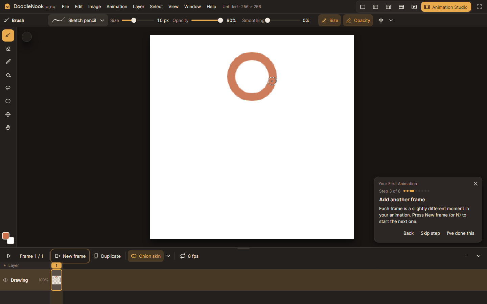
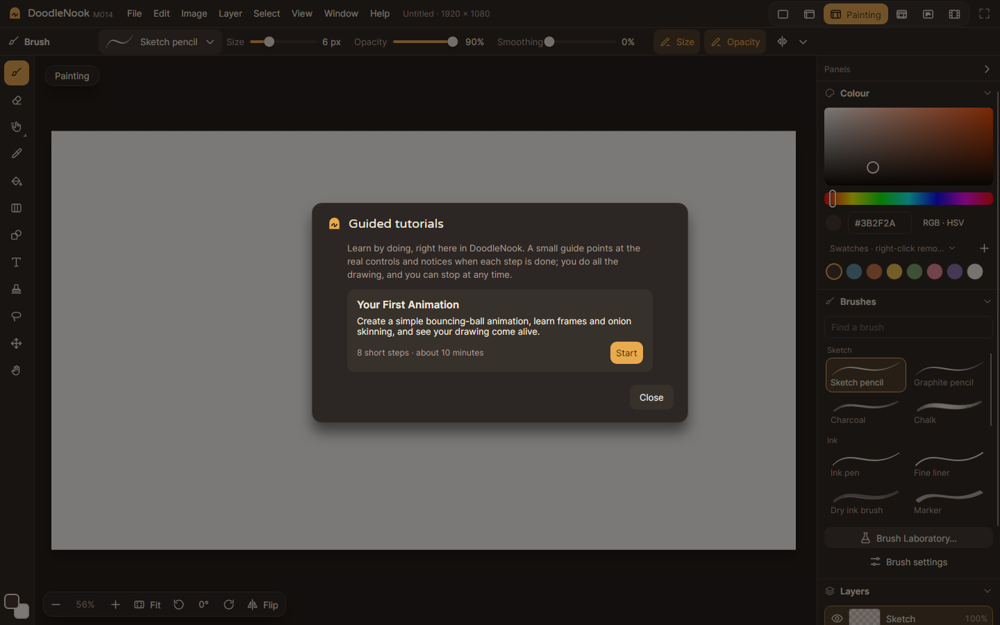
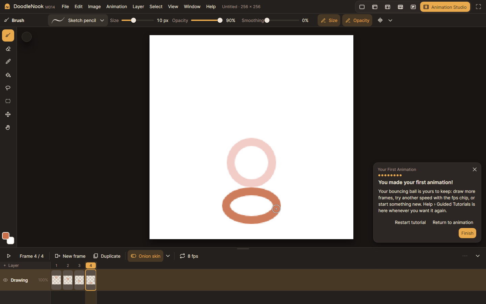
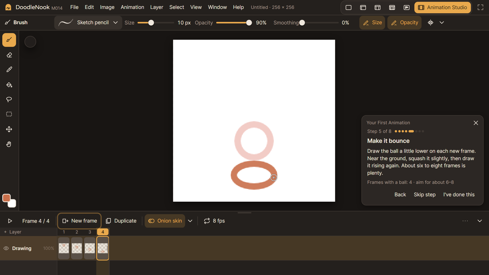

# Mission 014 — The Gentle Guide

Interactive lessons done in the real interface. **Help › Guided Tutorials…** offers one lesson, **Your First
Animation**. A small floating guide points at the actual control to use next with a soft outline and notices when
each step is done, while you make a bouncing ball in Animation Studio. You do all the drawing.

**Status:** implemented and verified by automated tests on Linux and on Windows CI, plus a smoke test of the packaged
`DoodleNook.exe`. Awaiting your playtest ([PLAYTEST.md](PLAYTEST.md)). The pen hasn't been tested: every test used a
mouse or simulated input.

## The experience

**Help › Guided Tutorials…** (after Quick Start Guide, also in Quick Sketch's menu) opens a small window with one
card: the lesson's title, its description, "8 short steps · about 10 minutes" and **Start**. Only finished lessons
are listed.

A welcome card (**Not now** / **Start**), then eight steps:

| Step | You do | The guide notices |
|---|---|---|
| 1. Create the animation | **Create practice animation**: 256 × 256 at 8 fps, in Animation Studio | the new animation is open |
| 2. Draw the first ball | draw with the brush (outlined) | a stroke at least 6 px across on this frame |
| 3. Add another frame | **New frame** (outlined) or N | the frame count went up |
| 4. Turn on onion skin | **Onion skin** (outlined) or O | it's on (if it already is, the guide says so and waits for Next) |
| 5. Make it bounce | draw the ball lower on each new frame, squash it near the ground | "Frames with a ball: k · aim for about 6–8"; done at 6 |
| 6. Play it | **Play** (outlined) or Enter; the fps chip changes speed | playback started (it never stops it; you press Next) |
| 7. Save your project | Ctrl+S or File › Save, and choose where | a save finished; explains `.dnk` as the editable project |
| 8. Export the animation | File › Export animation… (GIF, PNG sequence or sprite sheet) | an animation export finished |

The last card, **"You made your first animation!"**, has **Finish**, **Return to animation** (frame 1, ready to
draw) and **Restart tutorial**. All three leave the animation open: it's yours.

Each step's text is one to three sentences. When a step is done, a ✓ line confirms it ("✓ That's your first
drawing.") and the guide moves on after about a second. **Back**, **Skip step** and the **×** are always there. Steps
that wait for something show **I've done this**, in case the guide misses it.

## How the highlight works

- The outline is a rounded orange border on its own click-through layer, above the workspace and below dialogs. It
  takes no clicks, so it blocks nothing, and there is no darkening.
- It is attached to the control, not to a screen position. Each step names its control (`ToolBrush`,
  `NewFrameButton`, `OnionToggle`, `PlayButton`, `MenuFile`). After every layout pass the outline is placed over that
  control's actual bounds. It follows the control when the window is resized, the scale changes, the timeline grows
  or panels move.
- It pulses gently, between full and 40 % opacity every 0.75 s.
- **If the control isn't visible** (interface hidden with Tab, another workspace), the outline disappears and the
  guide says "Can't see it? DoodleNook can bring it back." **Show me** brings back the interface and Animation
  Studio, with the timeline open. None of the lesson's controls can be removed through Customize workspace, so the
  lesson always stays possible.
- **The guide** sits in the first corner of the canvas area (bottom-right, top-right, bottom-left, top-left) that
  doesn't cover the outlined control. Drag its title bar to move it; it stays where you put it and always stays on
  screen.

## How progress is noticed

Completion is read from the real application state, checked only when something happens:

- a stroke, undo or redo finishes (the picture's history, once per stroke, not per pen event);
- frames change;
- onion skin is switched;
- playback starts;
- the document is replaced;
- a save or an animation export finishes successfully.

Each step compares with counts taken when the step began (frames, undo steps, saves, exports, plays), so "done"
means "done during this step". There is no polling, no timer that checks state, no click counting and no screen
coordinates. Reading the picture uses each drawing's stored bounds, never a pixel scan.

**When nothing runs:** the guide's layer, outline and listeners don't exist until a lesson first starts. When it
ends (Finish, ×, Not now, Return), every listener is removed and the timers stop. A test checks that the listener
counts are exactly as before.

## Your work is protected

- The practice animation is made through the normal New animation path. If the open picture has unsaved changes,
  you get the usual **Save / Don't save / Cancel** first; Cancel keeps everything and you stay on step 1.
- The tutorial never saves by itself. Save and Export use the normal dialogs, so you choose where.
- Nothing temporary goes into the drawing: the outline and the guide are separate from the document, and the
  lesson's state (step, counts) lives only in memory. The animation is an ordinary document with ordinary undo.
- Exiting at any point, or finishing, closes only the guide. The animation, its frames and its history stay as they
  are.
- Skipping step 1 is allowed: the lesson then just points at controls in whatever is open. It never changes the
  picture itself.

## Never in the way

- The guide's buttons can't take keyboard focus, so every shortcut keeps working while it is open: B, E, N, O,
  Enter, [ ], Ctrl+Z, and Alt+1 … Alt+6 for workspaces.
- **Escape** keeps its usual meaning (stop playback, cancel a selection or transform). It doesn't close the guide;
  the × does.
- No new workspace, panel, sidebar or permanent button: one Help menu entry.

## The structure (for later lessons)

A lesson is a list of `TutorialStep` records (`src/DoodleNook.App/Tutorials/`). Each step has:

- a title and text;
- the name of the control to outline;
- a "done" check on the application state;
- an optional action button, progress line and reveal.

`TutorialRunner` shows any such lesson and `TutorialGuide` draws the guide. "Your First Animation" is
`FirstAnimationTutorial.cs`, about 120 lines. A new lesson is another file and one entry in `All`. There is no
scripting language and no framework.

## Quick Start

`docs/QUICK-START.md` (and Help › Quick Start Guide) has a new section, **"10. Learn by doing"**, with a real
screenshot of the lesson. The other pictures were captured again with this build.

## Also fixed

After a Perspective or Warp transform ended, its four corner handles (or warp grid points) could stay drawn on the
canvas, even in another picture. They now leave with the transform. This was a Mission 010 bug, found in this
mission's smoke screenshot; the transform tests now check it.

## Verification

**App tests** (`TutorialWindowTests`, 6 tests, in the real window):

- **The whole lesson** with real buttons and drawing:
  - the practice document (256 × 256, 8 fps, unsaved, Animation Studio);
  - drawing, New frame, onion skin, six frames with drawings, Play not interrupted;
  - a real `.dnk` save and a real GIF export;
  - Finish: the artwork is kept and the listener counts are back to before.
- **Unsaved work** is asked about first, and Cancel keeps it open, unchanged.
- **Back, Skip step and I've done this;** Exit midway: the drawing, frames and undo all keep working.
- **The outline follows** the New frame button through a window resize. With the interface hidden, the outline goes
  and **Show me** brings it back.
- **A 1280 × 720 window at 150 %:** every outlined control is clear of the guide, the guide stays on screen, and
  dragging it moves it exactly.
- **Shortcuts:** N adds the frame and finishes the step, the guide's buttons aren't focusable, Escape doesn't close
  it, and Alt+1 changes workspace, after which Show me returns to Animation Studio.

`TutorialScreenshots` and `QuickStartScreenshots` capture the pictures in this folder and in the Quick Start.

**Smoke test section 19 (packaged app):**

- opens the Guided Tutorials window and starts the lesson from it;
- the practice animation (256 × 256, 8 fps, unsaved, Animation Studio);
- the brush outlined, a drawing noticed, New frame outlined;
- Skip, then Exit midway;
- listeners back to before, the drawing kept, and New frame and drawing still working.

## Known limitations

- **One lesson.** The structure is ready for more; which ones is your call after the playtest.
- **Escape doesn't close the guide** (by design, see above). The × or Finish does.
- **Save and Export are noticed only when they succeed.** Cancelling the file dialog leaves the step waiting; **I've
  done this** or **Skip step** moves on. A still-picture export (File › Export) doesn't count for step 8.
- **The guide can cover a corner of the canvas.** It avoids the outlined control, not your drawing. Drag it away if
  it is in the way; it stays where you put it for the rest of the lesson.
- **The pen hasn't been tested** with the guide open. It never takes focus or clicks outside itself, so it shouldn't
  matter, but only your Kamvas can confirm that.

## Delivery

Branch `iteration/014-the-gentle-guide`, started from Mission 013's final commit (e0f1e43). The Windows build is the
artifact **DoodleNook-win-x64** of the newest green run of
[Windows build on this branch](https://github.com/crosenlund79/DoodleNook/actions/workflows/windows-build.yml?query=branch%3Aiteration%2F014-the-gentle-guide).

### Results

**Windows CI**, run [#36](https://github.com/crosenlund79/DoodleNook/actions/runs/44932509720) (commit 72f7d74):

- **Automated tests:** app 207, engine 331, and the three benchmark tests in their own step. All passed.
- **Package:** published self-contained and zipped. `DoodleNook.exe` reports 0.14.0+72f7d74, and its README-FIRST
  has the new "The Gentle Guide" section.
- **The packaged app's smoke test: 82/82.** Section 19:
  - opened Guided Tutorials and started the lesson;
  - got a fresh, unsaved 256 × 256, 8 fps practice animation in Animation Studio;
  - saw the brush outlined, a drawing noticed, and New frame outlined;
  - skipped a step and exited midway;
  - afterwards the listeners were back to before, and the drawing stayed and kept working.

  The title reads "DoodleNook — M014".

**Linux:**

- **Tests:** engine 333/333, app 208/208.
- **Smoke test under Xvfb:** 79/79, including the five checks of section 19. The three Windows-clipboard checks don't
  run there.

The Windows CI results and the final commit's artifact link are in the delivery report.
