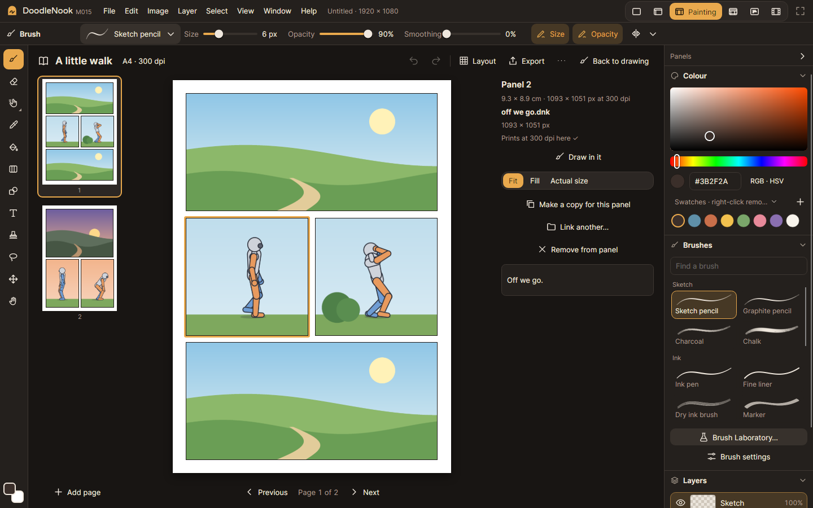
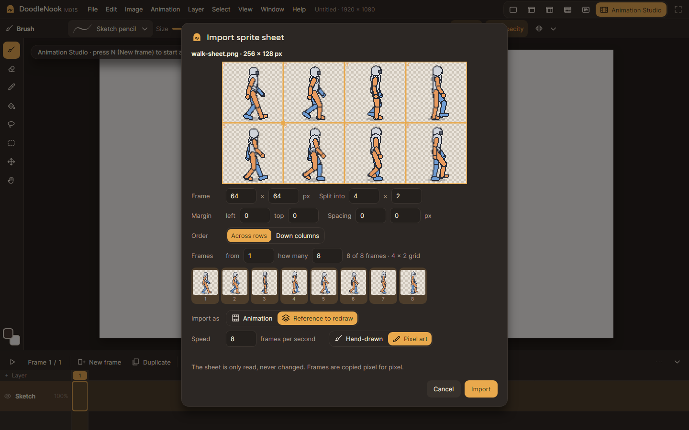
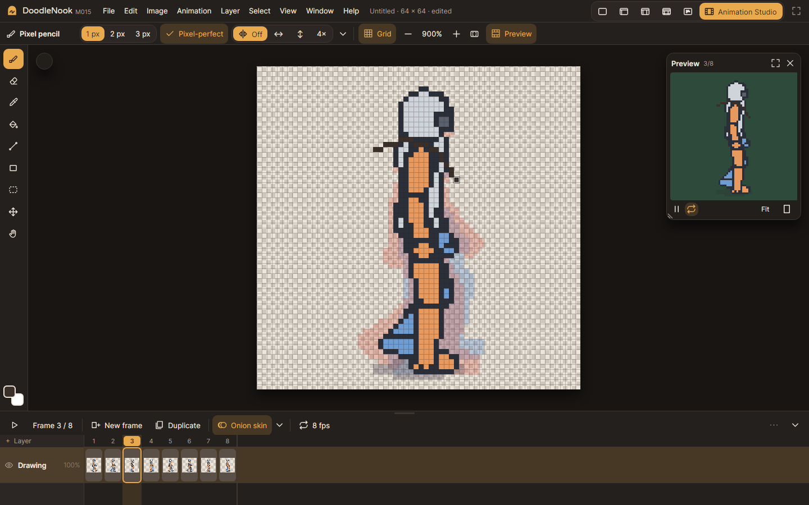
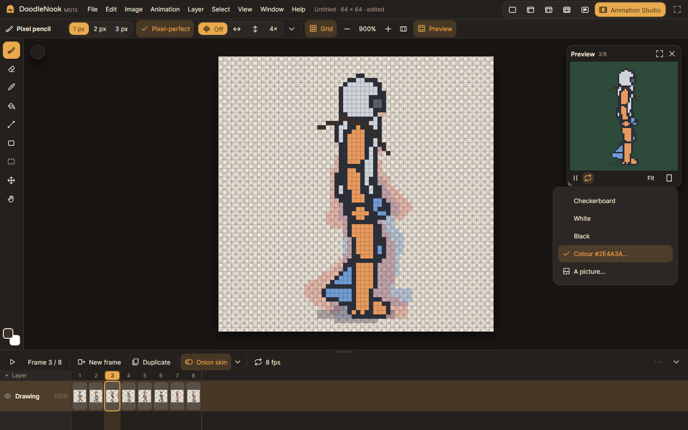
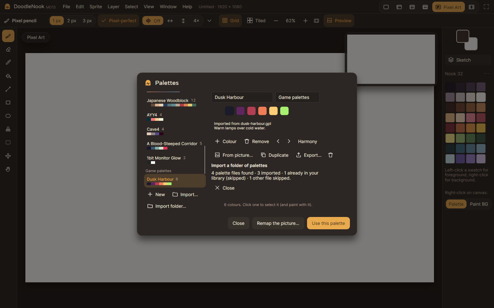
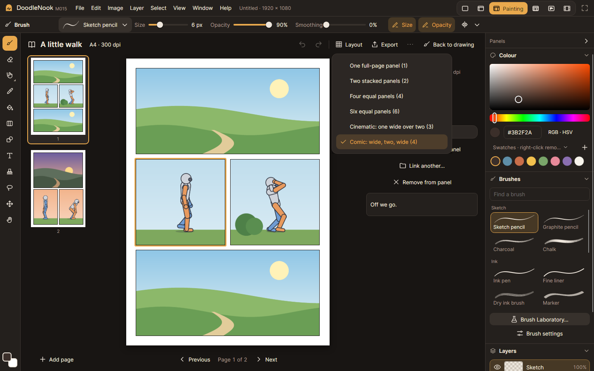
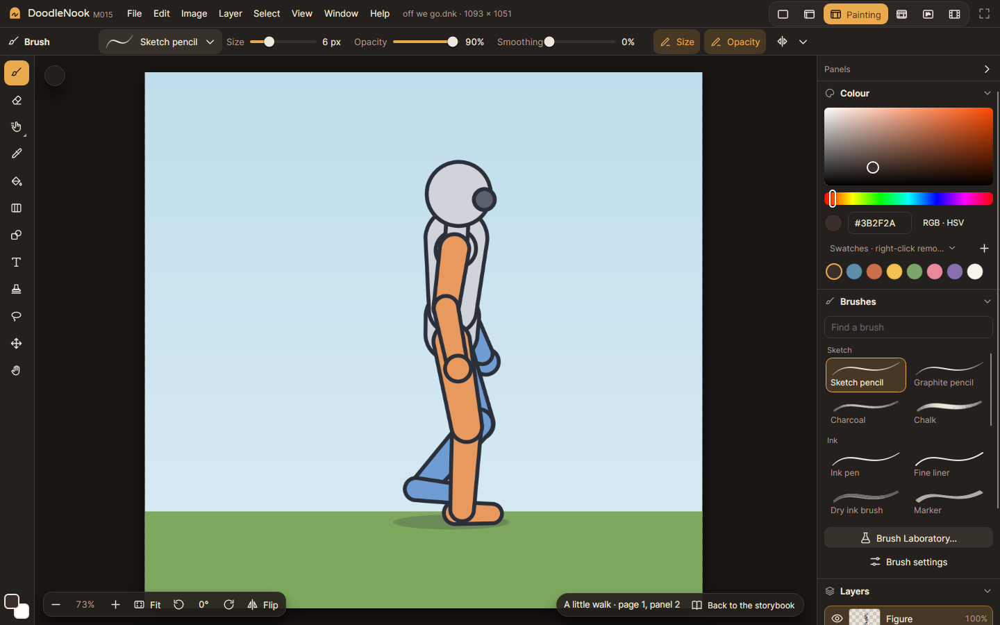

# Mission 015 — The Game Artist's Workshop

Four everyday jobs made easier, all built on what DoodleNook already had:

- **Slice a sprite sheet** into an animation, and lay pictures out on a sheet.
- **Watch the animation while drawing**: the Live Animation Preview.
- **Import a whole folder of palettes** into your own library.
- **Arrange drawings into comic and storyboard pages**: Storybook Studio.

**Status:** implemented and verified by automated tests on Linux and on Windows CI, plus a smoke test of the packaged
`DoodleNook.exe` (see [Verification](#verification)). Awaiting your playtest ([PLAYTEST.md](PLAYTEST.md)). Every test used a
mouse or simulated input; the pen hasn't been tested.

Nothing new is visible until it is asked for: four File menu entries, one View menu entry, one button in the Palettes
window and one sample under Help. No new toolbar, no new workspace, no new drawing engine.



## A. Sprite Sheet Workshop

### Sprite sheet → animation: File › Import sprite sheet…

One dialog. The sheet is shown with the grid it will cut, so what is imported is exactly what is outlined:

- **Drag on the sheet** to move the grid (the margins); **drag the first frame's corner** to size the frames.
- Or type: **Frame** width × height, **Split into** columns × rows (the frame size follows), **Margin** left/top,
  **Spacing** between frames, **Order** (across rows, or down columns), **Frames** from / how many.
- Only **whole cells** become frames: a cell cut off at the right or bottom edge never does. Pixels no cell covers are
  pointed out ("12 px at the right aren't part of any frame: check the frame size, margin and spacing").
- **Empty cells start left out** (the unused end of a last row, for instance); a filmstrip below shows every frame, and a
  click leaves one out or brings it back.
- Impossible settings are explained in words ("A frame 200 px wide is wider than the sheet (128 px)") and can't be
  imported.
- A **first guess** is ready when the dialog opens. If the sheet has its own JSON beside it (`walk.png` + `walk.json`:
  DoodleNook's export, or the usual list of `frame` rectangles other sprite tools write), the grid comes from it,
  exactly. Otherwise DoodleNook looks for the smallest frame size whose cell borders fall on clear, transparent lines,
  with something drawn between each pair of borders (so a gap inside a sprite isn't taken for a border). Non-square
  frames are found too. An opaque strip is cut into squares.
- **Import as** *Animation* (one layer, transparent, a drawing per frame; identical neighbours become a held drawing)
  or *Reference to redraw*: the Mission 012 four layers (Reference locked at 35 %, then Sketch, Outline and Coloring),
  made by the same code as **Import animation**.
- Frames are copied **pixel for pixel**: no resampling, so pixel art stays sharp. The sheet is only read.



### Animation → sprite sheet: File › Export animation… › Sprite sheet

Already there since Mission 006 and unchanged: row, column or grid (choose the columns; rows follow), spacing between
frames, padding inside each cell, a margin around the sheet, transparent background (the paper is optional), frame order
kept, visible layers and layer opacity respected, frames never trimmed one by one (their placement on the canvas is
kept), optional JSON. It uses the same compositing as every other export.

### Image sequence → sprite sheet: File › Sprite sheet from pictures…

Choose one numbered picture (its sequence is found, in natural order: `walk_2` before `walk_10`) or select several. A
filmstrip shows them (click to leave one out). Choose the columns (rows follow), spacing and margin, and optional JSON.
Pictures of different sizes go into cells as large as the largest, **unscaled**, with transparent space around them:
**bottom centre** (feet on one line), centre, or top left. The pictures are only read; saving over one of them is
refused.

### The round trip

An animation exported as a sheet and imported again (with the sheet's JSON, or with matching settings typed in) gives
back the same frames **pixel for pixel**, partly transparent pixels included. This is tested in the engine (three
layouts, spacing, padding and margin) and in the real window, and checked by the smoke test of the packaged program.

## B. Live Animation Preview: View › Animation preview



- **Its own clock.** It loops the whole animation, independent of the frame being edited: draw on frame 3 while it
  plays all of them. It never moves the editing frame.
- **Play / pause, loop** (off: it plays once and stops on the last frame), the animation's frame rate and per-frame
  durations, ping-pong included.
- **Zoom:** *Fit* (as large as the panel allows), or *Actual size (1×)*, 2×, 3×, 4×: whole screen pixels per picture
  pixel, never blurred.
- **Docked** in the corner of Animation Studio's canvas (drag its lower-left corner to resize it), or **floating** in a
  window of its own (⤢), which can go anywhere, a second screen included, and stays open in every workspace. The ×
  closes it, and it stays closed until you open it again. Its place, size, docked or floating, zoom, loop and background
  are remembered.
- **Live.** Each frame has a signature of everything that decides how it looks (its drawings and their revisions, layer
  opacity and visibility, the paper). The preview keeps each frame it has drawn and draws one again only when its
  signature changed. So drawing, erasing, undo and redo, layer opacity, hiding a layer, new frames and new timing all show,
  and nothing else is redrawn. During a stroke the frame being drawn on is left as it was and redrawn when the stroke
  ends; after that, at most four times a second while it keeps changing.
- **Nothing runs** while it is hidden, paused or its window minimised. Its drawings are released when it closes, and kept
  within 160 MB while open (exact pixels at 1–4×; in Fit mode only as large as the panel needs).
- **Backgrounds** (display only): checkerboard, white, black, a colour of your choice, or a picture (a game background,
  say), behind transparent areas. The preview has its own (its background button); the canvas has one too
  (View › Behind transparent areas). Neither ever changes the picture or reaches an export.



**Docking, honestly:** the preview docks in one place, the corner of Animation Studio's canvas, and floats as a window
of its own. It isn't a general drag-to-dock framework: that would have meant rebuilding the interface's layout system.
Opening the preview outside Animation Studio opens it floating, since only Animation Studio has the corner.

## C. Palette Library: Palettes › Import folder…

- **One folder, one go:** choose a folder (subfolders included, or not). The Palettes window says what it found ("“My
  Lospec” holds 52 palette files and 3 other files, which are left alone") and, after **Import**, one summary: found,
  imported, already in your library (skipped), damaged or empty, other files skipped, couldn't be read. Never a dialog
  per palette. Files are read in the background.
- **Formats**, each a small, strict reader: GIMP `.gpl` (including the "#Palette Name:" and "#Description:" lines palette
  sites add), `.hex` lists, JASC and RIFF `.pal`, Paint.NET `.txt`, Adobe `.ase` (RGB and grey swatches; CMYK and Lab
  can't be converted exactly and are reported) and palette pictures `.png` (one colour per pixel or block, at most 256).
  A README or a photo in the folder is skipped as "not a palette", not an error.
- **Your own copies:** the colours are copied into your personal library (`%AppData%\DoodleNook\Library\library.json`),
  so they stay after closing DoodleNook, restarting Windows, or moving or deleting the downloaded folder. They go in a
  collection named after the folder.
- **No duplicates:** a palette whose colours are already in your library (yours or DoodleNook's built-in ones, in any
  order) is skipped, so importing the same folder twice adds nothing. A palette with the same name as another but
  different colours is kept as "Name (2)". Nothing is ever overwritten. When one palette comes in several formats, the
  formats that carry its name are read first, so the copy kept has its proper name.
- **Where it came from:** the file's name, and the description, creator, source and licence when the file gives them,
  are kept and shown with the palette. Imported palettes are for your own library: nothing is ever bundled with
  DoodleNook.
- **Managing them:** as before in the Palettes window: browse (grouped by collection, with colour counts), select,
  rename, change colours, delete (click twice); built-in palettes can't be deleted.
- **Everywhere palettes are used:** an imported palette is an ordinary library palette, so Palette Lock, Remap to
  palette, Painting, Pixel Art, Animation Studio and Game Edit Mode's project palette and exceptions all offer it (all
  of them list the same library). The alpha rules are unchanged.



## D. Storybook Studio

### What it is

A storybook (`My story.donkbook`) is a small file listing pages: each page has a layout, and each panel shows an
ordinary, editable DoodleNook drawing (`.dnk`), kept in the folder beside it (`My story art/`). Storybook Studio
arranges and prints; it never paints. Drawing happens in the normal editor.

**File › New storybook…**: the page size (A4, A5, A3, Letter, 20 cm square, or your own; portrait or landscape), the
resolution (300 dpi for print, 150 for screen, 600 for fine line art), the first page's layout, then where to save it.
**File › Open storybook…** (or **Open…**, which also takes a `.donkbook`). **Help › A little walk (storybook)** opens
the sample.

### The view

Over the canvas, like Game Edit Mode's catalog: the page strip on the left (thumbnails; right-click a page to
duplicate, move or delete it; **Add page** with a layout), the page in the middle as it will print (**Previous** /
**Next**, Page Up / Page Down), and on the right what the selected panel needs. **Back to drawing** (Esc) returns to
the editor. Every change is saved at once (safely: a temporary file, then replaced) and can be undone (Ctrl+Z,
Ctrl+Shift+Z), and the drawing underneath is never touched by that undo.

### Layouts

Six: one full-page panel, two stacked, four equal, six equal, *Cinematic* (one wide over two) and *Comic* (wide, two,
wide). **Layout** changes the current page's. Going to a layout with fewer panels never deletes anything: the drawings
that no longer fit wait **beside the page** (in the panel inspector); select a panel and click one to put it there.
Going back to more panels puts waiting drawings into the empty slots.



### Linked drawings

- **Double-click a panel** to draw in it: its drawing opens in the normal editor. Save as usual (Ctrl+S); the chip
  **Back to the storybook** returns to the page, which shows the new drawing. A drawing still open with unsaved changes
  shows as it is now.
- An **empty panel**: **New drawing** makes a blank drawing of exactly the panel's size at the project's resolution and
  opens it. **Link a drawing…** shows one of your `.dnk` drawings there; a PNG (or other picture) becomes an editable
  `.dnk` copy in the art folder, and the picture itself isn't changed.
- **Shared drawings:** a drawing can be in several panels; editing it changes all of them. **Make a copy for this panel**
  gives one panel its own copy.
- **Placement**, non-destructive: *Fit* (the whole drawing), *Fill* (cropped to fill the panel), *Actual size* (at the
  project's resolution, centred). Drawings keep their shape; nothing is stretched.
- **Missing files** keep their panel ("Missing drawing"); **Find it…** links it again. Opening a storybook says how many
  are missing.
- **Notes:** an optional note per panel, for storyboards.



### One resolution for every panel

The storybook has one rule: every panel has the same pixels per centimetre. At 300 dpi a 15 × 10 cm panel is
1772 × 1181 pixels and a 7 × 8 cm panel is 827 × 945: larger panels simply have more pixels. One calculation
(`StorybookProject.Pixels`, millimetres / 25.4 × dpi, rounded) sizes the page, every panel, and every new drawing, so
nobody has to work out sizes by hand.

- The inspector shows each panel's size in centimetres and pixels, and the drawing's resolution as it prints there
  ("Prints at 300 dpi here ✓").
- A drawing below the project's resolution is **never silently resampled**. It is flagged ("Prints at 135 dpi here,
  below the project's 300 dpi"), and on linking you choose: **use it as it is**, or **make a resized copy** at the
  panel's size. The original is never changed, and enlarging is described honestly: it gives the right size to paint
  the detail in; it doesn't add detail.
- When a layout or the page size changes a panel's size, the assessment follows; the drawing isn't touched, and a resized
  copy is offered again if needed.

### Export

**Export ›** *This page as PNG…*, *All pages as PNG files…* (`name_01.png`, `name_02.png` …), *All pages as one PDF…*.
Pages are rendered at the project's resolution (A4 at 300 dpi = 2480 × 3508), with the page colour, each drawing placed
as its panel says (resampled once, averaging when it shrinks, with no fading at its edges when it grows), and the panel
borders. PNGs carry the print resolution (`pHYs`), so other programs know their physical size. The **PDF** has one page per
page at its physical size; it uses Skia's PDF writer, already part of DoodleNook, with no new library. Everything is
written to a temporary file first, then moved into place.

### The file format (`.donkbook`, version 1)

Readable JSON. Paths are relative to the storybook's folder, with `/` (absolute only on another drive), so a storybook
folder can be moved or copied as a whole.

```json
{
  "format": "DoodleNook Storybook", "version": 1,
  "pageWidthMm": 210, "pageHeightMm": 297, "dpi": 300,
  "marginMm": 10, "gutterMm": 5, "borderMm": 0.6, "paper": "#FFFFFF",
  "pages": [
    { "id": "p3f9…", "layout": "comic",
      "panels": [ { "artwork": "A little walk art/the hill.dnk", "fit": "fit", "note": "Morning over the hill." }, … ],
      "unplaced": [ ] }
  ]
}
```

Layouts are `single`, `two-stacked`, `four`, `six`, `cinematic` and `comic` (an unknown one reads as `single`). A file
from a newer DoodleNook is refused with a clear message. A file with more panels than its layout keeps the extra ones
beside the page rather than dropping them.

### Not in this milestone (by design)

No free-form panel layouts, curved panels, speech balloons, typography, print production (bleed, crop marks, CMYK) or
story-planning tools.

## E. Compatibility

Nothing existing was replaced. The full regression suite passes: drawing, painting, Quick Sketch, Pure Sketch, Editing,
Pixel Art, Animation Studio, Brush Laboratory, palettes, Palette Lock and Remap, undo and redo, autosave and recovery,
`.dnk` files, Game Edit Mode (`template_` handling and project palette locks included), animation import, the reference
library and Guided Tutorials.

- No `.dnk` format change. The Storybook is a new, separate file type.
- The library file (`library.json`) gains optional fields for imported palettes' origin. Older DoodleNook versions ignore
  them.
- The settings file gains optional preview and background settings; older settings files load with the defaults.
- The old Animation menu "Preview panel" is now "Animation preview" (the same switch as View › Animation preview and
  the Customize workspace option).

## F. Screenshots

Captured from the running application (headless Skia, the same code and styles as on Windows), at a 1440 × 900 desktop
and the Kamvas 13 at 150 % (1280 × 720 logical). In this folder:

| | Desktop | Kamvas 13, 150 % |
|---|---|---|
| Sprite sheet slicing grid | [sprite-sheet-grid.png](sprite-sheet-grid.png) | [sprite-sheet-grid-kamvas13-150.png](sprite-sheet-grid-kamvas13-150.png) |
| Imported animation frames | [sprite-sheet-imported.png](sprite-sheet-imported.png) | |
| Live preview while editing | [live-preview.png](live-preview.png) | [live-preview-kamvas13-150.png](live-preview-kamvas13-150.png) |
| Preview in its own window | [live-preview-window.png](live-preview-window.png) | |
| Preview background choice | [preview-backgrounds.png](preview-backgrounds.png) | [preview-backgrounds-kamvas13-150.png](preview-backgrounds-kamvas13-150.png) |
| Bulk palette import results | [palette-folder.png](palette-folder.png) | [palette-folder-kamvas13-150.png](palette-folder-kamvas13-150.png) |
| Storybook page overview | [storybook-page.png](storybook-page.png) | [storybook-page-kamvas13-150.png](storybook-page-kamvas13-150.png) |
| Storybook layout selection | [storybook-layouts.png](storybook-layouts.png) | |
| Panel drawing in the normal editor | [storybook-panel-in-editor.png](storybook-panel-in-editor.png) | |

On the Kamvas at 150 % the sprite sheet dialog scrolls, with its buttons always in view.

## Verification

See [the results](#results) for numbers.

- **Engine:** slicing (whole cells, margins, spacing, both orders, first frame and count, plain-word problems, first
  guesses with and without JSON, non-square frames, empty cells), the round trip through PNG in three layouts, plain and
  reference imports, pictures of different sizes; every palette format, damaged and non-palette files, folder import with
  duplicates (also in another order and against built-in palettes), name clashes, subfolders, one save, persistence
  after the folder is deleted, lock and remap with an imported palette; Storybook's pixels per centimetre (the brief's
  1772 × 1181 and 827 × 945), resolution checks, pages, layouts that keep every drawing, panels that tile without
  overlapping, save and reopen with relative links after moving the folder, missing files, damaged and newer files,
  export placement (fit, fill, actual size, borders, drawings untouched), PNG print resolution, and the sample.
- **Real window:** the sprite sheet import (JSON grid, first guess, a wrong size explained, split into columns × rows,
  frames left out, reference import) and pictures → sheet; palette folder import with one summary; the preview's clock,
  pause, loop, live updates that redraw only the changed frame, layer opacity and visibility, new frames and timing,
  stopping and releasing when hidden, floating and docking, closing by its ×, display-only backgrounds, settings saved and
  older settings loading; Storybook from creation to a panel drawn in the editor and shown on the page, shared,
  low-resolution and missing drawings, layouts, page management, Ctrl+Z undoing the storybook (not the drawing), and
  export as PNG and PDF.
- **Measured:** drawing with the preview open and playing against closed (out/measurements/m015-preview.json, see
  [Performance](#performance)).
- **Smoke test of the packaged program:** a sprite sheet round trip through the dialog, the preview on its own clock and
  in its own window, a palette folder, and the sample storybook with a page exported at 2480 × 3508.

### Results

| | Engine tests | App tests (real window) | Smoke test of the packaged program |
|---|---|---|---|
| Linux (development) | 370 passed | 228 passed | 83 checks passed |
| Windows CI, [run #41](https://github.com/crosenlund79/DoodleNook/actions/runs/44981318224) (commit `fa7ba8f`) | 370 passed | 228 passed | 86 checks passed (Windows NT 10.0.26100) |

New in this mission: 27 engine tests (sprite sheets 11, palette import 5, Storybook 11) and 20 app tests (sprite sheets
3, palette folder 1, preview 7 with the measurement, Storybook 4, screenshots 5), and 4 smoke checks. The
packaged `DoodleNook.exe` reports version `0.15.0+fa7ba8f…` and the title "DoodleNook — M015". The first checkpoint
(sprite sheets and palettes, commit `6f8e9e1`) was also green on Windows:
[run #40](https://github.com/crosenlund79/DoodleNook/actions/runs/44978354446).

## Performance

Measured in the real window on Linux, headless Skia; the numbers are relative, Windows will differ. The measurement
(`PreviewWindowTests.Drawing_with_the_preview_playing_is_as_quick_as_without`, written to
`out/measurements/m015-preview.json`) used a 1920 × 1080, 6-frame animation, a 24 px brush, 160 pen events per stroke,
and the median of three rounds:

| | Pen event, median | Pen event, 95th percentile |
|---|---|---|
| Preview closed | 0.053 ms | 0.175 ms |
| Preview open and playing | 0.050 ms | 0.184 ms |

No measurable difference: the preview drew 18 frames in all, once each plus the frames that changed after a stroke, and
none during a stroke. Mission 011's measurements weren't touched: drawing, compositing, undo and saving use the same code
as before.

Other costs, by design rather than measured:

- **Sprite sheet dialog:** the filmstrip is rebuilt at most every 120 ms while numbers are typed or the grid dragged.
- **Palette import:** files are read on a background thread; the library is saved once, at the end.
- **Storybook:** the page strip uses the 256 px previews stored in each `.dnk` (no layers are read); sharper 900 px
  pictures are made in the background only for pages being looked at, and at most 40 are kept. Exports render one page
  at a time and read each drawing once.

## Known limitations

- **Docking** is one corner of Animation Studio's canvas, or a window of its own; there is no drag-to-dock.
- **Storybook panels** show an animation's current frame (the one it was saved on). Pages are pictures; animated panels
  aren't played.
- **PDF pages are pictures** at the project's resolution, not vector or text. Good for printing and sharing; not for
  print-shop production (no bleed, crop marks or CMYK).
- **Storybook** is over the canvas like Game Edit Mode's catalog; the drawing workspace's own panels (and Animation
  Studio's timeline) stay where they are around it.
- **Palette formats:** Adobe `.ase` CMYK and Lab swatches are reported rather than converted; Photoshop `.aco` isn't
  read.
- **Pen:** everything was tested with a mouse and simulated input. Your Kamvas 13 is the judge.
