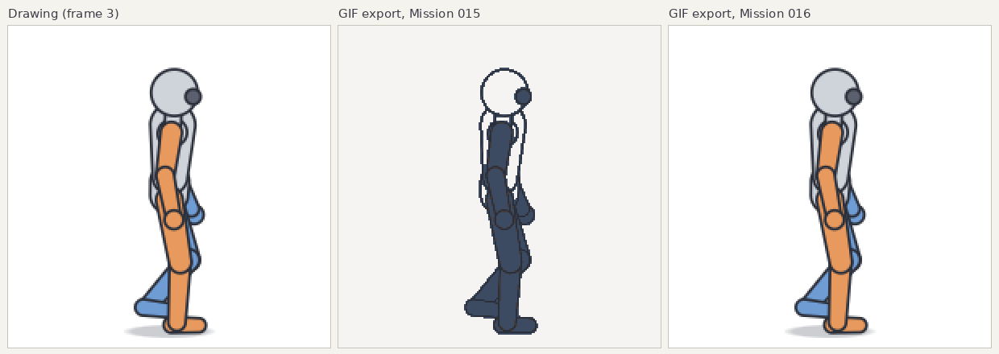
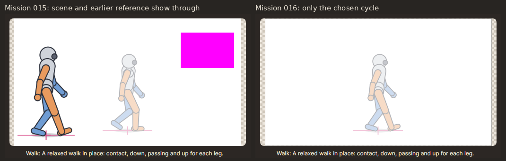
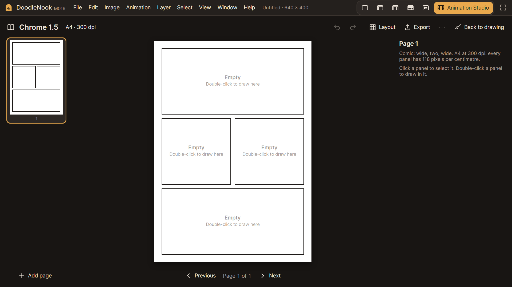
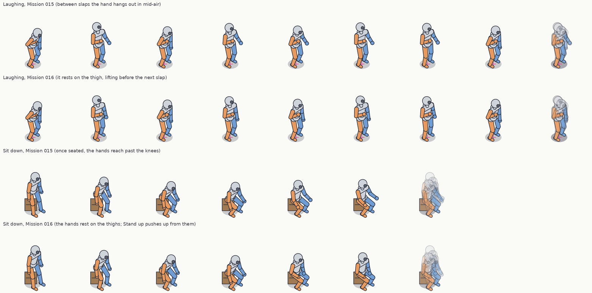
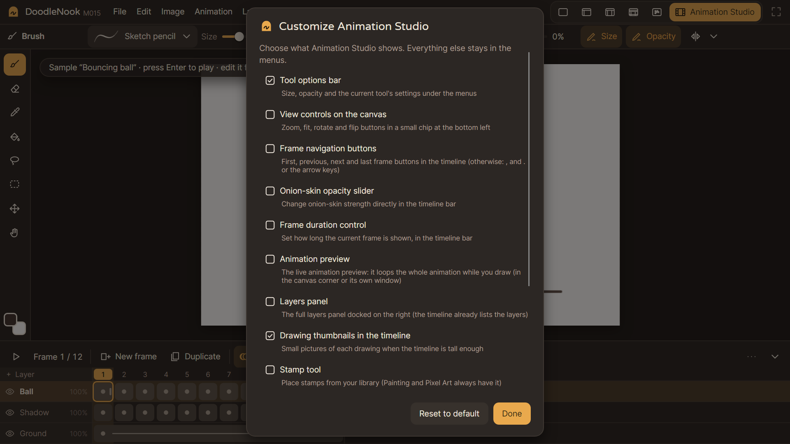

# Mission 016 — The Completion Pass

No new creative features. This mission fixed what was reported, checked the existing workflows the way they are used,
with real files from other programs, and fixed what those checks found.

**Status:** fixed and verified by automated tests on Linux and Windows CI, independent decoders, real files made by
other people and programs, and the packaged program's smoke test (see [Verification](#verification)). Awaiting your
playtest ([PLAYTEST.md](PLAYTEST.md)). Every test used a mouse or simulated input; the pen hasn't been tested.

The details, numbers and every check (including the ones that failed first) are in
[QUALITY-REPORT.md](QUALITY-REPORT.md). The project-wide [playtest status](../../PLAYTEST-STATUS.md) and the
[repository consolidation recommendation](../../REPOSITORY-CONSOLIDATION.md) were written in this mission too.

## What changed for you

| | Before | Now |
|---|---|---|
| **GIF export** | Anti-aliased drawings on white paper turned slate grey (an orange shirt became #3C4B61) | Colours as drawn: average error 0.04 levels on the reported walk, where it was 22 |
| **Reference picker** | Its preview showed the scene behind the figure, so references inserted earlier looked like part of the chosen cycle | Only the chosen cycle, on a plain page the size of the canvas; dragging still places the feet |
| **Storybook** | Brush options, tools, dock and timeline stayed around it, and shortcuts or menu commands could change the drawing hidden underneath | It has the window to itself below the menus. Nothing reaches the hidden drawing unseen, and everything comes back when you return to drawing |
| **Copy** | Only inside DoodleNook | Also to other programs, with transparency where they support it (PNG, 32-bit bitmap, plus a bitmap on white) |
| **Palette folders** | A 5,414-colour palette was cut to 1,024 silently and imported again every time; indexed PNG palettes were refused | The summary says what was kept, and a second import adds nothing; indexed and grey PNGs import |
| **Sprite sheets** | The first guess was wrong on all 10 real sheets tried | Right on 7 of 10: characters standing on their cell's edge, and sheets with gaps between frames |
| **Sit down, Stand up, Laughing** | Hands hanging in mid-air (Laughing) or reaching past the knees (Sit down) | Hands rest on the thighs |
| **Dialogs at 150 %** | Customize's buttons were cut off on the Kamvas; the reference dialog's summary scrolled away | Title and buttons always in view; the part between them scrolls when needed |
| **Cut on a locked layer** | Said "Cut" but left the pixels | Copies, and says the layer is locked |

## 1. GIF colour corruption

**Cause:** the GIF palette's median cut. When one colour held more than half of a box's pixels and sorted last on the
split channel, the split fell back to taking off one colour. White paper is exactly that colour on the red channel.
Each of the 255 splits took one dark colour off, while the paper, the artwork's colours and all their blends were
averaged into one off-white entry. The palette never contained an orange.

**Fix:** a variance-based median cut (the box furthest from its own average is split first, where both halves are
closest to theirs), then three refining passes. Colours are matched exactly, and counting no longer stops after
100,000 colours.

Transparency, timing, disposal, looping and exact pixel-art palettes are unchanged; DoodleNook's own GIF import reads
the new files pixel for pixel as PIL does. Eight regression fixtures (`GifColourTests`) cover:
- anti-aliased art on white, including the orange-on-slate case;
- transparent art;
- soft gradients, dithered and not;
- limited-palette pixel art;
- more than 256 colours;
- colours that appear only in a later frame.

Five of the eight fail on the old encoder.

## 2. Reference picker preview

The preview drew the document's whole current frame behind the figure. It now draws a plain page in the canvas's paper
colour (or the checkerboard) at the canvas's size, with only the chosen cycle on it. The document can hold any number
of references, as before.

## 3. Storybook chrome, and the drawing underneath

- While the storybook is shown, the drawing workspace's options bar, tool strip, dock, timeline, docked preview and
  view chip are hidden. The menus and workspace switcher stay.
- They come back as they were after Esc, **Back to drawing**, opening a panel's drawing, or choosing a workspace.
- Found by the workflow audit: keys and menu commands could change the drawing hidden underneath. Now:
  - no shortcut reaches it;
  - Ctrl+N and Ctrl+O go back to drawing first;
  - Ctrl+S says the storybook saves itself;
  - a drawing command chosen from a menu goes back to the drawing first, so you see what it does;
  - Edit › Undo and Redo act on the storybook, as Ctrl+Z does.
- A floating preview window stays where you put it, as with Tab.

## 4. Copy to other programs

**Edit › Copy** (Ctrl+C) and **Cut** (Ctrl+X) put the copied pixels (only the copied area) on the Windows clipboard:
- "PNG", which keeps transparency (Paint.NET, GIMP, Krita, browsers, Office);
- a 32-bit bitmap with alpha;
- a bitmap on white, for programs that ignore transparency and would otherwise show it black.

The pictures are prepared off the drawing thread. Ctrl+V inside DoodleNook still pastes DoodleNook's own copy in
place; something copied in another program afterwards still wins. If Windows can't take the picture, a message says so
and the copy still works inside DoodleNook.

## 5. Real files from other programs

Checked with palette files from GIMP, Inkscape and LibreSprite, sprite sheets by other artists (OpenGameArt, CC0;
Kenney's 1-Bit Pack, CC0), and GIF, APNG and PNG sequences from other tools. The files were used for checking only and
weren't added to the repository. Found and fixed:
- **Long palettes:** a palette keeps at most 1,024 colours. The import now says so ("the first 1024 of 5414 colours")
  and recognises the palette when the folder is imported again; before, it added the palette again every time.
- **Indexed and grey PNG palettes** (common for small palette pictures) import. They were refused with a message about
  a "project file".
- **Game Edit's palette picker** offered only .gpl and .hex; it now offers all six formats.
- **Sprite sheet first guess:** a sprite may touch its cell border (characters stand on the bottom row) as long as
  nothing crosses it, and a gap of 1–2 transparent pixels between frames is found. Sheets whose tiles touch, with no
  transparency to go by, still need the frame size typed in.
- **Checked, no defect found:**
  - animation import: GIF and APNG decode exactly as PIL decodes them;
  - a mixed indexed/RGBA PNG sequence imports pixel for pixel;
  - palette colours match an independent parser in every one of 69 palettes;
  - cutting sheets is exact.

## 6. Sit down, Stand up, Laughing

The body movement of all three reads naturally and was kept. In Laughing, the left hand now rests on the thigh between
slaps and lifts before the next one, instead of hanging in mid-air. In Sit down, the hands rest on the thighs once
seated, so Stand up, which plays it backwards, pushes up from them. No new references or rigs.

## 7. Workflow audit, UI review and document safety

- **Workflow audit (A–H):** draw and export, an animation taken apart and put back, references, Game Edit, sprite
  sheets, Storybook, the clipboard and personal palettes, each driven end to end through the real window. One defect:
  the storybook issue above.
- **UI review at 150 %:** all six workspaces and the main dialogs were captured at the Kamvas's 150 %; every dialog
  fits, keeps its buttons visible and closes with Esc. Two fixes:
  - Customize's buttons had been off screen;
  - the reference dialog's summary had scrolled out of view.
  
- **Document safety:** closing, opening another file, a missing file, switching workspaces, the storybook's panel
  drawings and autosave were checked; nothing unsaved is lost without asking. One fix: the storybook's chip under a
  panel's drawing now says "not saved yet" as soon as you draw (it used to stay silent).

## Verification

| | Engine tests | App tests (real window) | Smoke test of the packaged program |
|---|---|---|---|
| Linux (development) | 383 passed | 244 passed | 83 checks passed |
| Windows CI, [run #47](https://github.com/crosenlund79/DoodleNook/actions/runs/45050551041) (commit `bd0fb59`) | 383 passed | 244 passed | 89 checks passed (Windows NT 10.0.26100), including the 3 real-clipboard Copy checks |

The benchmarks run separately (2 engine, 1 app) and passed on both. Every Mission 016 checkpoint was green on Windows:

| Run | Commit | What it added |
|---|---|---|
| [#43](https://github.com/crosenlund79/DoodleNook/actions/runs/45041042001) | `22ab315` | The GIF colour fix |
| [#44](https://github.com/crosenlund79/DoodleNook/actions/runs/45044582064) | `57a253c` | Reference preview, storybook chrome, clipboard, import fixes |
| [#45](https://github.com/crosenlund79/DoodleNook/actions/runs/45047444794) | `714b281` | Dialogs at 150 %, version M016 |
| [#46](https://github.com/crosenlund79/DoodleNook/actions/runs/45048628426) | `7564173` | Document safety |
| [#47](https://github.com/crosenlund79/DoodleNook/actions/runs/45050551041) | `bd0fb59` | Performance and screenshots |

New in this mission:
- **Engine tests:** GIF colours 8, DIB encoder 2, PNG decoding 3, palette limit 1, sprite sheet guess 1.
- **App tests:** reference preview 1, storybook chrome 1, clipboard 3, workflow audit 7, UI review 1, document safety 4.
- **Smoke test:** 3 real Windows clipboard checks.

## Performance

Mission 011's benchmarks (`UnderTheHoodBenchmarks`, `HeadToHeadBenchmarks`, `UnderTheHoodAppBenchmarks`, unchanged
since then) were run on Mission 011's final commit (`efa32ae`) and on this mission's code. The run was on the same
machine (the Linux sandbox, 4 cores, no GPU), one after the other, in two rounds in opposite order. The raw results are
in [measurements/](measurements/). This compares Mission 011 with everything since (Missions 012–016), not only this
mission.

| Moment | M011 (round 1 / 2) | M016 (round 1 / 2) |
|---|---|---|
| Thin ink stroke, per pen event, 1 layer (head to head) | 0.0231 / 0.0232 ms | 0.0225 / 0.0229 ms |
| Thin ink stroke, 3 layers (head to head) | 0.0505 / 0.0459 ms | 0.0443 / 0.0442 ms |
| Big soft brush, 12 layers, per pen event (engine) | 3.47 / 2.91 ms | 2.93 / 3.01 ms |
| Pen event in the window, 3 layers, 24 px | 0.065 / 0.069 ms | 0.068 / 0.074 ms |
| Recomposite everything, 2560 × 1440, 12 layers | 259 / 259 ms | 244 / 249 ms |
| Undo all of 30 big strokes, 12 layers | 4,953 / 4,878 ms | 4,665 / 4,813 ms |
| Undo memory after those strokes | 195 MB | 195 MB |
| Workspace switch, 95th percentile | 365 / 344 ms | 343 / 352 ms |
| Game Edit, 300 PNGs: longest UI stall | 100 / 100 ms | 98 / 96 ms |
| First window | 1,915 / 1,795 ms | 1,771 / 1,771 ms |

**No regression was found.** A few single-shot numbers looked worse in one or both rounds, so each was measured
directly and repeatedly with both engines in fresh processes:

| Item | M011 | M016 | Verdict |
|---|---|---|---|
| Saving and opening a 48-frame 1080p animation (seven writes and reads; medians of two runs) | write 345–381, read 205–220 ms | write 408–411, read 199–239 ms | Within the noise: single writes ranged 318–616 ms on both |
| Adding 200 brushes to a library | 214–351 ms | 228–387 ms | Same |
| Adding 100 stamps to a library | 105 / 129 ms | 123 / 134 ms | Same |
| PNG encode, 64 × 64 / 256 × 256 | 0.20–0.34 / 2.8–4.8 ms | 0.20–0.31 / 2.7–4.0 ms | Same |
| Palette-locked big soft brush, per pen event | 0.85 / 0.90 ms | 1.22 / 0.98 ms | Round 1 high, round 2 the same as M011: noise |

The drawing engine wasn't changed in this mission. GIF export, which was, is measured in the quality report (the same
without dithering, up to about 20 % slower with it, in the background). The packaged program's frame timing on Windows
is in the CI run's smoke report.

## Known limitations

- **Sprite sheets** whose tiles touch, with no transparent line or gap between them, aren't guessed: type the frame
  size (or *Split into* columns × rows).
- **GIF** is still limited to 256 colours per animation and to on/off transparency (a soft shadow below 50 % opacity
  disappears). Dithering, on by default, hides the banding in soft gradients.
- **Copy to other programs** gives them a flat picture of the copied pixels on that layer, not layers.
- **The Game Edit catalog** still keeps the drawing tools around it; the storybook no longer does (a decision for you).
- **A failed save** can't be simulated in the test sandbox. The protection (a temporary file first, replaced only when
  complete) is unchanged from earlier missions.
