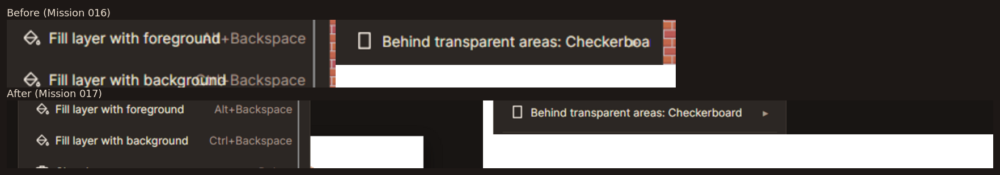

# Mission 017 quality report

Every check this mission ran, how it was run, and what it found, including the checks that found nothing. The fixes
are summarised in the [README](README.md). Unless a section says otherwise, checks ran on the Linux development machine
(4 cores, no GPU) with the same code that Windows CI built and tested.

## 1. Every menu command, every dialog at 150 %

**How.** A new test (`MenuCrawlTests`) opens a fresh 1280 × 720 window at 150 % scaling in each of the six workspaces,
with a picture that has a layer and a selection (Animation Studio uses the Bouncing ball sample), and runs every
enabled command in every menu that workspace actually shows: the menu bar, Quick Sketch's ☰ and Pure Sketch's corner
menu. Only Exit is skipped. Each command gets a fresh window. When a command opens a dialog, the test checks that:

- the dialog card and its button row lie inside the window, with nothing cut off;
- no single-line text is wider than the space it has (measured, not looked at);
- Esc closes it.

It also records a screenshot of each dialog.

**Result.** 223 commands ran across the six workspaces (Painting 125, Quick Sketch 30, Animation 24, Pixel Art 22, Pure
Sketch 17, Editing 5; a command shared by several menus runs once per menu). 65 opened a dialog, and all 65 fit, kept
their buttons in view and closed with Esc. The other 158 acted directly. No command threw an exception.

**What it found and what was fixed:**

| Found | Fix |
|---|---|
| **Colour balance**: the label "Magenta ↔ Green" was cut off at 150 %, in all three tones | The labels' column is wider (132 instead of 110 px). The detector was checked by putting the old width back: it flagged the label in all three places. |
| **Canvas size**: you couldn't see which anchor cell was chosen. The cell was styled as chosen, but a background set in code covered the style | The chosen cell shows its highlight (and ●); the others keep the plain background |
| **About** still said "Mission 014" | It names this build's version and milestone, and lists Storybook Studio and the sprite-sheet tools |
| **Quick Sketch and Pure Sketch with a storybook shown**: Quick Sketch's drawing bar (brush, undo, ☰ with *Clear layer*) stayed over the storybook, and Pure Sketch's corner menu could change the hidden drawing | Quick Sketch's bar is hidden while a storybook is shown (Esc brings both back). Both menus go back to the drawing first, as the other workspaces' menus have done since Mission 016. |
| **Help › Diagnostics** after any save: the timing name "Save: compress and write (background)" ran into its value at 150 %. The crawl found it only in the full test run, where earlier tests had saved a picture. | Long names wrap in a slightly wider column. Test: `Diagnostics_timing_names_never_run_into_their_values` saves first, then checks the name fits its column and ends before its value. |
| The sample storybook couldn't be created when the Documents folder isn't available (found on Linux, where it isn't set) | It falls back to the user's folder, then the temporary folder. On Windows, Documents always exists, so this only makes the code sturdier. |

## 2. Shortcuts and tooltips

- **Every shortcut a menu shows is answered by the window.** For each menu entry with a shortcut, one fresh window runs
  the menu command and another presses the keys. The test then compares what each changed (dialog, layers, active
  layer, undo step, selection, tool, zoom, rotation, workspace, hidden interface, window state, storybook). All of them
  match, more than 40 pairs; Alt+F4 is the only one skipped.
- **Every key the F1 list names does what it says** (new test). The list is written by hand, while the tool keys come
  from the tool table, so the two could drift apart. The test presses each key and checks the result:
  - the tool letters in Painting and Editing (B E I H V M Shift+M L W C G Shift+G U S T Shift+B Shift+S J) and in Pixel
    Art (B E U Shift+U G);
  - X and D for the colours;
  - Alt+1 … Alt+6 for the workspaces, in the order the list gives;
  - in Animation Studio: Home, End, comma and full stop, the arrows, N, Shift+N and O.

  It found that in Painting, M, Shift+M, W and C did nothing, while the list named them with no note. That is by
  design: Painting has no rectangle select, magic wand or crop (they are in Editing), and Quick Sketch and Animation
  Studio leave some tools out too. The list now says so: its tool keys are under a heading "Tools the workspace
  shows", and the selection row notes "M, W, C in Editing (M also in Pixel Art and Animation Studio)". The test now
  checks the keys in five workspaces:
  - a key picks its tool wherever the workspace shows that tool;
  - a key leaves the tool alone where it isn't shown;
  - every key works in at least one workspace.
- **Every button that shows only an icon has a tooltip** in all six workspaces (scroll bar parts excepted). None was
  missing.

## 3. Old files keep opening

**How.** The engines of seven earlier missions were checked out at their final commits: M005 (`4e63ccb`), M006
(`c17424e`), M007 (`54995e6`), M008 (`1ddf4f4`), M011 (`efa32ae`), M013 (`e0f1e43`) and M015 (`cb2fc96`). A small program built against each old engine wrote files with that engine's own code. Each engine also
rendered its own files (every frame of every animation) to PNG. Today's engine then opened every file and rendered it
again, and the pixels were compared exactly. The programs are in [measurements/tools](measurements/tools); the output
is [measurements/old-files.txt](measurements/old-files.txt).

The files cover every `.dnk` format version:

| Format | First written by | What the test files hold |
|---|---|---|
| 1 | M005 | Layered still picture with soft alpha |
| 2 | M006 | Animations: the Bouncing ball (12 frames, 3 layers) and Pixel slime (8 frames) |
| 3 | M007 | Picture locked to the Nook 32 palette (Palette Lock) |
| 4 | M008 | Design file: a shape group, a mask and a Brightness/Contrast adjustment layer |
| 5 | M013 | Animation with an inserted reference cycle |

Also from M007 onward: a creative pack (`.dnkpack`: 3 brushes, 2 stamps, 1 pattern, 1 palette), a reference board
(`.dnkboard`, 5 pictures) and a GIMP palette (`.gpl`, 10 colours). From M015: a storybook (`.donkbook`, 2 pages) with 7
linked drawings.

**Result.** Every file opened. Every render matched the old engine's own pixel for pixel: 30 pictures and animations,
160 renders. Every palette-locked picture was still locked to its 32 colours. Every pack imported, every board opened and every palette read, and the storybook resolved all 7 of its
drawings. Nothing needed fixing.

## 4. Crash recovery and a failed save, in the real program

Mission 016 could only test these inside the test harness. This time the real program ran on a virtual screen (Xvfb,
1600 × 1000), driven by real X11 mouse and keyboard events. A small XTest sender sends what a mouse and keyboard would,
through the operating system's input path ([measurements/tools/x11-input.cs](measurements/tools/x11-input.cs)).
Autosave was set to 30 seconds, one of the Preferences choices.

**Crash and recovery.**
1. The real program opened a saved picture, and three strokes were drawn with the mouse. The title said "· edited".
2. After the autosave the process was killed with SIGKILL: no shutdown code ran. The picture's own file was
   byte-for-byte unchanged.
3. On restart, the program offered *Recover unsaved work?*, naming the picture and its file
   ([screenshot](real-app-recovery-offered.png)).
4. Enter (Recover) brought the picture back, still marked as edited. Ctrl+S saved it to its own file
   ([screenshot](real-app-recovered-and-saved.png)), and the recovery copy was removed.
5. The saved file's pixels were **identical** to the autosaved copy's, and differed from the original in exactly the
   5,814 pixels the strokes covered.

**A save that fails.** Two kinds of failure were forced on the real program with `chattr +i`, which root can't override:
- **The folder can't be written:** the temporary copy can't even be created.
- **The file can't be replaced:** the folder is writable, so the temporary copy is written completely, but swapping it
  in fails.

In both cases the program said it couldn't save, and the previous file stayed **byte-for-byte intact**. No temporary
file was left behind. Once the protection was removed, Ctrl+S saved normally.

**Defects found and fixed:**

| Found | Fix |
|---|---|
| **"· edited" didn't follow the picture.** The menu row's "· edited" only changed when the tool or colour changed. After a stroke the picture looked saved, and after undoing back to the saved state it still said "edited". Mission 016's tests didn't look at that label. In the first real session the marker only appeared because a swatch was clicked after a stroke. | The menu row follows the picture's history (strokes, undo, redo, size changes) and follows the new picture when one is opened. Test: `The_top_bar_says_edited_as_soon_as_a_stroke_ends_and_after_undo_and_save` fails without the fix and passes with it. Checked again in the real program afterwards. |
| **The failed-save message only showed a hidden temporary file's path**, as in `Access to the path '…/.picture.dnk.e563…tmp' is denied`. It didn't say whether the picture on disk was harmed or what to do. | The message still gives the reason, then adds: "The file on disk was not changed, and your picture is still open with all its changes. File › Save As… can save it somewhere else." ([screenshot](real-app-failed-save.png)). Test: `A_failed_save_says_the_file_is_untouched_and_keeps_the_picture_unsaved`. |

**Seen and left alone.** On Linux, a killed session leaves its empty lock file in the recovery folder. On Windows the
operating system deletes that file itself, even when the process is killed, because it is opened with
delete-on-close. So there is nothing to fix for DoodleNook's platform.

## 5. Workflow audit, part 2

**How.** The real program ran on a virtual screen (Xvfb), driven by real X11 mouse and keyboard events. Eight
workflows were used the way an artist would, and each screen was looked at. Every suspected defect was reproduced a
second time and traced to its cause in the source. Then I confirmed each one with a window test that fails on the old
code and passes with the fix. No exception reached the error log in any session.

| Workflow | What was done | Result |
|---|---|---|
| Brush Laboratory | Tip, size, texture; playground strokes, Example and Clear; rename; Save as new; Use this brush; painting with it; restart | Works, apart from defects 1 and 3 below |
| Stamps and patterns | 4 stamps with size and rotation; undo and redo one stamp at a time; Brick wall pattern fill, one undo step | Works, apart from defect 4 |
| Text and shapes (Editing) | Add text, edit it again (one "Edit text" step), rounded rectangle, resize by a handle, move, undo each step | Works, apart from defect 2 |
| Liquify, Smudge, Clone | Liquify push; Ctrl+Z inside; Esc and Cancel; Enter applies; the session undoes as one step. Smudge (Shift+B); Clone with Alt+click source | Works, apart from defect 5 |
| Pixel tools with Palette Lock | Pixel slime: palette from the picture, lock; pencil, fill, eraser; 3 × Ctrl+Z restores exactly; a soft brush in Painting paints only palette colours (every pixel sampled) | Works, apart from defects 7 and 8 |
| Timeline (Bouncing ball) | Arrows, N, Shift+N, hold a frame longer, delete a frame, undo of each, Enter / Esc, onion skin (O), frame duration dialog, undo jumping back to the frame it changed | All correct |
| Guided tutorial | Start, the unsaved-changes question (Cancel and Don't save), steps 1–5 advancing on their own, Back, × closing it while Ctrl+Z keeps working | All correct |
| Reference board | Board shown from a saved board; move, wheel zoom, fit, drag and resize the board, background menu, close and reopen keeping the layout | All correct. Adding a picture through + needs the file dialog and wasn't tested. |

Esc closed every dialog tried: F1 shortcuts, Palettes, Creative library, Customize workspace, Preferences, About and
Diagnostics.

**Defects found and fixed:**

| # | Found | Cause | Fix |
|---|---|---|---|
| 1 | **Brush Laboratory:** dragging a slider changed the brush, but the number beside it stayed put (Hardness said 85 % while it was 21 %) | The slider row threw away its refresh | The number follows the knob |
| 2 | **Text:** Ctrl+Enter, as the editor's own hint says, added a new line instead of finishing | The text box accepts Return, so it took the key first | Ctrl+Enter is handled before the box sees it |
| 3 | **The options bar** kept a brush's old name after it was renamed in the Lab | It only refreshed when the brush's settings changed | The name counts too |
| 4 | **Stamp tool:** [ and ] resized the stamp, but the message gave the brush size ("Size 6 px") | The message ignored the stamp tool | "Stamp size 87%" (in pixel art "Stamp size 2×") |
| 5 | **Liquify:** Ctrl+Z took back the last Liquify stroke but said "Undid brush stroke" (or just "Undid ") | The message named the picture's next undo step | "Took back the last Liquify stroke"; during a transform, "Transform cancelled" |
| 6 | **Menus:** long entries ran into their shortcut or under the ▸ of a sub-menu, for example "Fill layer with foreground" in Edit, "Behind transparent areas: Checkerboard" in View, "Lock the picture to "PICO-8 palette"…", and "Make independent (stop sharing with c…" in the timeline's ⋯ | Every menu was a fixed 270 px wide | A menu is at least that wide and grows to fit its longest entry (up to 560 px). A new test lays out every menu and sub-menu of every workspace and checks that no text runs past its entry or into its neighbour. |
| 7 | **Pixel Art's palette menu** changed the picture's palette (it is saved with the picture) without an undo step. Ctrl+Z did nothing, the picture didn't count as changed, and closing didn't ask, so the choice could be lost. | The palette was set directly | Choosing a palette, Palette from the picture, Reset to Nook 32, and adding or removing a colour are each one undo step that marks the picture as changed. (A palette-locked picture already went through the remap preview.) |
| 8 | **The same menu's tick** stayed on a saved palette after *Palette from the picture* | It ticked the swatches' choice, not the picture's palette | It ticks the picture's own palette |
| — | **F1 list:** the scroll bar covered the ends of long lines | No room for the scroll bar | Room on the right |

**Seen and left for you to judge:**
- **Text hint:** the "Ctrl+Enter or Esc to finish…" hint under the text box is dim text with no background, so it can
  be hard to read over a busy picture. It is a matter of look, so it was left alone.
- **Colour panel:** the "Swatches · right-click remo…" label is shortened on purpose to fit the panel.

## 6. Exports read by an independent decoder

**How.** DoodleNook's own export code wrote every export kind from the Mission 015 test files. The checks used design.dnk
(layered, with paper), Pixel slime (8 frames, transparent, with frames of 125 and 180 ms) and the Bouncing ball (12
frames, many colours). Next to each export, the exact pixels it should hold were written as raw RGBA. Pillow 12.3, not
DoodleNook's code, then decoded everything ([measurements/tools/exports-check.py](measurements/tools/exports-check.py)).

| Export | What Pillow read |
|---|---|
| PNG | RGBA, 320 × 200, **identical** pixels |
| JPEG (quality 92) | RGB, average error 0.98 of 255 against the picture on white (lossy, as expected) |
| WebP (quality 92) | Average error 0.64 of 255 |
| PNG sequence | 8 files, transparent, **identical** pixels in all 8 |
| Sprite sheet + JSON | The JSON parses. 3 × 3 grid with spacing, padding and margin. All 8 frame rectangles lie inside the image without overlapping, each crop is **identical** to its frame, and the durations match (125, 180, … ms). |
| Animated GIF, pixel art | 8 frames, looping, **identical** pixels in every frame |
| Animated GIF, Bouncing ball | 12 frames, not looping, every frame within 0.00 average error (colour-reduced) |

GIF stores time in steps of 10 ms. DoodleNook rounds where each frame ends on the running timeline, so a 125 ms frame
comes out as 120 or 130 ms and the animation doesn't drift. Every frame boundary was within 5 ms of the asked one. A
first, naive version of the check expected each frame on its own to be rounded, and "failed" on this; the encoder's
documented behaviour is the right one. The full output is in
[measurements/exports-pillow.txt](measurements/exports-pillow.txt).

## 7. A long session

**How.** A new measurement, `LongSessionBenchmarks`, draws in one window for a long session on a 1920 × 1080 picture.
Each round moves to the next of Painting, Editing, Pixel Art and Quick Sketch and draws 25 strokes. It also:
- undoes and redoes 5 steps;
- adds a layer every 4 rounds and merges one down 2 rounds later;
- saves and autosaves every 5 rounds;
- saves and reopens the file every 4 rounds.

It records stroke times, how long the screen takes to catch up, memory after a full garbage collection, listener
counts, and whether closed pictures are released. CI runs it with the other benchmarks (16 rounds);
`DN_SOAK_ROUNDS` makes it longer. The 64-round run below is in
[measurements/long-session-64-rounds-linux.json](measurements/long-session-64-rounds-linux.json).

The strokes go through the canvas's pen input, as Mission 011's benchmarks do. The first version sent them as window
mouse events, but in the headless test window every such event repaints the whole window in software. A probe measured
25 ms per event at 640 × 400 and 150–200 ms at 1920 × 1080 ([measurements/headless-input-probe.txt](measurements/headless-input-probe.txt)),
so a stroke took 2–3 seconds: that measures the test harness, not drawing.

**Result (Linux, 64 rounds, 1,600 strokes, 2.2 minutes):**

| | Early in the session | Late in the session |
|---|---|---|
| A stroke (16 pen events, the stroke's end and the work it queues), median | 1.4 ms | 1.3 ms |
| Memory right after reopening the file (the same state every time) | 76.2 MB (2nd reopen) | 76.7 MB (16th reopen) |
| Listeners on the session and the picture (state, document, history, layers) | 21 / 20 / 6 / 12 | 21 / 20 / 6 / 12 |

No slowdown, no growth, no listener pile-up. A screen catch-up took about 270 ms in Painting and Editing, 390 ms in
Quick Sketch (a bigger canvas) and 70 ms in Pixel Art. That is the headless window repainting everything in software,
the same every round.

**Closed pictures.** Of the 17 pictures closed during the session, 2 were still in memory at the end, even after every
workspace had been shown once. In the 32-round session it was 2 of 9, so the number doesn't build up with the pictures
opened. Part of it was traced: a workspace's dock that isn't shown keeps its last-rendered copy, and through it the
picture it last showed, until that workspace is shown again. The rest of the hold is inside the UI toolkit's rendering
and wasn't pinned down. The measurement fails if more than 3 closed pictures stay, or if memory after a reopen grows by
more than 48 MB over the session.

**Seen while building it.** The first version added layers faster than it merged them, so the picture grew to 9 full-size
layers and memory with it (74 → 203 MB). That was the picture getting bigger, not a leak. The session now keeps the layer
count steady.
