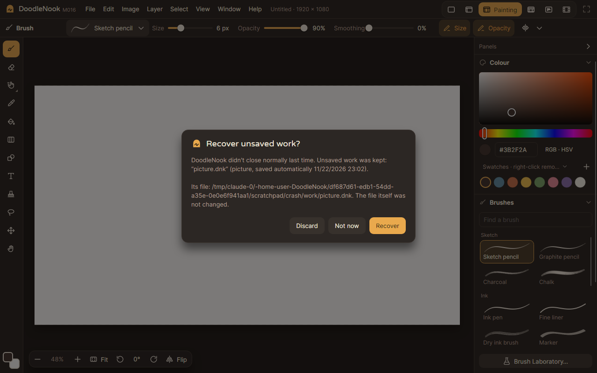
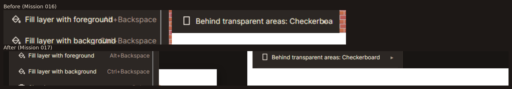

# Mission 017 — The Second Pass

No new features. A second round of the Mission 016 kind, aimed at what that mission couldn't reach. Mission 017 ran
every menu command at 150 %, checked the keyboard shortcuts against what the keys really do, and opened files written by
earlier missions' own code. It crashed the real program and made its saves fail on purpose. It used the workflows the
way an artist would, read the exports with an independent decoder, and ran a long drawing session. Then it fixed what
these checks found.

**Status:** fixed and verified by automated tests on Linux and Windows CI, by the real program on a virtual screen with
real mouse and keyboard events, and by independent tools (see [Verification](#verification)). Awaiting your playtest
([PLAYTEST.md](PLAYTEST.md)). Every check used a mouse, a keyboard or simulated input; the pen hasn't been tested.

Every check, how it was run and what it found, including the ones that found nothing, is in
[QUALITY-REPORT.md](QUALITY-REPORT.md).

## What changed for you

| | Before | Now |
|---|---|---|
| **"· edited" in the menu row** | Only changed when you picked another tool or colour: after a stroke the picture looked saved, and after undoing back to the saved state it still said "edited" | Follows the picture: it appears when a stroke ends and goes when you undo back to the saved state or save |
| **A save that fails** | "Couldn't save" with the path of a hidden temporary file | Says the file on disk was not changed, that the picture is still open with all its changes, and that File › Save As… can save it elsewhere. The picture stays marked as edited. |
| **Canvas size** | You couldn't see which anchor cell was chosen | The chosen cell is highlighted |
| **Colour balance at 150 %** | "Magenta ↔ Green" was cut off | Fully visible |
| **Quick Sketch and Pure Sketch with a storybook** | Quick Sketch's drawing bar stayed over the storybook, and both workspaces' menus could change the hidden drawing | The bar steps aside; the menus go back to the drawing first, as in the other workspaces |
| **Pixel Art palette menu** | Choosing a palette couldn't be undone and didn't count as a change, so closing didn't ask and the choice could be lost; the tick could point at the wrong palette | One undo step, marks the picture as edited; the tick shows the picture's own palette |
| **Menus** | Long entries ran into their shortcut or under ▸ (Edit, View, the palette and timeline ⋯ menus) | A menu grows to fit its longest entry |
| **Brush Laboratory** | The numbers beside the sliders didn't move; a renamed brush kept its old name in the options bar | Both follow at once |
| **Text** | Ctrl+Enter added a new line instead of finishing | Ctrl+Enter finishes, as the hint says |
| **Messages** | [ and ] with the stamp tool reported the brush size; Ctrl+Z in Liquify said "Undid brush stroke" | "Stamp size 87%"; "Took back the last Liquify stroke" |
| **Help › Diagnostics, F1** | A long timing name ran into its value; F1's scroll bar covered line ends; F1 named M, W and C without saying they're Editing's | All readable; F1 says which keys work where |
| **About** | Said "Mission 014" | Names this build (0.17.0, M017) |

## What was checked

1. **Every menu command at 150 %:** 223 commands in six workspaces, 65 dialogs. All fit, keep their buttons in view
   and close with Esc. Three defects were found and fixed (Colour balance, Canvas size, Quick and Pure Sketch with a
   storybook).
2. **Shortcuts and tooltips:** every shortcut shown in a menu does the same as the menu command. Every key named in
   the F1 list does what the list says (new test, 50+ keys). Every icon-only button has a tooltip.
3. **Old files:** files written by the engines of Missions 005, 006, 007, 008, 011, 013 and 015 open in today's
   DoodleNook with **identical pixels** (30 pictures and animations, 160 renders). They cover every `.dnk` format
   version, plus packs, reference boards, palettes and a storybook.
4. **Crash and save safety in the real program:** the program was killed mid-session and restarted, and it offered
   the work back. Recovered and saved, the pixels matched the autosave exactly. Saves were made to fail in two ways,
   and the previous file stayed byte-for-byte intact both times. This found the "· edited" defect and the unclear
   message.
5. **Workflow audit, part 2:** eight workflows in the real program with real mouse and keyboard input (Brush
   Laboratory, stamps and patterns, text and shapes, Liquify/Smudge/Clone, pixel tools with Palette Lock, the
   timeline, a guided tutorial, the reference board). Eight defects were found, each confirmed by a test that fails on
   the old code, and fixed.
6. **Exports read by Pillow:**
   - PNG, the PNG sequence and the sprite-sheet crops have identical pixels;
   - JPEG and WebP are within their lossy error;
   - the sprite-sheet JSON matches its image;
   - the GIFs have the right frames, timing and looping.
7. **A long session:** 1,600 strokes in four workspaces with undo, layers, saves and 16 reopenings of the file. Strokes
   didn't slow down (1.4 → 1.3 ms), memory after each reopen stayed flat (76–77 MB), and no listeners piled up.
   Closed pictures don't build up: 2 stayed in memory, whether 9 or 17 had been closed. A new measurement (in CI with
   the benchmarks) keeps checking this.

## Verification

| | Engine tests | App tests (real window) | Benchmarks and long session | Smoke test of the packaged program |
|---|---|---|---|---|
| Linux (development) | 383 passed | 261 passed | passed | 83 checks passed |
| Windows CI, [run #50](https://github.com/crosenlund79/DoodleNook/actions/runs/45092004652) (commit `666ac2c`) | 383 passed | 261 passed | 2 + 2 passed | 89 checks passed (Windows NT 10.0.26100) |

Windows CI was green at each Mission 017 commit: [run #49](https://github.com/crosenlund79/DoodleNook/actions/runs/45090187920)
(`b05eaba`, the fixes and tests) and [run #50](https://github.com/crosenlund79/DoodleNook/actions/runs/45092004652)
(`666ac2c`, the long session's results kept with the others). The run for this README's own commit is the delivery
run (see the final report).

New in this mission (17 app tests, plus one measurement):
- **`MenuCrawlTests`** (5):
  - every menu command and dialog at 150 %;
  - menu shortcuts against the real keys;
  - every key the F1 list names;
  - icon-only buttons have tooltips;
  - every menu entry fits its menu.
- **`Mission017FixTests`** (12): one per defect, each failing on the old code.
- **`LongSessionBenchmarks`** (1 measurement): runs with the benchmarks.

Checks outside the test suite, each in the quality report with its tools and output:
- files from seven earlier engines;
- the real program crashed and its saves made to fail;
- the workflow audit in the real program;
- exports read by Pillow.

## Known limitations

- **The pen** (Huion Kamvas 13) can only be checked by you.
- **Real-program checks ran on Linux** under a virtual screen (Xvfb), with real X11 input. The Windows build is checked
  by CI's tests and the packaged program's smoke test, not by hand.
- **GIF timing** is stored in 10 ms steps. DoodleNook keeps the whole animation's timing right, so a single 125 ms frame
  becomes 120 or 130 ms.
