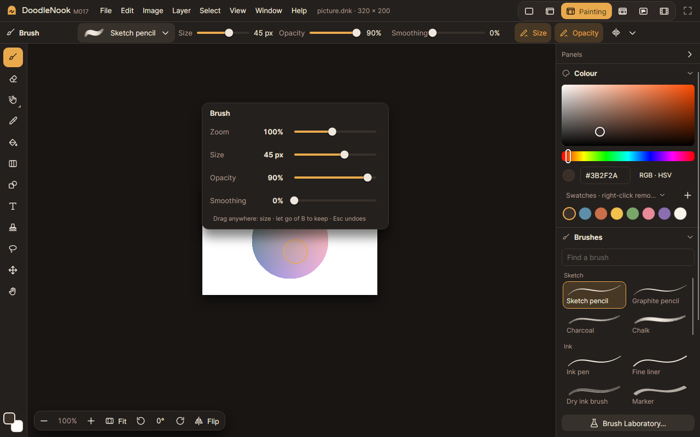
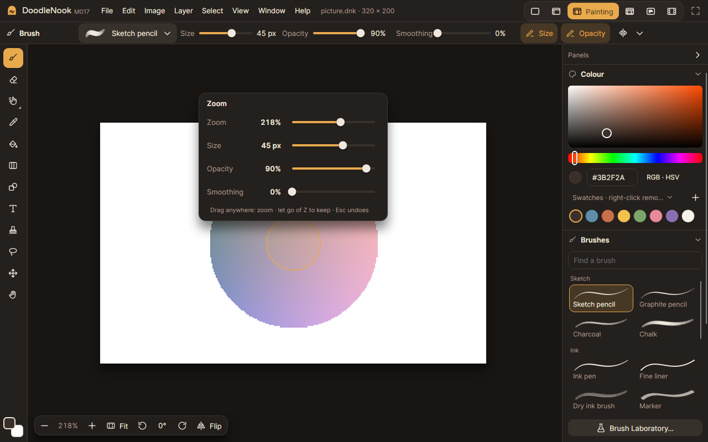
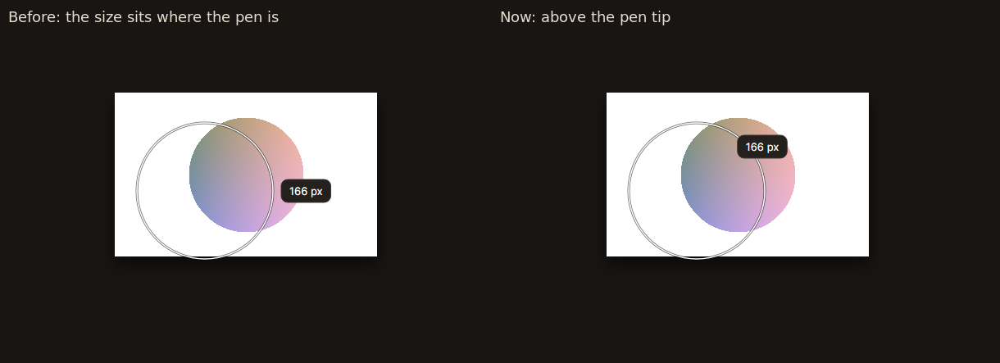

# Mission 018 — Quick Adjust

Built from the owner's notebook page (24 November 2026), transcribed:

> • When adjusting stuff like brush size… show a pop-up with pixel size, because the pen obstructs the view.
> • Need an easy zoom drag right in the drawing area… I'm considering something where you can hold Z and drag the pen
>   left/right or up/down.
> • Similar with brush and eraser… if the key is held and you drag… you change size.
>
> → Well, easier thing… When either is held a popup appears where you can adjust: zoom, brush size, opacity,
> smoothing… once you let go of the key the change is made.

**Status:** built and verified:
- by window tests;
- by the real program on a virtual screen with real keyboard and mouse events (holding a key down, dragging);
- by the smoke test of the packaged program.

Awaiting your playtest ([PLAYTEST.md](PLAYTEST.md)). Only you can judge how it feels with the pen on the Kamvas.

## What changed for you

### Hold B, E or Z: a small card at the pen

- **Hold B** (brush), **E** (eraser) or **Z** (zoom) for a moment, about a quarter of a second. A small card appears
  just above the pen.
- **Rows:**
  - Zoom is always there.
  - Size, Opacity and Smoothing appear where the tool has them. The brush has all four; the eraser has no opacity; Pixel
    Art's pencil has zoom and whole-pixel sizes.
- **Adjusting:**
  - Drag on a slider with the pen; the change shows at once.
  - Or drag **anywhere** outside the card: B and E change the size, Z zooms. Right or up is more, left or down less, and
    Shift is finer.
  - The brush's real size is drawn as a ring where the pen was. Zooming keeps the spot under the pen in place.
- **Let go of the key:** the card closes and the change is kept. **Esc** while still holding puts everything back.
- **A quick tap** of B or E still just picks the tool, exactly as before. Z on its own had no other use.
- **Nothing is painted** while the key is held. The card waits if you are in the middle of a stroke, and doesn't open
  over a dialog or the storybook.
- **Where the numbers are:** the card sits above the pen, where neither the pen nor your hand covers it. Each number
  sits **left** of its slider, so the pen on the slider doesn't hide it. Near the top edge the card moves beside the pen
  instead.

### The size above the pen

The right-drag size gesture showed the size next to the circle's edge, which is exactly where the pen is while
dragging. Now the size sits just above the pen tip. Dragging the quick palette's centre (right-click wheel) does the
same: the number in the centre is under the pen, so the size also shows above the pen while you drag.

### Also

- A slider's number now has room for "100%" before the next label; in the options bar it ran into "Smoothing".
- The F1 list, the Brush and Eraser tool tips, the zoom read-out's tip and the Quick Start guide mention the hold
  keys.

## Interface checklist ([INTERFACE-PHILOSOPHY.md](../../design/INTERFACE-PHILOSOPHY.md))

The card is not a permanent control: it exists only while a key is held, at the pen, and leaves nothing behind.

1. **Used frequently?** Yes: size, opacity and zoom change constantly while drawing.
2. **Relevant to this workspace?** Every drawing workspace has these settings; each row shows only where the tool has it.
3. **Already reachable another way?** Yes: the options bar, `[` `]`, right-drag and the quick palette. All stay as they
   were. The card is for when the pen is on the drawing and the eyes shouldn't leave it.
4. **Contextual rather than permanent?** It is contextual: it appears while the key is held and goes when it's let go.
5. **Pinnable instead?** Not needed: nothing is added to the screen.
6. **Less drawing area?** No (only while held).
7. **Comfortable at 1280 × 720, 150 %?** Yes, tested in all four corners of the Kamvas-sized window.
8. **Discoverable?** Yes: F1 list, tool tips, Quick Start guide.
9. **The Mission 003 look?** The same card style, colours and sliders as the other pop-overs, but opaque, because it
   sits over the artwork.
10. **Does it make something the owner enjoys easier?** It is the owner's own request.

## Verification

| | Engine tests | App tests (real window) | Smoke test of the packaged program |
|---|---|---|---|
| Linux (development) | 383 passed | 270 passed | 84 checks passed, including the new quick adjust check |
| Windows CI | see the final report | see the final report | see the final report |

New window tests (`QuickAdjustTests`, 9):
- a tap only picks the tool;
- holding B opens the card above the pen, the sliders change the brush, and letting go keeps it;
- the eraser's rows, and dragging anywhere for size;
- Z zooms around the pen, and Esc puts everything back without the held key reopening the card;
- nothing is painted while the key is held;
- the card waits during a stroke;
- Pixel Art's whole pixels;
- the size read-outs above the pen;
- the card stays inside the canvas in every corner at 150 %.

**The real program** ran on Linux under a virtual screen, driven by real X11 events: holding B, then Z, down while
dragging on the sliders and on the canvas, letting go, and Esc. It also checked the right-drag read-out against the
Mission 017 build. All of it behaved as described above. The screenshots on this page come from those runs.

## Known limitations

- **The pen** on the Kamvas can only be checked by you. Most of all: is the quarter-second hold right, and is the card
  in a comfortable place for your hand?
- **The hold keys are B, E and Z**, read from your note. A different key, or a different delay, is a one-line change.
- **On Windows the key repeats while held.** DoodleNook ignores the repeats, but this was tested with X11 events on
  Linux, not with a Windows keyboard. The packaged program's smoke test opens the card on Windows.
