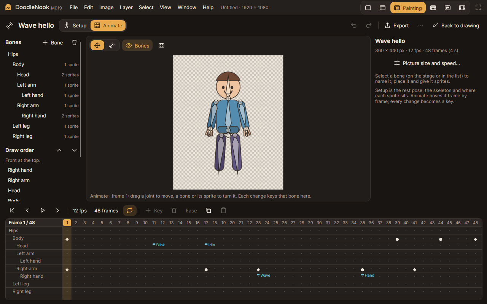
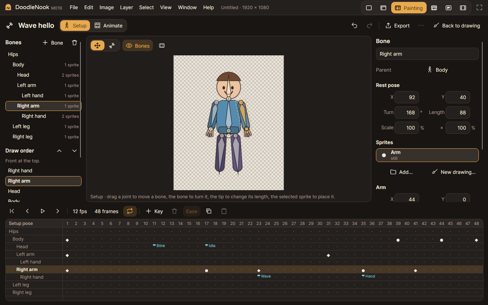
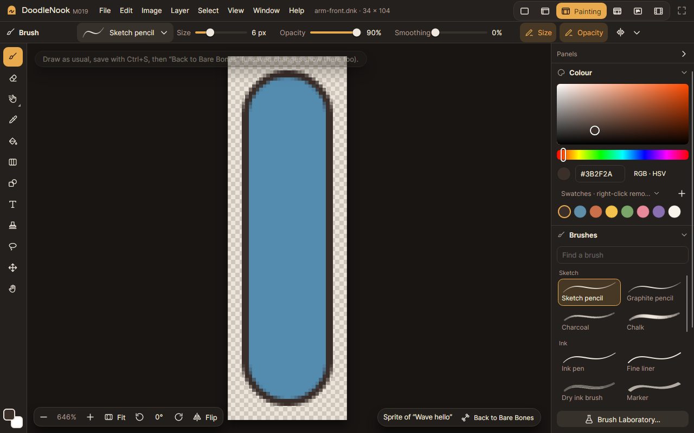
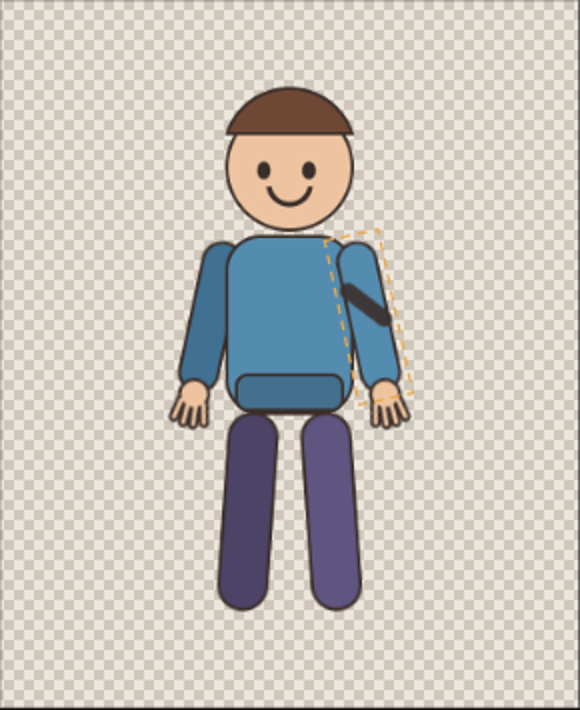
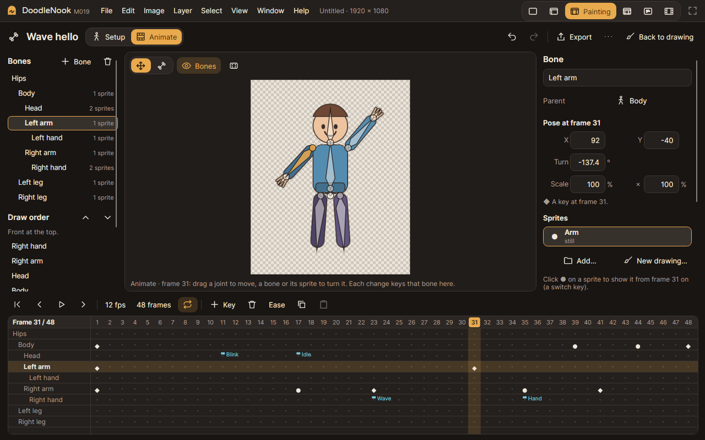
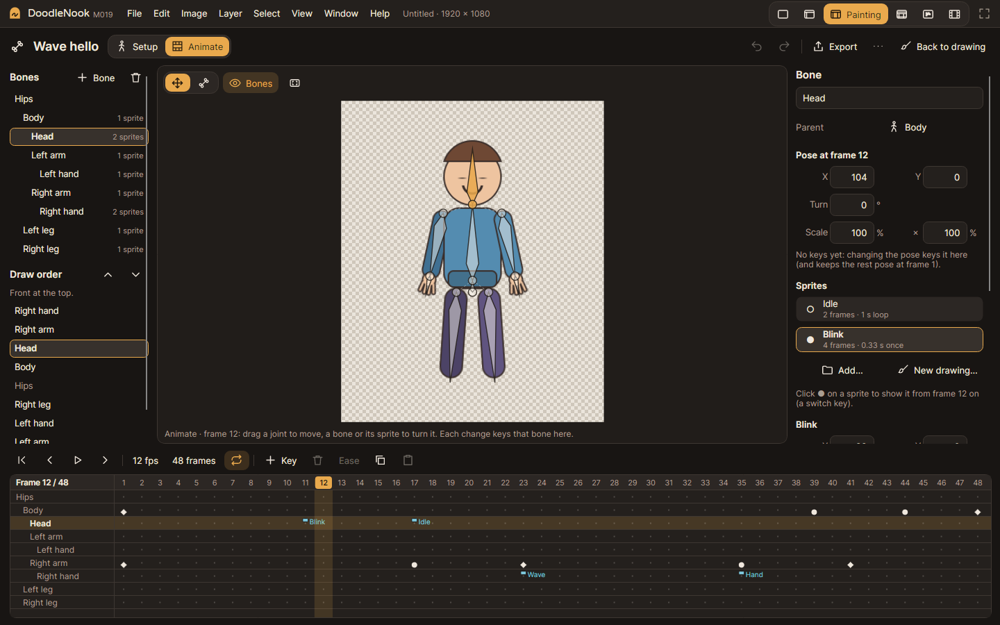
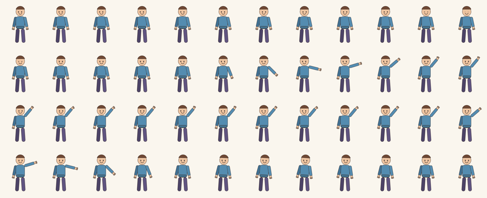
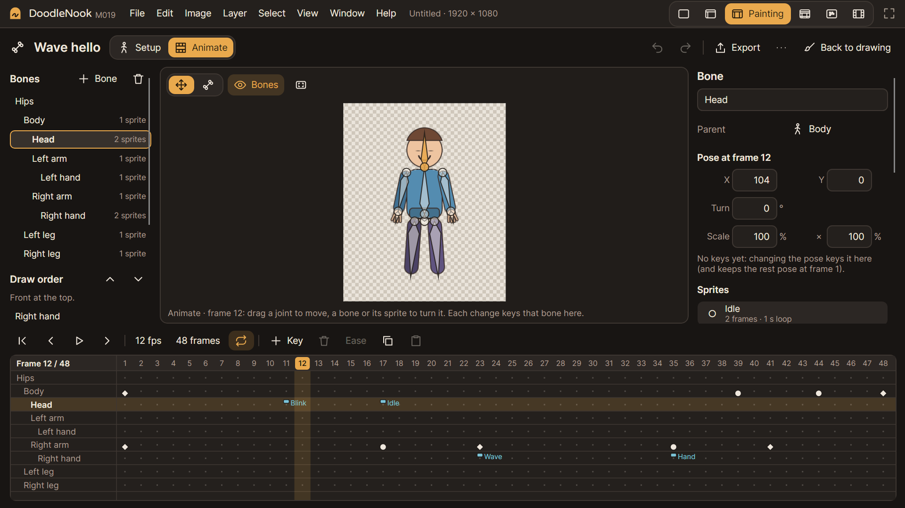

# Mission 019 — Bare Bones

An experimental 2D skeletal animation editor in a view of its own. You build a skeleton of bones, hang your own
DoodleNook drawings on them as sprites, and animate by posing the bones on a master timeline. A sprite can be an
**animated** drawing (a blink, a wave) that runs on its own clock, and keys on the timeline switch which one plays.

**Status:** built and verified:
- by engine tests and tests in the real window;
- by the real program on a virtual screen, driven with real mouse and keyboard events;
- by the smoke test of the packaged program.

Awaiting your playtest ([PLAYTEST.md](PLAYTEST.md)). Bare Bones is a first version. Only you can judge whether posing
with the pen feels right.



## Backup first

Before any change, the last commit of Mission 018 (`7dfe723`, the build you have) was kept in two places:
- the branch **`backup-before-m019-bare-bones`** on GitHub, at `7dfe72383867df37655ec9822d7c58549ecece4c`, checked
  with `git ls-remote`;
- a local tag of the same name.

GitHub refused to take the tag (the connection here is not allowed to push tags), so the branch is the backup you can
see. Nothing was force-pushed, reset or deleted. Mission 019 is on its own branch, `iteration/019-bare-bones`.

## Opening it

- **File › New skeletal animation…**: choose the picture size, speed and length, then where to save it (a
  `.dnkbones` file).
- **File › Open skeletal animation…**, or **File › Open…** with a `.dnkbones` file.
- **Help › Wave hello (Bare Bones)** opens the sample. It is made in `Documents/DoodleNook/Samples` the first time.

Bare Bones takes the window like Storybook Studio does: the drawing tools, options, panels and timeline step aside.
**Esc** or **Back to drawing** returns to the picture you had open, exactly as it was. **File › Bare Bones “…”**
comes back. While Bare Bones is shown, no key and no menu command changes the drawing out of sight: a drawing command
from a menu goes back to the drawing first. Edit › Undo is Bare Bones' own.

## The view

- **Left: Bones.** The hierarchy, indented by parent, with how many sprites each bone has. Below it is **Draw order**,
  front at the top, with ▲▼ to move the selected bone's sprite forward or back.
- **Middle: the stage.** The character as it will be exported, with the bones drawn on top. The **Bones** button (or
  **H**) hides them. They are only ever drawn here, never in an export.
- **Right:** the selected bone (name, parent, pose) and its sprites, or the project when nothing is selected.
- **Bottom: the master timeline.** One row per bone. A pose key is a diamond (round when it eases). A sprite switch is a
  small blue tag followed by the sprite's name.

**Setup / Animate** at the top (or **Tab**):
- **Setup** is the rest pose: build the skeleton, place the sprites. Keys aren't touched.
- **Animate** poses frame by frame: every change to a bone becomes a key at that frame.

Clicking a frame on the timeline goes to Animate.

## Skeleton (Setup)



- **Add bones:**
  - Choose **＋ Bone** (or **A**) and drag on the stage. The first bone is a root.
  - Each new bone hangs from the selected one. Start the drag at a bone's end to chain.
  - A click without dragging makes a short bone continuing its parent's direction.
- **Drag a joint** (the circle) to move a bone.
- **Drag the bone** to turn it about its joint. **Shift** turns in 15° steps.
- **Drag the square tip** of the selected bone to change its length and direction.
- **Children follow.** A child keeps its place on its parent; scale carries down the hierarchy too.
- **Rename:** the name box, or double-click the bone in the list.
- **Reparent** with **Parent** on the right, or right-click › Parent:
  - the bone stays where it is on screen;
  - DoodleNook refuses a parent that is one of the bone's own children (no loops).
- **Delete** (the bin, or **Delete** in Setup): the bone's children stay where they are, joined to its parent. Its
  sprites and keys go; the drawings they linked to are untouched. Ctrl+Z brings it all back.
- **Exact values:** X, Y, turn, length and scale can be typed on the right.

## Sprites (attachments)

A bone can hold several sprites and shows one at a time. A sprite is any of these, **linked, never copied in and never
changed by Bare Bones**:
- a DoodleNook drawing, still or animated;
- a PNG, JPEG, WebP, BMP or GIF picture.

- **Add…**: links a file.
- **New drawing…**: a transparent drawing sized to the bone, saved in an `art` folder beside the project, linked, and
  opened in the editor. Still or Animated (4 frames to start with).
- **Shown upright.** A new sprite appears the way it was drawn, upright on screen in the rest pose, centred halfway
  along its bone. Drag it on the stage (Setup, selected bone) to place it, or type X / Y / turn / scale. **−90° / +90° /
  180°** turn it in quarter steps.
- **Open in editor** (or double-click the sprite):
  - The drawing opens in Painting (Pixel Art for a pixel-art project), or in Animation Studio if it is animated.
  - A **Back to Bare Bones** chip waits at the bottom right.
  - **Unsaved changes already show** on the character. Saving writes only that drawing.
- **Make editable…** (for a picture): makes a `.dnk` copy in `art` and links it. The picture isn't changed.
- **Replace…** links another file and keeps the placement and keys. **Remove** takes the sprite off the bone, with its
  switch keys; the file isn't touched.
- **Draw order** decides which sprite covers which.





## Keyframe animation (Animate)



- **Posing keys the bone.** Drag a joint, a bone or **its sprite** (grabbing the sleeve turns the arm). That bone gets
  a key at this frame.
- **The rest pose is kept.** A bone's first key at a later frame also keys frame 1 with the rest pose, so the frames
  before it don't change.
- **How keys play:**
  - Position and scale change evenly between keys.
  - Rotation goes the short way round: 350° → 10° passes through 0°, not 180°.
  - **Ease** (the button, or right-click a key) eases in and out of a key towards the next.
  - Before the first key and after the last, the nearest key holds.
- **Key commands:**
  - **K** keys the selected bone's pose as it is now.
  - **Delete** (or the bin) removes its keys at this frame.
  - **Drag a key** along its row to move it.
  - Right-click a cell for all key commands.
- **Copy and paste:**
  - **Ctrl+C** copies the pose at this frame: the selected bone, or every bone when none is selected (click an empty
    spot).
  - **Ctrl+V** pastes it as keys at another frame, for example to make the last frame match the first.
- **Playback:**
  - **Enter** plays and pauses; **← →** and **, .** step; **Home / End** go to the ends.
  - Drag along the frame numbers to scrub.
  - **12 fps** and **48 frames** set speed and length (presets, or exact values in Picture size and speed…), and
    **⟳** loops.
- **One drag, one step:** every change is saved straight away (safely), and **Ctrl+Z** undoes a whole drag at once.
  Ctrl+S just says it's already saved.

## Animated attachments

The special feature. The head can hold **Idle** (a looping animated drawing) and **Blink** (a short one). In Animate,
click **○** next to a sprite to show it **from this frame on**: a switch key, the blue tag on the timeline. No blending:
it simply changes.

Each animated sprite has its own settings:
- **Loop:** round and round while shown.
- **Play once:** it plays, then **keeps its last frame**.
- **Speed:** ¼× to 4×, where 1× is the drawing's own timing.
- **Restart** (the default) starts from its first frame at each switch to it. **Keep running** carries on as if it had
  been playing since frame 1.

**Timing is by time, not by frames.**
- A sprite plays at its drawing's own frame durations, whatever the master timeline's fps. An 8 fps wave under a
  12 fps timeline shows its frames at 0, 0, 1, 2, 2, 3… exactly as many milliseconds in as each master frame is.
- Every frame is worked out from its frame number alone. Nothing is carried over from the previous frame, so
  scrubbing backwards, jumping, playing, looping and exporting all give **exactly the same picture** for the same frame.
- When the master timeline loops, frame 1 is frame 1 again. Nothing drifts, however many times it goes round.



## The sample: "Wave hello"

A simple figure in nine bones, with ten sprites made from nine ordinary DoodleNook drawings in `art/` (both hands share one):
- the torso, the left arm and hand, and both legs are **still**;
- the head has **Idle** (2 frames, looping) and **Blink** (4 frames at 12 fps, played once);
- the right hand has **Hand** (still) and **Wave** (4 frames at 8 fps, looping).

48 frames at 12 fps (4 seconds):

| Frames | What happens |
|---|---|
| 1–10 | Standing, Idle |
| 11–16 | A blink (Blink, once), then back to Idle |
| 17–23 | The right arm rises |
| 23–34 | The hand waves (Wave) with the arm up |
| 35–41 | The arm comes down, back to the still hand |
| 39–48 | A slight sway of the body, then round again |



The project is also in this folder: [sample/Wave hello](sample/Wave%20hello), and as a GIF: [wave-hello.gif](wave-hello.gif).

## The file (`.dnkbones`)

Readable JSON, saved safely (a temporary file, then replaced), so a failed save never damages the previous file.

```json
{
  "format": "DoodleNook skeletal animation", "version": 1,
  "width": 360, "height": 440, "pixelArt": false, "fps": 12, "length": 48, "loop": true,
  "bones": [ { "id": "…", "name": "Head", "parentId": "…", "x": 104, "y": 0, "rotation": 0, "scaleX": 1, "scaleY": 1, "length": 76,
               "attachments": [ { "name": "Idle", "source": "art/head-idle.dnk", "x": 38, "rotation": 90, "loop": true, "speed": 1, "restart": true }, … ],
               "attachment": "…" }, … ],
  "drawOrder": [ "…" ],
  "tracks": [ { "boneId": "…", "keys": [ { "frame": 16, "rotation": 168, "smooth": true }, … ], "switches": [ { "frame": 10, "attachment": "…" } ] } ]
}
```

- **Versioned.**
  - A file from a newer DoodleNook is refused with a clear message, never half-read.
  - A future change to the format would get a new version number and a migration.
- **Linked, relative.**
  - Sprites are stored relative to the project's folder, so the folder can move or be copied as a whole.
  - **Save as…** relinks them from the new place.
  - The art itself is never embedded and never flattened: each `.dnk` keeps its layers and frames.
- **Missing files are kept.** A sprite whose file is gone stays with its placement and keys. It shows nothing, says
  which file is missing and where it was, and **Replace…** links it again. The rest of the character still shows.
- **Damage is repaired where possible.** A loop between bones, a missing parent, keys past the end, unknown ids and
  impossible values make the file open with a sensible repair rather than not at all.

## Export

**Export › Export animation…** uses the same dialog and the same exporters as Animation Studio:
- an animated GIF;
- a sprite sheet with its JSON;
- PNG files (name_0001.png …);
- a whole-number scale.

**Export › This frame as PNG…** writes the frame on show. Exports are the artwork only, on transparency, and never
include bones, handles or outlines. The GIF encoder merges identical neighbouring frames into one longer frame, as it
always has; the length stays exact.

## Interface checklist ([INTERFACE-PHILOSOPHY.md](../../design/INTERFACE-PHILOSOPHY.md))

Bare Bones adds no permanent control to the drawing workspaces: two File entries and a Help sample. Everything else
lives in its own view, opened on purpose.

1. **Used frequently?** Within Bare Bones, the visible controls are the everyday ones: bones, the stage, play, keys,
   sprites. Settings are in menus (fps and length presets, Picture size and speed…).
2. **Relevant to this workspace?** It is its own view, like Storybook Studio. No existing workspace could hold a
   skeleton naturally, and no drawing workspace changed.
3. **Already reachable another way?** The everyday actions have keys (the F1 list has a Bare Bones section), and bones
   and keys have right-click menus.
4. **Contextual rather than permanent?** Contextual: sprite settings appear only for the selected sprite, animated-
   sprite settings only for an animated one, Length only in Setup.
5. **Pinnable instead?** Not needed: nothing is added to the drawing screens.
6. **Less drawing area?** None in the drawing workspaces. Inside Bare Bones, the stage fills what's left, and the
   timeline grows only as far as the bones need (at most about a third of the height).
7. **Comfortable at 1280 × 720, 150 %?** Yes, tested: every control in the window, every bone's row in the timeline,
   and a stage of 745 × 361 (screenshot below).
8. **Discoverable?** File and Help menus, tool tips on every icon, a hint line under the stage that says what a drag
   will do, the F1 list.
9. **The Mission 003 look?** The same colours, buttons, segmented choices, cards and timeline style as Storybook Studio
   and Animation Studio.
10. **Does it make something the owner enjoys easier?** It is the owner's own request, and it reuses the owner's
    drawings and the editor they already like rather than adding a second painting engine.



## Verification

| | Engine tests | App tests (real window) | Smoke test of the packaged program |
|---|---|---|---|
| Linux (development) | 406 passed (23 new) | 277 passed (7 new) | 88 checks passed, including the 4 new Bare Bones checks |
| Windows CI, [run #56](https://github.com/crosenlund79/DoodleNook/actions/runs/45593244906) (commit `126ad63`) | 406 passed | 277 passed | 94 checks passed (Windows NT 10.0.26100), including the 4 Bare Bones checks: Blink at frame 12 and Wave at 28, playback, one key and one undo step per drag, a 4-second GIF and a sprite sheet identical to the artwork |

The benchmarks and the long session (2 + 2) also passed on Windows.

**New engine tests** (`SkeletonTests`, 23):
- **Hierarchy:**
  - children follow their parent's position, rotation and scale;
  - reparenting keeps a bone in place and refuses loops;
  - deleting a bone keeps its children where they were;
  - names stay unique, and parents come before children.
- **Keys:**
  - linear position and scale, rotation the short way (350° → 10° through 0°);
  - ease in and out;
  - the rest pose is kept before a first key;
  - shortening the timeline removes keys past the end.
- **Animated sprites:**
  - switches change the sprite without blending;
  - an 8 fps sprite under a 12 fps timeline shows the frames its milliseconds say;
  - speed, Restart and Keep running;
  - a one-shot holds its last frame;
  - scrubbing forwards, backwards and in random order gives identical results;
  - playback time loops back to frame 1 with no drift after 100 passes.
- **Rendering:**
  - a sprite turns about its bone's joint;
  - draw order and transparency;
  - **the picture never contains bones**;
  - pixel-art projects keep exact pixels.
- **The file:**
  - save and reopen with relative links, and a moved folder still works;
  - saving elsewhere relinks and never changes the artwork (bytes and file time checked);
  - a missing or unreadable file shows nothing and says why;
  - damaged, newer or foreign files are refused or repaired;
  - clones are independent.
- **Export:** every master frame goes through the existing GIF, sprite sheet and PNG sequence writers.
- **The sample:** its structure, the story (blink at 12, wave at 28, the sway), every frame inside the picture.

**New window tests** (`BareBonesWindowTests`, 7):
- the sample opens, shows its story, and the drawing chrome steps aside and comes back;
- a skeleton drawn by dragging, posed, keyed and undone **one drag at a time**:
  - copy and paste of a pose;
  - Enter plays and stops;
  - while Bare Bones is shown, Delete and Ctrl+Z don't touch the drawing;
- animated sprites switched on the timeline with their own timing;
- export as a GIF, a sprite sheet (×2, with JSON) and 36 PNG files, containing only the sprites' colours;
- a sprite drawn in the normal editor, its unsaved paint shown on the stage, then saved;
- a missing sprite kept and explained, then replaced;
- menus and workspaces go back to drawing; the storybook and Bare Bones take turns;
- the whole view at 1280 × 720, 150 %.

The menu crawl (every menu command at 150 %, including the new ones) and the F1 key check also pass.

**The smoke test** of the packaged program now opens the sample in Bare Bones and checks four things:
- the animated sprites are switched (Blink at frame 12, Wave at 28);
- playback moves on with time;
- a posing drag is one key and one undo step;
- the animation exports as a 4-second GIF and an 8 × 6 sprite sheet, identical to the artwork (no bones).

**The real program** ran on Linux under a virtual screen, driven by real X11 mouse and keyboard events:
- Help › Wave hello;
- choosing the left arm on the timeline and turning it by dragging its sleeve: a key at frame 31 and the rest key at
  frame 1, saved to the file;
- Ctrl+Z (the key gone from the file) and Ctrl+Y (back);
- Enter to play and Enter to stop;
- Esc back to the drawing, then File › Bare Bones “Wave hello” back again;
- Setup with the right arm selected;
- double-clicking its sprite to open it in Painting, painting a stroke and choosing Back to Bare Bones. The stroke showed
  on the character while the `.dnk` on disk was unchanged (checked by its checksum).

The real-program screenshots on this page come from that run.

While the full test suite ran alongside, the stop key took effect two frames late on the virtual screen. In the window
tests it stops at once, and drawing a frame of the sample takes about 4 ms.

## What isn't in it

**Not included on purpose** (the brief's exclusions):
- inverse kinematics, automatic rigging, skin weights, mesh deformation;
- physics, cloth, bone constraints, ragdolls, procedural walking;
- blend trees, complex easing curves, state machines;
- game-engine runtimes, Godot plugins, Spine compatibility;
- automatic sprite separation, AI rigging, nested skeletons.

## Known limitations

- **The pen** on the Kamvas can only be checked by you: grabbing joints, bones and sprites with the pen, and whether
  the hit areas are big enough.
- **Sprites are linked, not embedded.** Moving a sprite's file on its own breaks its link (the project then says which
  file is missing). Moving the whole folder is fine.
- **Ease** is one gentle in-and-out curve. There are no curve editors, on purpose.
- **Reparenting while animated** keeps the rest pose exactly. The bone's keys are converted with the rest pose too, so a
  bone reparented in the middle of an animation can look slightly different between keys until you re-key it.
- **Undo** keeps the last 200 changes of this session; the file itself is saved at every change.
- **Playback** draws the whole character every frame. The sample takes about 4 ms a frame here. A very large picture
  with many large sprites will play more slowly.
- **The stage** zooms with the wheel and pans with the middle button or Space-drag; there is no rotation of the view.
